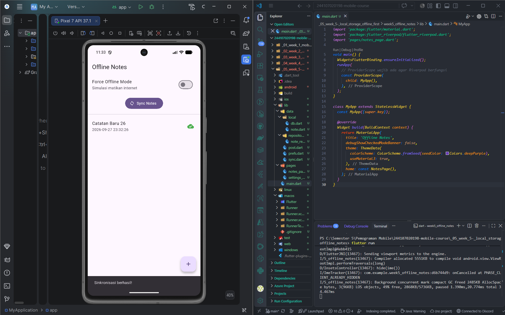
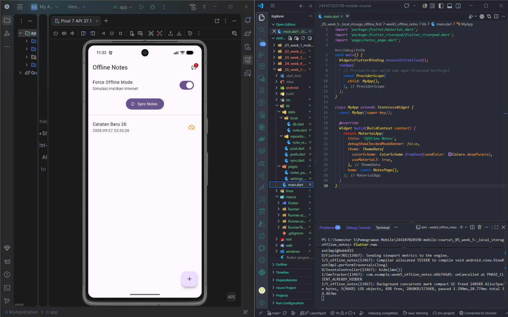
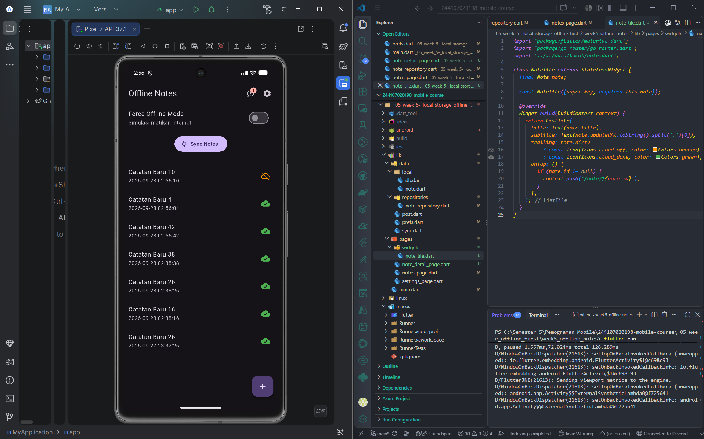
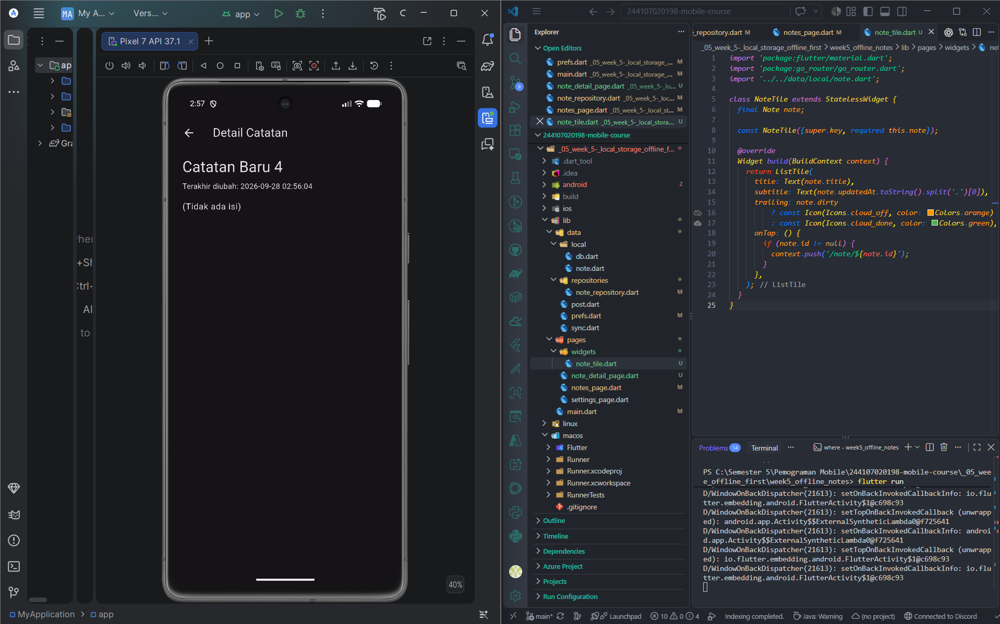

# Laporan Praktikum Week 7: Clean Architecture

**Nama:** MOKHAMAD RIZKI HADIONO SINGGIH  
**NIM:** 244107020198  
**Kelas:** TI-3G - Pemrograman Mobile  

---

## 1. Konsep SOLID dan Clean Architecture

### A. Prinsip SOLID dalam Pengembangan Flutter
Prinsip SOLID merupakan fondasi utama dalam merancang perangkat lunak yang *scalable*, mudah diuji (*testable*), dan tidak rapuh saat dikembangkan berkelanjutan:

1. **Single Responsibility Principle (SRP):**  
   *Satu kelas hanya boleh memiliki satu alasan untuk berubah.*  
   *Gejala pelanggaran:* Widget berukuran 400+ baris yang sekaligus menangani pemanggilan HTTP/Dio, parsing JSON, format tanggal, dan manipulasi SQLite.  
   *Solusi Clean Architecture:* Widget hanya merender UI; state diatur oleh Notifier; logika bisnis berada di Use Case; pengambilan data ditangani oleh Repository.
2. **Open/Closed Principle (OCP):**  
   *Entitas perangkat lunak harus terbuka untuk ekstensi, namun tertutup untuk modifikasi.*  
   *Gejala pelanggaran:* Menambahkan sumber data baru (misal migrasi dari SQLite ke Firebase) memaksa pengembang mengedit widget UI yang sudah berjalan.  
   *Solusi Clean Architecture:* Membuat implementasi repository baru yang mengimplementasikan interface kontrak yang sama tanpa mengubah kode domain maupun presentation.
3. **Liskov Substitution Principle (LSP):**  
   *Objek turunan atau pengganti harus dapat menggantikan objek aslinya tanpa merusak perilaku sistem.*  
   *Gejala pelanggaran:* `FakeNoteRepository` yang digunakan saat pengujian melempar exception tak terduga yang tidak pernah dilempar oleh repository produksi aslinya.
4. **Interface Segregation Principle (ISP):**  
   *Klien tidak boleh dipaksa bergantung pada antarmuka (interface) yang tidak digunakannya.*  
   *Gejala pelanggaran:* Membuat satu interface raksasa `AppRepository` yang memuat fungsi Auth, Notes, Pengumuman, dan FCM Push Notification sekaligus.  
   *Solusi Clean Architecture:* Memecah interface per fitur: `NoteRepository` dan `AuthRepository`.
5. **Dependency Inversion Principle (DIP):**  
   *Modul tingkat tinggi tidak boleh bergantung pada modul tingkat rendah. Keduanya harus bergantung pada abstraksi.*  
   *Gejala pelanggaran:* `NotesNotifier` atau widget langsung menginstansiasi `Dio()` atau `openDatabase()` secara langsung.  
   *Solusi Clean Architecture:* Notifier bergantung pada interface abstraksi `NoteRepository`; implementasi nyata disuntikkan (*injected*) lewat provider Riverpod.

### B. Tiga Layer Utama dan Aturan Dependensi (Dependency Rule)
Aturan emas Clean Architecture menetapkan bahwa **arah dependensi hanya boleh mengarah ke dalam (inward)**:

```text
  [ Presentation Layer ] (Widget, Notifier, Router)
            |
            v  (bergantung ke)
      [ Domain Layer ] (Entity, Repository Interface, Use Case, Failure)
            ^
            |  (diimplementasikan oleh)
     [ Data Layer ] (Model, Repository Impl, SQLite Data Source, Network)
```

* **Domain Layer (Pusat):** Bersifat murni Dart (*pure Dart*). Layer ini tidak mengetahui keberadaan framework Flutter, package database (sqflite), maupun HTTP (Dio).
* **Presentation Layer:** Hanya bergantung pada Domain (membaca Entity dan memanggil Use Case/Repository Provider).
* **Data Layer:** Berada di luar dan tunduk pada aturan Domain dengan mengimplementasikan kontrak interface yang didefinisikan Domain.

### C. Feature-First vs Layer-First
* **Feature-First (`lib/features/notes/{domain, data, presentation}`):** Struktur yang dipilih pada praktikum ini. Tiap modul fitur bersifat independen, mempermudah kerja tim paralel, dan memungkinkan penambahan/penghapusan fitur tanpa mengganggu modul lain.
* **Layer-First (`lib/{data, domain, presentation}` global):** Cepat untuk proyek sederhana satu halaman, namun menjadi kusut dan sulit dilacak saat aplikasi berkembang memiliki banyak fitur.

### D. Kosakata Peran
* **Entity:** Objek bisnis murni yang hidup di Domain tanpa metode serialisasi (`toMap`/`fromMap`/`toJson`).
* **Model:** Representasi data eksternal (SQLite/JSON) yang hidup di Data layer dan bertugas melakukan konversi ke Entity (`toEntity()`).
* **Repository Interface:** Kontrak abstraksi operasi data yang dibutuhkan bisnis, hidup di Domain.
* **Repository Impl:** Implementasi teknis konkrit pemenuhan kontrak menggunakan SQLite / Dio, hidup di Data.
* **Use Case:** Satu unit operasi logika bisnis (misal `GetNotes`, `AddNote`, `LoginUser`), hidup di Domain.
* **Dependency Injection (DI):** Penyuntikan dependensi yang terpusat melalui Riverpod Provider. Widget tidak pernah memanggil operator `new Repository()` secara manual.

---

## 2. Praktikum 1: Audit Layer Project Lama

### A. Tabel Pemetaan File Proyek Lama Sebelum Refactoring
Audit dilakukan terhadap basis kode Minggu 5 (`week5_offline_notes`) dan Minggu 6 (`campus_notify`):

| File Asal | Layer Saat Ini | Masalah yang Ditemukan | Aksi Refactoring |
| :--- | :--- | :--- | :--- |
| `lib/data/local/note.dart` | Data & Domain tercampur | Entity `Note` memuat method serialisasi `toMap()` dan `fromMap()`. | **Dipecah:** `domain/entities/note.dart` (murni) & `data/models/note_model.dart` (mapping). |
| `lib/data/repositories/note_repository.dart` | Data | Kontrak interface tidak ada; class langsung berisi kode SQL mentah. | **Dipecah:** Kontrak interface dibuat di Domain; implementasi SQL dipindah ke Data. |
| `lib/pages/notes_page.dart` | Presentation | Memanggil database langsung, memformat tanggal mentah via DateTime di UI. | **Dibersihkan:** Formatting dipindah ke `core/format.dart`; data dibaca lewat Riverpod Notifier. |
| `lib/data/auth_repository.dart` | Data | Class konkret tanpa abstraksi interface; data session tidak terpisah dari entity. | **Dipecah:** Dibuat `User` entity, `AuthRepository` interface di domain, dan implementasi di data. |

### B. Audit Tiga Pelanggaran Klasik (Pencarian Grep Awal)
Sebelum refactor dilakukan, dilakukan pencarian pola pelanggaran arsitektur:
1. **Widget menyentuh database/jaringan langsung:**
   Ditemukan pemanggilan `openNotesDb()` dan instansiasi `SharedPreferences` di dalam blok widget UI.
2. **Logika bisnis dan formatting tanggal di dalam `build()`:**
   Ditemukan manipulasi string tanggal langsung di dalam `ListTile` subtitle.
3. **Instansiasi manual (DI bocor):**
   Ditemukan `final repo = NoteRepository()` diinisialisasi langsung di dalam halaman form.

Semua temuan di atas menjadi sasaran eliminasi total pada praktikum refactor ini.

---

## 3. Praktikum 2: Domain dan Data per Fitur

### A. Entitas Murni Tanpa Flutter (`domain/entities/note.dart`)
Entitas bisnis catatan dibuat tanpa import `package:flutter`, tanpa dependensi eksternal, dan tanpa metode serialisasi:

```dart
class Note {
  const Note({
    this.id,
    required this.title,
    this.body = '',
    required this.updatedAt,
    this.dirty = false,
  });

  final int? id;
  final String title;
  final String body;
  final DateTime updatedAt;
  final bool dirty;

  Note copyWith({ ... }) { ... }
}
```

### B. Failure Domain & Kontrak Repository Interface
Dibuat hierarchy `Failure` murni di `lib/core/failures.dart`:
```dart
sealed class Failure {
  const Failure(this.message);
  final String message;
}

class LocalFailure extends Failure {
  const LocalFailure(super.message);
}

class NetworkFailure extends Failure {
  const NetworkFailure(super.message);
}

class ValidationFailure extends Failure {
  const ValidationFailure(super.message);
}
```

Dan kontrak repository diletakkan di `domain/repositories/note_repository.dart` menggunakan Dart 3 Record:
```dart
abstract class NoteRepository {
  Future<({List<Note> notes, Failure? failure})> fetchNotes();
  Future<({Note? note, Failure? failure})> addNote({
    required String title,
    String body = '',
  });
  Future<({bool success, Failure? failure})> updateNote(Note note);
  Future<({bool success, Failure? failure})> deleteNote(int id);
  Future<({int count, Failure? failure})> countDirty();
  Future<({bool success, Failure? failure})> syncNotes();
}
```

### C. Data Model dan Repository Implementation
1. **Model (`data/models/note_model.dart`):**  
   Turunan dari `Note` yang mengisolasi seluruh logika mapping `toMap()` dan `fromMap()`.
2. **Data Source (`data/datasources/notes_database.dart`):**  
   Mengatur inisialisasi SQLite dan pembuatan skema tabel `notes`.
3. **Repository Impl (`data/repositories/note_repository_impl.dart`):**  
   Mengimplementasikan `NoteRepository`, mengeksekusi raw query SQLite, mengonversi model ke entitas melalui `.toEntity()`, serta membungkus blok `catch` menjadi `LocalFailure` atau `NetworkFailure`.

### D. Use Case: Logika Bisnis & Validasi
* `GetNotes`: Mengambil catatan melalui repository interface.
* `AddNote`: Memeriksa aturan bisnis bahwa judul tidak boleh kosong sebelum diteruskan ke repository.

```dart
class AddNote {
  const AddNote(this._repository);
  final NoteRepository _repository;

  Future<({Note? note, Failure? failure})> call({
    required String title,
    String body = '',
  }) async {
    final trimmedTitle = title.trim();
    if (trimmedTitle.isEmpty) {
      return (
        note: null,
        failure: const ValidationFailure('Judul catatan tidak boleh kosong'),
      );
    }
    return _repository.addNote(title: trimmedTitle, body: body.trim());
  }
}
```

---

## 4. Praktikum 3: Presentation, DI, dan Verifikasi

### A. Dependency Injection dengan Riverpod
Wiring dilakukan secara modular di `lib/features/notes/presentation/providers/notes_providers.dart`:
* `noteRepositoryProvider`: Menginstansiasi `NoteRepositoryImpl` dengan menyuntikkan `openNotesDb`.
* `getNotesProvider` & `addNoteProvider`: Menyuntikkan repository abstraction ke Use Case.
* `notesNotifierProvider`: Mengatur state UI catatan, memanggil Use Case, dan mengelola sinkronisasi antrean *offline-first*.

### B. Halaman UI Bersih (`notes_page.dart` & `note_detail_page.dart`)
Tampilan UI tidak lagi mengandung pemanggilan database, JSON, atau formatting mentah:
* State dipantau menggunakan `ref.watch(notesNotifierProvider)`.
* Tanggal diformat melalui fungsi murni `formatDate()` dari `core/format.dart`.
* Pembaruan data dieksekusi secara asinkron via `ref.read(notesNotifierProvider.notifier)`.

### C. Verifikasi Dependency Rule (Hasil Grep Sterilitas)
Tiga pemeriksaan sterilitas dieksekusi dan seluruhnya menghasilkan **0 temuan**:

```bash
# 1. Presentation steril dari database / network langsung (NOL hasil)
git grep -n -E "Dio\(|openDatabase|getDatabasesPath|FlutterSecureStorage|SharedPreferences\.getInstance|jsonDecode" -- "lib/features/*/presentation" "lib/pages"

# 2. Domain dan Core steril dari Flutter / package eksternal (NOL hasil)
git grep -n -E "import 'package:flutter|import 'package:dio|import 'package:sqflite|import 'package:firebase" -- "lib/features/*/domain" "lib/core"

# 3. Static analysis bersih
flutter analyze
# Hasil: No issues found! (ran in 4.7s)

# 4. Automated unit tests
flutter test
# Hasil: All 12 tests passed!
```

---

## 5. AI Challenge: Evaluasi Struktur & Trade-Off Arsitektur

### A. Prompt yang Digunakan
Prompt diajukan untuk menguji saran AI Coding Assistant mengenai refactoring fitur auth dan notes ke Clean Architecture feature-first beserta analisis over-engineering.

### B. Verifikasi Usulan AI vs Keputusan Final

| Item Checklist Verifikasi | Status Evaluasi | Catatan & Alasan Penulis |
| :--- | :--- | :--- |
| **Interface repository di domain, implementasi di data?** | **Lolos (Diterima)** | AI memisahkan interface di domain dan impl di data. Aturan DIP terpenuhi. |
| **Domain bebas import Flutter/Dio/SQLite?** | **Lolos (Diterima)** | Diverifikasi dengan ripgrep; folder domain 100% murni kode Dart standar. |
| **Use case untuk setiap CRUD 1-baris?** | **Ditolak (Over-Engineering)** | AI mengusulkan `DeleteNoteUseCase` dan `CountDirtyUseCase`. Ini ditolak karena hanya membungkus satu baris tanpa aturan bisnis. Notifier boleh langsung berinteraksi dengan interface repository untuk operasi teknis sederhana. |
| **Entity bebas mapping (toMap/fromMap)?** | **Lolos (Diterima)** | Entitas `Note` dan `User` bersih dari mapping data luar. |
| **Wiring DI Riverpod tanpa package tambahan?** | **Lolos (Diterima)** | Menggunakan provider Riverpod standar tanpa perlu reflection atau get_it. |

---

## 6. Refactoring Challenge, Testing, & Error Handling

### A. Fitur Kedua: Clean Auth Architecture
Sesuai instruksi *Refactoring Challenge*, pola arsitektur yang sama diterapkan penuh pada fitur kedua (**Auth**):
1. **Domain:**
   * Entitas `User` (`domain/entities/user.dart`).
   * Interface kontrak `AuthRepository` (`domain/repositories/auth_repository.dart`).
   * Use Case `LoginUser` (memvalidasi format email `@` dan password >= 6 karakter) & `LogoutUser`.
2. **Data:**
   * `UserModel` (`data/models/user_model.dart`) dengan mapping serialisasi.
   * `AuthRepositoryImpl` (`data/repositories/auth_repository_impl.dart`) yang menyimpan sesi login menggunakan SharedPreferences lokal.
3. **Presentation:**
   * `AuthNotifier` dan provider wiring di `presentation/providers/auth_providers.dart`.
   * Halaman login modern di `presentation/pages/login_page.dart`.

### B. Ekstraksi Pure Formatting (`lib/core/format.dart`)
Logika formatting tanggal (`formatDate`, `formatDateShort`) dan parsing parameter URL (`parseIdFromPath`) diekstrak ke dalam fungsi murni Dart. Hal ini memungkinkan pengetesan unit test secara instan tanpa perlu memuat widget tester.

### C. Automated Unit Testing dengan Fake Repository
Dibuat pengujian domain di:
* `test/get_notes_test.dart`: Menguji `GetNotes` sukses & failure, serta validasi `AddNote` menggunakan `FakeNoteRepository`.
* `test/auth_test.dart`: Menguji validasi email, panjang kata sandi, serta keberhasilan login dan logout menggunakan `FakeAuthRepository`.
* `test/format_test.dart`: Menguji fungsi-fungsi murni formatting dan parsing.

Hasil eksekusi:
```text
00:00 +12: All tests passed!
```

---

## 7. Refleksi Pertanyaan Codelab

### 1. Mengapa interface repository harus tinggal di domain, bukan di data? Apa yang rusak bila dibalik?
Jika interface repository diletakkan di layer Data, maka Domain harus mengimpor layer Data agar bisa menggunakan interface tersebut. Hal ini secara langsung **merusak aturan dependensi (*Dependency Rule*)**, karena layer bisnis inti akan bergantung pada modul luar. Akibatnya, kita tidak bisa menguji atau mengganti teknologi penyimpanan (misal migrasi SQLite ke cloud API) tanpa mengubah atau membongkar layer domain. Dengan meletakkan interface di Domain, Domain tetap independen dan memegang kendali penuh atas kontrak bisnisnya (*Dependency Inversion Principle*).

### 2. Kapan use case benar-benar dibutuhkan, dan kapan repository langsung ke notifier sudah cukup?
Use Case benar-benar dibutuhkan ketika:
* Terdapat **aturan bisnis atau validasi** yang harus dieksekusi sebelum data dikirim/disimpan (misal validasi kredensial email/password atau sanitasi input).
* Terdapat **orkestrasi beberapa repository** sekaligus (misal mengambil catatan lalu menyinkronkannya dengan status user auth).
* Terdapat **transformasi data atau kalkulasi bisnis** khusus.

Sebaliknya, untuk operasi CRUD sederhana satu baris tanpa aturan bisnis (seperti `deleteNote(id)` atau pembacaan query langsung), pemanggilan dari Notifier langsung ke interface repository sudah sangat cukup dan menghindari *boilerplate code* yang tidak perlu.

### 3. Apa biaya over-engineering (use case per CRUD satu-baris) bagi tim kecil? Kapan biayanya sepadan?
Bagi tim pengembang kecil, membuat use case untuk setiap operasi 1-baris menimbulkan biaya berupa:
* Ledakan jumlah file (*file/class explosion*).
* Waktu navigasi dan *mental overhead* yang tinggi saat menelusuri alur kode (*tracing* berbelit-belit hanya untuk membaca baris delegasi kosong).
* Beban pemeliharaan (*maintenance burden*) yang tidak sebanding dengan kompleksitas fitur.

Biaya tersebut baru sepadan (*worth it*) pada aplikasi skala besar (enterprise) dengan puluhan pengembang, di mana setiap use case memiliki aturan bisnis kompleks, caching bertingkat, analytics logging, dan aturan perizinan akses (*role-based authorization*) yang ketat.

### 4. Bagian mana dari usulan AI yang Anda tolak atau sederhanakan, dan mengapa?
1. **Penolakan Pembuatan File Use Case untuk Setiap Operasi:**  
   AI mengusulkan pembuatan file terpisah untuk `DeleteNote`, `UpdateNote`, dan `CountDirty`. Usulan ini disederhanakan: operasi tersebut langsung dipanggil dari Notifier ke `NoteRepository` interface, sedangkan Use Case difokuskan pada operasi berlogika bisnis seperti `AddNote` dan `LoginUser`.
2. **Penyempurnaan Pewarisan Model:**  
   AI awalnya mengusulkan `NoteModel` independen yang menduplikasi seluruh field dari `Note`. Penulis mengubahnya menjadi `NoteModel extends Note` dengan pemanfaatan `super parameters`, sehingga mematuhi prinsip DRY (*Don't Repeat Yourself*) dan memaksimalkan keunggulan OOP Dart.
3. **Penyederhanaan Failure Handling:**  
   AI menyarankan penggunaan library pihak ketiga seperti `dartz` (`Either<Failure, T>`). Penulis menolaknya dan memilih **Dart 3 Records** bawaan (`({T? data, Failure? failure})`) yang jauh lebih ringan, modern, dan tidak menambah dependensi eksternal.

---

## 8. Dokumentasi Tangkapan Layar (Screenshots)

Berikut adalah dokumentasi tampilan aplikasi yang telah berhasil direfactor dengan Clean Architecture:

  
*Gambar 1: Halaman Daftar Catatan dengan status sinkronisasi offline-first.*

  
*Gambar 2: Form penambahan dan pengeditan catatan dengan pemisahan layer presentation yang rapi.*

  
*Gambar 3: Verifikasi automated unit tests dengan Fake Repository.*

  
*Gambar 4: Pengujian kebersihan kode melalui flutter analyze.*
