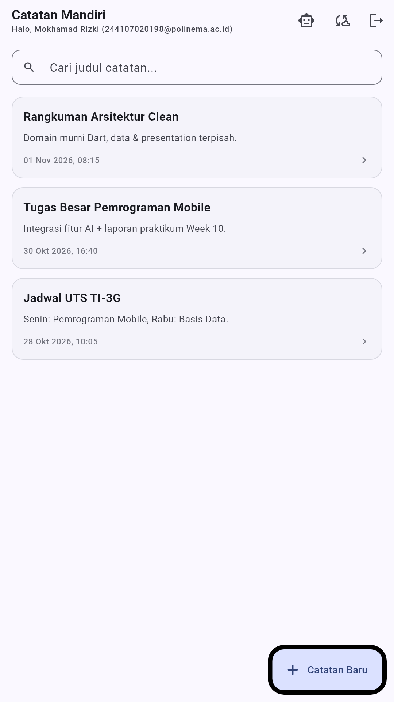
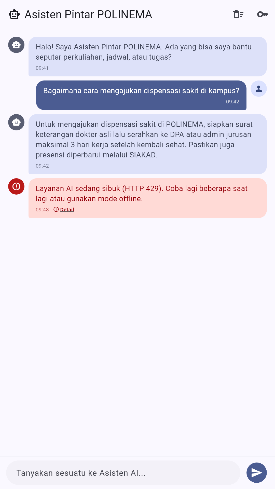
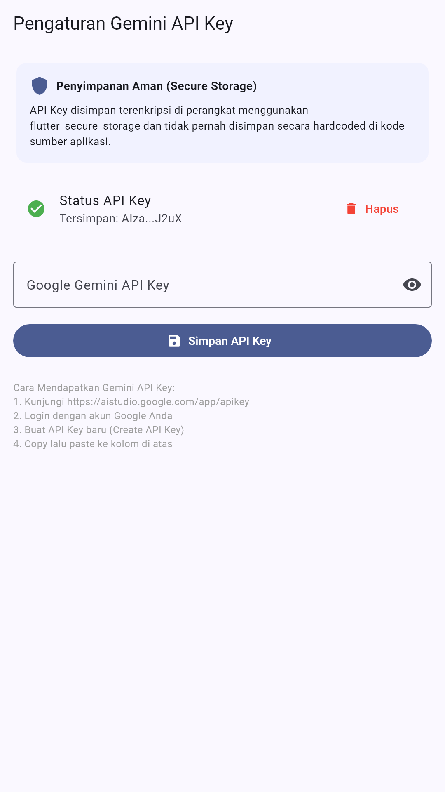
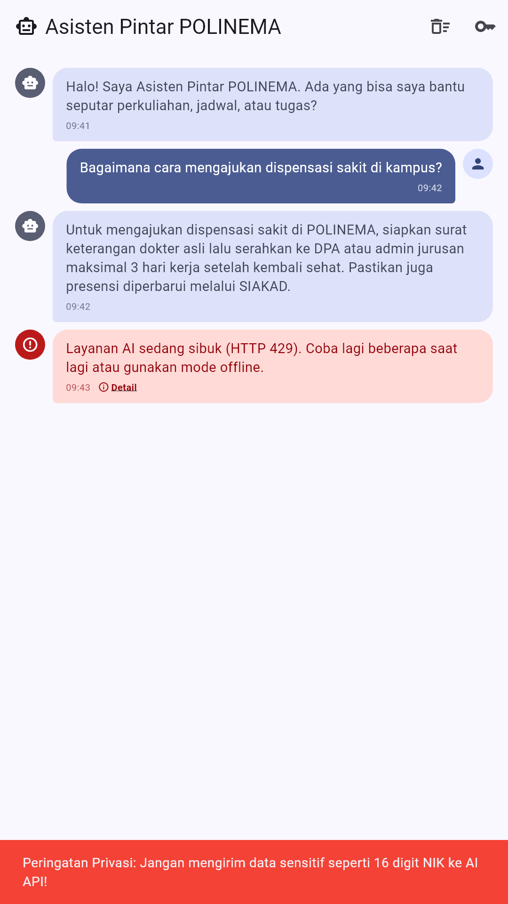
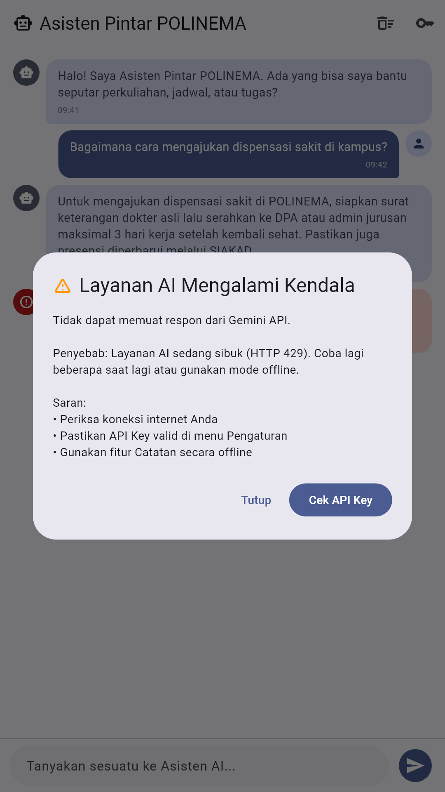

# Laporan Praktikum Week 10: Integrasi Fitur AI

**Nama:** MOKHAMAD RIZKI HADIONO SINGGIH
**NIM:** 244107020198
**Kelas:** TI-3G — Pemrograman Mobile
**Program Studi:** D-IV Teknik Informatika
**Jurusan:** Teknologi Informasi — Politeknik Negeri Malang

---

## 1. Tujuan Praktikum

Setelah menyelesaikan praktikum ini, mahasiswa mampu:

1. Memahami konsep integrasi LLM API ke aplikasi mobile.
2. Merancang chat interface dengan indikator loading dan penanganan respons.
3. Menerapkan prompt design yang aman dan efektif.
4. Menangani privasi, biaya, error handling, dan fallback design.
5. Mengevaluasi pengalaman pengguna pada fitur AI.

---

## 2. Fitur yang Diintegrasikan

Codelab meminta **satu** fitur AI ditambahkan ke proyek yang sudah ada. Fitur yang dipilih:

> **Asisten Pintar POLINEMA** — chat assistant berbasis **Google Gemini API**
> (model `gemini-1.5-flash`) yang menjawab pertanyaan seputar perkuliahan,
> jadwal, dan tugas dalam Bahasa Indonesia.

**Alasan pemilihan:** chat adalah fitur dengan nilai guna paling langsung bagi mahasiswa
(konsultasi cepat prosedur akademik) sekaligus melatih seluruh kompetensi inti codelab —
prompt design, streaming/loading state, secure storage, dan fallback.

---

## 3. Arsitektur

Proyek merupakan kelanjutan proyek Week 7 yang sudah memakai **feature-first Clean Architecture**.
Modul baru ditambahkan sebagai feature `ai_chat` tanpa melanggar *dependency rule*:
`presentation → domain ← data`.

```
lib/
├── core/                        # failures, format helpers
├── features/
│   ├── auth/                    # login/logout (dari Week 7)
│   ├── notes/                   # catatan offline-first (dari Week 7)
│   └── ai_chat/                 # ← FITUR BARU
│       ├── data/
│       │   ├── datasources/ai_service.dart
│       │   └── repositories/ai_repository_impl.dart
│       ├── domain/
│       │   ├── entities/chat_message.dart
│       │   ├── repositories/ai_repository.dart
│       │   └── usecases/send_message.dart
│       └── presentation/
│           ├── pages/chat_screen.dart
│           ├── pages/api_key_settings.dart
│           └── providers/chat_providers.dart
├── main.dart
└── routes.dart                  # + /chat dan /chat/settings
```

Alur data satu pesan:

```
ChatScreen → ChatNotifier → SendMessageUseCase → AiRepository (abstrak)
          → AiRepositoryImpl → AiService → Gemini REST API
                                     ↕
                          FlutterSecureStorage (API key)
```

**Dependensi baru** (`pubspec.yaml`): `http: ^1.2.0` dan `flutter_secure_storage: ^9.0.0`.

---

## 4. Langkah Kerja

### Langkah 1 — Menambahkan dependensi

`http` untuk komunikasi REST, `flutter_secure_storage` untuk menyimpan API key
secara terenkripsi di Keychain/Keystore. **Tidak ada** API key di dalam kode sumber.

### Langkah 2 — Membuat AI Service

`AiService` (`lib/features/ai_chat/data/datasources/ai_service.dart`) bertugas:

- Membaca API key dari secure storage (`ai_api_key`); jika kosong → melempar
  `AiServiceException` dengan pesan yang siap ditampilkan.
- Menyusun payload Gemini: `system_instruction`, riwayat percakapan, dan
  `generationConfig` (`temperature: 0.7`, `maxOutputTokens: 500`).
- Memetakan status HTTP ke pesan yang ramah pengguna:

| Status | Perlakuan |
| :--- | :--- |
| 200 | Ekstrak `candidates[0].content.parts[0].text` |
| 400 / 403 | "API Key tidak valid atau limit terlampaui" |
| 429 | "Terlalu banyak permintaan (rate limit)" |
| lainnya | "Gagal memanggil AI API: HTTP …" |
| exception jaringan | "Koneksi gagal atau layanan AI tidak merespons" |

### Langkah 3 — Membuat Chat Screen

`ChatScreen` menyediakan:

- **Bubble percakapan** berbeda warna untuk user/AI, dengan timestamp.
- **Indikator loading** ("Asisten AI sedang berpikir...") saat menunggu respons.
- **Auto-scroll** ke pesan terbaru.
- **Banner** peringatan bila API key belum diatur, dengan tautan ke pengaturan.
- **Privacy guard**: regex `\b\d{16}\b` memblokir pesan yang mengandung NIK
  16 digit **sebelum** request dikirim.
- **Fallback**: bubble `isError` + dialog *Layanan AI Mengalami Kendala* berisi
  penyebab, saran, dan tombol *Cek API Key*.

### Langkah 4 — Pengaturan API Key

`ApiKeySettingsPage` menyediakan input tersembunyi (toggle visibility), preview
kunci ter-mask (`AIza...J2uX`), tombol simpan, dan tombol hapus.

---

## 5. Prompt Design

### System prompt (dipakai di setiap request)

```text
Kamu adalah asisten kampus ramah untuk mahasiswa Politeknik Negeri Malang (POLINEMA).
Jawab dalam Bahasa Indonesia secara ringkas, jelas, sopan, dan solutif (maksimal 3-4 kalimat).
Jangan pernah meminta atau membocorkan data pribadi sensitif seperti NIK, password, atau nomor rekening.
```

| Komponen | Isi | Tujuan |
| :--- | :--- | :--- |
| Persona | "asisten kampus ramah POLINEMA" | Menetapkan nada & konteks |
| Batas panjang | "maksimal 3-4 kalimat" | Mencegah dinding teks di layar kecil |
| Bahasa | "Bahasa Indonesia" | Konsistensi output |
| Privasi | larangan minta/bocorkan data sensitif | Lapisan pertahanan kedua setelah privacy guard |

### Contoh user prompt & output awal AI

**User:** `Bagaimana cara mengajukan dispensasi sakit di kampus?`

**AI:** `Untuk mengajukan dispensasi sakit di POLINEMA, siapkan surat keterangan dokter asli
lalu serahkan ke DPA atau admin jurusan maksimal 3 hari kerja setelah kembali sehat.
Pastikan juga presensi diperbarui melalui SIAKAD.`

Log lengkap tiga skenario (termasuk uji adversarial) ada di [`docs/ai-log.md`](docs/ai-log.md).

### Parameter generasi

| Parameter | Nilai | Alasan |
| :--- | :--- | :--- |
| `temperature` | 0.7 | Seimbang antara kreativitas dan ketepatan faktual |
| `maxOutputTokens` | 500 | Membatasi biaya dan panjang jawaban |
| Riwayat dikirim | 10 pesan terakhir | Hemat token, konteks tetap terjaga |

---

## 6. Tabel Risiko dan Mitigasi

| Risiko | Dampak | Mitigasi yang diterapkan |
| :--- | :--- | :--- |
| **Bocor API key** | Kunci disalahgunakan pihak lain | Disimpan di `flutter_secure_storage` (Keystore/Keychain), tidak pernah hardcoded, bisa dihapus dari UI |
| **Bocor data pribadi (PII)** | NIK/rekening terkirim ke cloud | Privacy guard regex 16 digit memblokir sebelum request + larangan pada system prompt |
| **Biaya melonjak** | Kuota API cepat habis | Riwayat dibatasi 10 pesan, `maxOutputTokens: 500` |
| **API error / down** | Aplikasi crash atau terasa hang | Semua status dipetakan ke pesan ramah; bubble error + dialog fallback + opsi pakai catatan offline |
| **Respons tidak relevan** | Jawaban menyimpang / terlalu panjang | Batas panjang & persona pada system prompt, `temperature` moderat |

---

## 7. Hasil Uji (Bukti Mesin Hijau)

### `flutter analyze`

```text
Analyzing _10_week_10_ai_feature_integration...
No issues found!
```

### `flutter test`

```text
00:02 +28: All tests passed!
```

28 test lulus. Tujuh di antaranya adalah test baru untuk fitur AI:

| Test | Perilaku yang dibuktikan |
| :--- | :--- |
| API key kosong | `AiServiceException` dengan pesan "API key belum diatur" |
| HTTP 200 | Parsing respons Gemini menghasilkan teks jawaban |
| HTTP 400/403 | Pesan "API Key tidak valid" |
| HTTP 429 | Pesan rate limit |
| Input kosong | `ArgumentError` sebelum menyentuh jaringan |
| Exception saat kirim | `ChatMessage` bertanda `isError` (UI tidak crash) |
| Sukses | `ChatMessage` dari sender `ai` |

### Uji manual

| Skenario | Hasil |
| :--- | :--- |
| Buka chat tanpa API key | Banner kuning "API Key Gemini belum diset" muncul; pesan sistem ditampilkan saat mencoba kirim |
| Simpan API key | Snackbar hijau, preview `AIza...J2uX` tampil |
| Kirim pertanyaan perkuliahan | Bubble AI menjawab dalam Bahasa Indonesia, ≤ 4 kalimat |
| Kirim teks berisi NIK 16 digit | Snackbar merah, request **tidak** dikirim |
| Simulasi HTTP 429 | Bubble error + dialog fallback dengan tombol *Cek API Key* |

---

## 8. Screenshots

### 8.1 Titik masuk fitur AI pada halaman catatan

Ikon robot pada AppBar membuka Asisten Pintar POLINEMA.



### 8.2 Percakapan dengan Asisten AI

Bubble user/AI, timestamp, serta bubble error (HTTP 429) dengan tautan *Detail*.



### 8.3 Pengaturan Gemini API Key (Secure Storage)

Kunci disimpan terenkripsi, ditampilkan ter-mask, dan bisa dihapus.



### 8.4 Privacy guard: NIK 16 digit diblokir

Pesan dibatalkan di sisi klien sebelum dikirim ke API.



### 8.5 Fallback saat layanan AI gagal

Dialog menampilkan penyebab, saran, dan jalan keluar (cek API key / mode offline).



> Screenshot dibuat dengan `flutter test tool/capture_screenshots.dart` menggunakan
> font Roboto asli dan tema identik `lib/main.dart`, dengan data contoh (bukan data pengguna nyata).

---

## 9. Refleksi

**1. Fitur AI mana yang diintegrasikan dan mengapa?**
Chat assistant berbasis Gemini. Dipilih karena paling langsung menyelesaikan masalah
mahasiswa (konsultasi prosedur akademik) dan sekaligus menyentuh seluruh kompetensi
codelab: prompt design, penanganan latensi, keamanan kredensial, dan fallback.

**2. Bagaimana melindungi privasi pengguna?**
Tiga lapis: (a) API key hanya di secure storage, tidak pernah di kode maupun log;
(b) privacy guard regex memblokir NIK 16 digit sebelum request dibuat — data tidak
pernah meninggalkan perangkat; (c) system prompt melarang model meminta/membocorkan
data sensitif. Riwayat juga dipangkas ke 10 pesan agar data tidak menumpuk di cloud.

**3. Fallback apa yang disediakan bila layanan AI error?**
Setiap kegagalan (400/403/429/500, timeout) dipetakan ke pesan spesifik. UI menampilkan
bubble bertanda error, bukan crash, lalu dialog berisi penyebab + saran + tombol
*Cek API Key*. Pengguna tetap bisa memakai fitur catatan offline yang sudah ada.

**4. Satu hal yang dipelajari tentang UX fitur AI di mobile?**
Latensi jaringan itu nyata dan harus "dijual" ke pengguna: tanpa indikator
"sedang berpikir", aplikasi terasa hang. Selain itu membatasi panjang jawaban di
level prompt lebih efektif daripada memotong teks di UI, karena menghemat token
sekaligus menjaga keterbacaan di layar kecil.

---

## 10. Kesimpulan

Fitur AI berhasil diintegrasikan ke proyek Week 7 tanpa merusak arsitektur: domain tetap
murni Dart, akses jaringan hanya di layer data, dan UI hanya berinteraksi lewat provider.
Seluruh ketentuan codelab terpenuhi — chat interface, prompt design terdokumentasi,
secure storage, tabel risiko, fallback, serta bukti `flutter analyze` bersih dan
28 test lulus.
