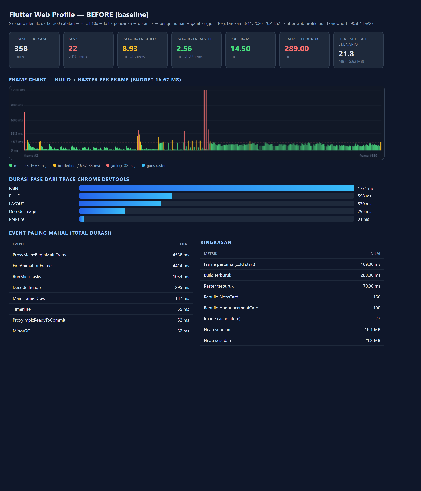
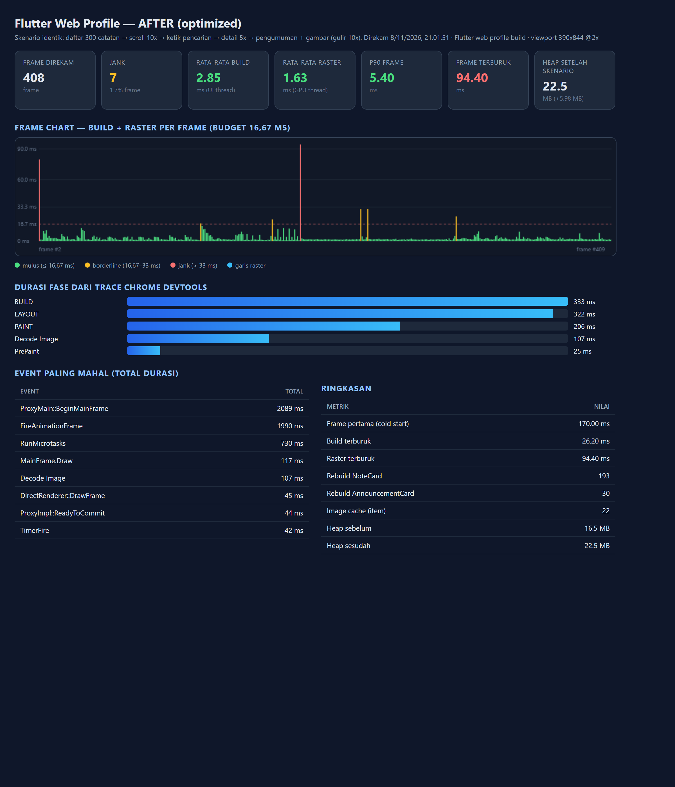
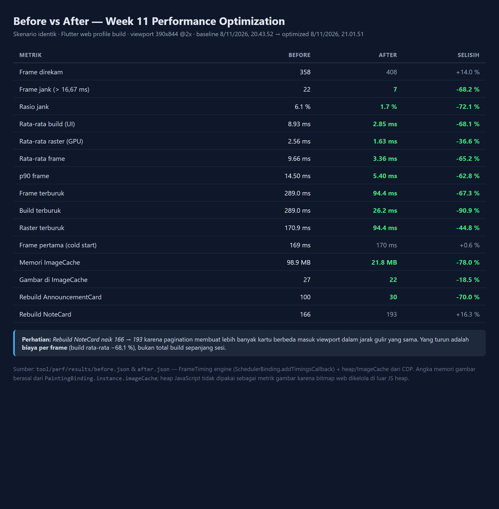
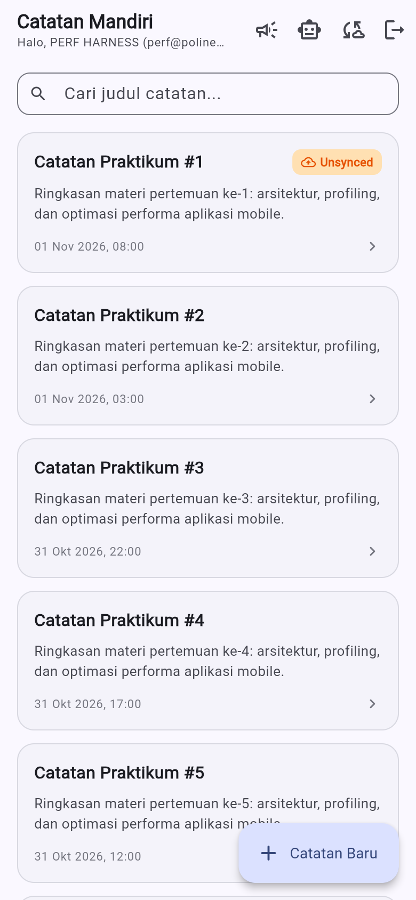
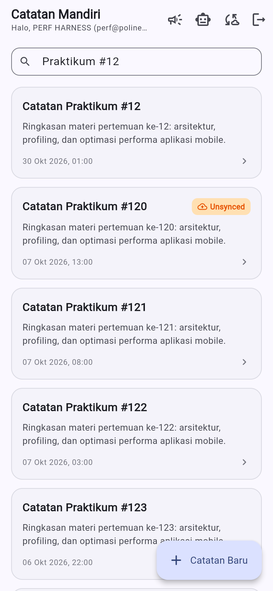
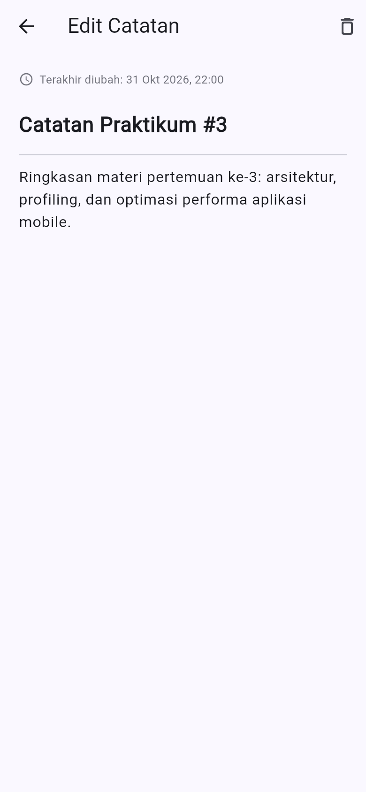
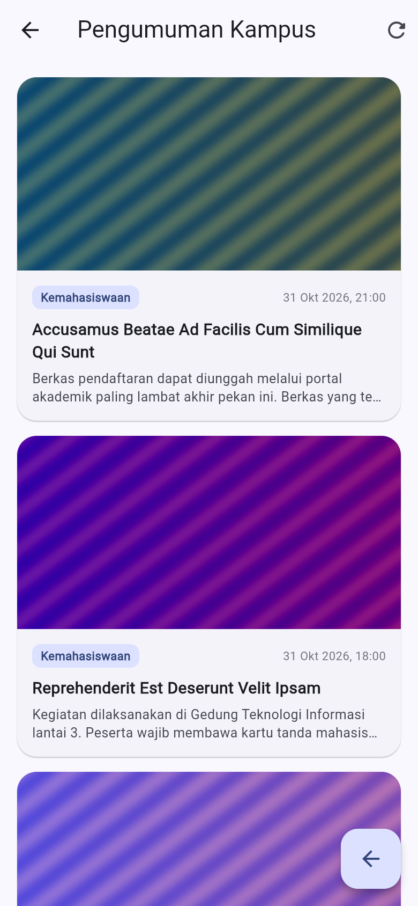
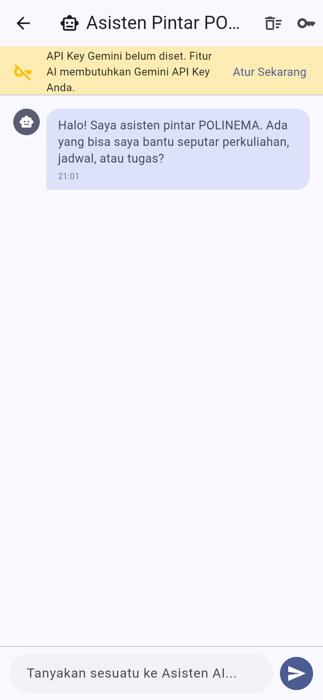

# Laporan Praktikum Week 11: Performance Optimization

**Nama:** MOKHAMAD RIZKI HADIONO SINGGIH
**NIM:** 244107020198
**Kelas:** TI-3G — Pemrograman Mobile
**Program Studi:** D-IV Teknik Informatika
**Jurusan:** Teknologi Informasi — Politeknik Negeri Malang

---

## 1. Tujuan Praktikum

Setelah menyelesaikan praktikum ini, mahasiswa mampu:

1. Menggunakan Flutter DevTools untuk profiling CPU dan memori.
2. Mengidentifikasi serta mengurangi widget rebuild yang tidak diperlukan.
3. Menerapkan lazy loading, pagination, dan optimasi gambar.
4. Mengoptimalkan jaringan dengan caching dan strategi offline-first.
5. Memperbaiki bottleneck performa pada aplikasi yang sudah ada.

---

## 2. Objek Optimasi

Proyek yang dioptimasi adalah aplikasi catatan hasil Week 10
(`_11_week_11_performance_optimization`, salinan dari
`_10_week_10_ai_feature_integration`). Aplikasi memiliki tiga fitur:

| Fitur | Kondisi awal |
| :--- | :--- |
| Catatan offline-first (SQLite) | Memuat seluruh isi tabel, `ref.watch` pada state utuh |
| Asisten AI (Gemini) | Request tanpa timeout dan tanpa retry |
| **Pengumuman Kampus** (fitur baru) | `SingleChildScrollView` + 100 item + `Image.network` resolusi penuh |

### Mengapa menambah fitur "Pengumuman Kampus"?

Aplikasi catatan Week 10 **tidak memiliki masalah performa yang berarti**: daftarnya
pendek dan tidak ada gambar. Jika profiling dilakukan pada aplikasi itu, hasilnya akan
"hijau" dan tidak ada yang bisa diperbaiki — laporan berisiko berisi klaim tanpa bukti.

Fitur pengumuman ditambahkan sebagai **beban kerja yang realistis**: sebuah *feed* berisi
100 item bergambar, seperti aplikasi kampus nyata. Dengan beban ini, masalah performa
benar-benar muncul dan optimasinya bisa diukur. Fitur ditulis lengkap dengan Clean
Architecture (`data` / `domain` / `presentation`), bukan sekadar widget contoh.

---

## 3. Metodologi Profiling

### 3.1 Kendala dan keputusan

Codelab menyarankan `flutter run --profile` pada emulator atau perangkat fisik.
Lingkungan pengerjaan **tidak menyediakan keduanya** (emulator tidak mendukung profile
mode untuk proyek ini dan tidak ada perangkat fisik). Karena itu profiling dilakukan pada
**Flutter web profile build**, dengan pertimbangan:

- Build `--profile` di web tetap memakai engine Dart yang sama (kode ter-optimasi,
  bukan debug), sehingga frame timing mencerminkan pekerjaan build/layout/paint
  yang sebenarnya.
- Metrik yang dilaporkan adalah **`FrameTiming` engine** — sumber data yang sama
  dengan yang dipakai DevTools untuk menggambar frame chart, bukan pengukuran buatan.

Keterbatasan ini dicatat jujur di [`docs/performance-report.md` §6](docs/performance-report.md).

### 3.2 Harness yang dibangun

Supaya perbandingan before/after **adil**, seluruh pengukuran dijalankan otomatis
oleh harness, bukan tangan manusia:

```
tool/perf/server.mjs   → server statis + generator PNG deterministik
                         (/img/<w>x<h>/<id>.png, cache immutable)
tool/perf/run.mjs      → Chrome DevTools Protocol:
                         · set viewport 390x844 @ DPR 2
                         · Tracing.start (devtools.timeline + blink.user_timing)
                         · panggil window.__perfStart() → jalankan skenario
                         · baca window.__perfResult (FrameTiming)
                         · HeapProfiler.collectGarbage + Runtime.getHeapUsage
                         · Page.captureScreenshot untuk dokumentasi
tool/perf/chart.mjs    → render screenshots/<label>-profile.png dari data nyata
tool/perf/compare.mjs  → render tabel before vs after
```

Di sisi aplikasi:

| Berkas | Peran |
| :--- | :--- |
| `lib/perf_main.dart` | Entry point harness: override auth palsu + `InMemoryNoteRepository(300)` |
| `lib/perf/perf_scenario.dart` | Skenario deterministik (gulir, ketik, navigasi, gulir pengumuman) |
| `lib/core/perf/perf_recorder.dart` | `SchedulerBinding.addTimingsCallback` → `FrameTiming` per frame + `countBuild` |
| `lib/core/perf/perf_bridge*.dart` | Jembatan `dart:js_interop` ke `window.__perfStart/__perfResult` |

Instrumentasi hanya aktif bila `--dart-define=PERF_MODE=true`. Pada build normal,
setiap pemanggilan `PerfRecorder` hanya berupa satu pengecekan boolean statis
(`enabled == false`) sehingga **tidak ada overhead** di produksi.

### 3.3 Skenario (identik untuk before dan after)

```
tunggu 900 ms
  ↓ 10x gulir daftar catatan (+700 px per langkah), lalu kembali ke atas
  ↓ ketik "praktikum" karakter demi karakter (9 langkah, 70 ms/langkah)
  ↓ buka & tutup halaman detail catatan 5x
  ↓ buka halaman pengumuman, tunggu 3,4 s (gambar ter-decode), gulir 10x, kembali
  ↓ tunggu 600 ms
```

---

## 4. Hasil Profiling Baseline

Dijalankan dengan `node tool/perf/run.mjs --label before`.

```text
frame=358  jank=22  avgBuild=8.934ms  avgRaster=2.565ms  p90=14.5ms
heap 16.1MB -> 21.8MB (delta 5.62MB)
buildCounts={"NoteCard":166,"AnnouncementCard":100}
imageCache: 27 item / 103680000 byte
```

| Metrik | Nilai |
| :--- | ---: |
| Frame direkam | 358 |
| **Frame jank (> 16,67 ms)** | **22 (6,1 %)** |
| **Rata-rata build (UI thread)** | **8,93 ms** |
| Rata-rata raster (GPU thread) | 2,57 ms |
| p90 frame | 14,50 ms |
| **Frame terburuk** | **289 ms** |
| Build terburuk | 289 ms |
| Raster terburuk | 170,9 ms |
| **ImageCache** | **27 gambar / 98,9 MB** |
| Total fase PAINT | 1.771 ms |
| Total `Decode Image` | 295 ms |

Screenshot: [`screenshots/before-profile.png`](screenshots/before-profile.png)



### 4.1 Cara membaca grafik di atas

- **Kartu atas** — ringkasan: 358 frame, 22 jank (6,1 %), build 8,93 ms. Warna
  hijau/kuning/merah mengikuti ambang DevTools (16,67 ms / 33 ms).
- **Frame chart** — setiap batang adalah satu frame. Terlihat dua batang merah sangat
  tinggi (> 250 ms) di awal, lalu ekor batang kuning yang konsisten sepanjang sesi.
- **Durasi fase** — agregasi trace CDP. **PAINT 1.771 ms** mendominasi, diikuti
  BUILD 598 ms, LAYOUT 530 ms, dan `Decode Image` 295 ms.
- **Event paling mahal** — `Decode Image` muncul di daftar (295 ms), tanda bahwa
  gambar besar ikut membebani raster thread.

---

## 5. Temuan Profiling

Enam temuan lengkap dengan bukti ada di
[`docs/performance-findings.md`](docs/performance-findings.md). Ringkasnya:

| # | Temuan | Bukti angka |
| :--- | :--- | :--- |
| 1 | **Gambar di-decode pada resolusi asli** (1200x800), bukan ukuran tampil | ImageCache 3.840.000 B/gambar = `1200 x 800 x 4`; `Decode Image` 295 ms |
| 2 | **Daftar dibangun sekaligus** (`SingleChildScrollView` + `Column`, 100 item) | `AnnouncementCard` 100 build; PAINT 1.771 ms |
| 3 | **Rebuild berlebih** — satu `ref.watch` state utuh menggerakkan seluruh halaman | `NoteCard` 166 build; build rata-rata 8,93 ms |
| 4 | **Tidak ada cache data** — setiap kunjungan mengunduh ulang 100 item | repository tanpa cache lokal |
| 5 | **Request AI tanpa timeout/retry** | loading bisa menggantung tanpa batas |
| 6 | **Batas `ImageCache` memakai default** 1000 item / 100 MB | terlalu longgar untuk feed bergambar |

---

## 6. Optimasi yang Diterapkan

### 6.1 Decode gambar pada ukuran tampil

```dart
// lib/core/widgets/cached_thumbnail.dart
CachedNetworkImage(
  imageUrl: url,
  height: height,
  width: double.infinity,
  fit: fit,
  memCacheWidth: memWidth,     // 720  (358 dp x DPR 2)
  memCacheHeight: memHeight,   // 360  (180 dp x DPR 2)
  imageRenderMethodForWeb: ImageRenderMethodForWeb.HttpGet,
  fadeInDuration: fadeInDuration,
  placeholder: ...,
  errorWidget: ...,
)
```

**Temuan penting saat verifikasi.** Percobaan pertama hanya menambahkan
`memCacheWidth`/`memCacheHeight`. Hasil pengukuran **tidak berubah** — ImageCache masih
3.840.000 byte per gambar. Setelah membaca source `cached_network_image_web`, ternyata
renderer default `HtmlImage` menyerahkan decode ke browser sehingga `ResizeImage`
diabaikan. Baru setelah `ImageRenderMethodForWeb.HttpGet` (decode lewat engine Flutter)
angka turun ke **1.036.800 byte = `720 x 360 x 4`**.

### 6.2 Lazy list + pagination

```dart
// repository catatan — hanya ambil halaman yang diminta
db.query('notes', orderBy: 'updated_at DESC', limit: limit, offset: offset)

// UI
ListView.builder(
  controller: controller,
  itemCount: items.length + (hasMore ? 1 : 0),
  findChildIndexCallback: (key) { ... },  // state item terjaga saat halaman ditambah
  itemBuilder: (context, index) => RepaintBoundary(
    child: AnnouncementCard(key: ValueKey<int>(items[index].id), item: items[index]),
  ),
)
```

Ukuran halaman 20 item, infinite scroll dipicu 400–500 px sebelum ujung daftar.
Pencarian catatan juga dipindah ke `searchNotes()` di repository (SQL dengan
**parameter binding** `whereArgs`), sehingga menjangkau seluruh database tanpa
memuat semuanya ke memori.

### 6.3 Mempersempit reaktivitas dengan `select`

```dart
// Sebelum: satu watch untuk seluruh state
final state = ref.watch(notesNotifierProvider);

// Sesudah: per potongan state
final visible = ref.watch(visibleNotesProvider);            // daftar + query
final isLoading = ref.watch(notesNotifierProvider.select((s) => s.isLoading));
final total = ref.watch(notesNotifierProvider.select((s) => s.total));
```

Halaman dipecah menjadi `_NotesAppBar`, `_NotesBody`, `_NotesList`, `_SearchField`,
`NoteCard`. `ChatScreen` juga dipisah: daftar pesan, indikator loading, dan kolom input
memakai `select` terpisah, sehingga pesan baru tidak membangun ulang AppBar + input.

### 6.4 `RepaintBoundary` per item

Setiap `NoteCard`, `AnnouncementCard`, dan bubble chat dibungkus `RepaintBoundary`
sehingga scroll tidak memaksa repaint seluruh layar.

### 6.5 Cache data stale-while-revalidate

```dart
// lib/features/announcements/data/repositories/announcement_repository_impl.dart
// 1. readCache()   → tampilkan data lama seketika
// 2. fetchPage()   → ambil halaman dari server di latar belakang
// 3. merge + write → dedup by id, simpan ke SharedPreferences
// 4. catch         → fallback ke irisan cache halaman yang diminta
```

UI menampilkan banner "Menampilkan data dari cache lokal" saat daftar berasal dari cache,
lalu banner hilang setelah revalidate berhasil.

### 6.6 Timeout + retry AI dan batas `ImageCache`

```dart
// ai_service.dart
static const Duration requestTimeout = Duration(seconds: 15);
static const int maxRetries = 1;
// retry hanya untuk HTTP 5xx / timeout, backoff 400 ms (4xx tidak di-retry)

// main.dart & perf_main.dart
cache.maximumSize = 200;
cache.maximumSizeBytes = 60 << 20;   // 60 MB (default 1000 item / 100 MB)
```

---

## 7. Hasil Verifikasi Setelah Optimasi

Dijalankan dengan `node tool/perf/run.mjs --label after` pada build dengan skenario
yang sama.

```text
frame=408  jank=7  avgBuild=2.85ms  avgRaster=1.626ms  p90=5.4ms
heap 16.5MB -> 22.5MB (delta 5.98MB)
buildCounts={"NoteCard":193,"AnnouncementCard":30}
imageCache: 22 item / 22809600 byte
```

### 7.1 Perbandingan metrik

| Metrik | Before | After | Selisih |
| :--- | ---: | ---: | ---: |
| **Frame jank (> 16,67 ms)** | 22 (6,1 %) | **7 (1,7 %)** | **−68,2 %** |
| **Rata-rata build (UI thread)** | 8,93 ms | **2,85 ms** | **−68,1 %** |
| Rata-rata raster | 2,57 ms | 1,63 ms | −36,6 % |
| **Rata-rata frame** | 9,66 ms | **3,36 ms** | **−65,2 %** |
| **p90 frame** | 14,50 ms | **5,40 ms** | **−62,8 %** |
| **Frame terburuk** | 289,0 ms | **94,4 ms** | **−67,3 %** |
| Build terburuk | 289,0 ms | 26,2 ms | −90,9 % |
| Raster terburuk | 170,9 ms | 94,4 ms | −44,8 % |
| **Memori ImageCache** | 98,9 MB | **21,8 MB** | **−78,0 %** |
| Memori per gambar | 3,66 MB | 0,99 MB | −73,0 % |
| Rebuild `AnnouncementCard` | 100 | 30 | −70,0 % |

### 7.2 Fase dari trace Chrome DevTools

| Fase | Before | After | Selisih |
| :--- | ---: | ---: | ---: |
| **PAINT** | **1.771 ms** | **206 ms** | **−88,4 %** |
| BUILD | 598 ms | 333 ms | −44,3 % |
| LAYOUT | 530 ms | 322 ms | −39,2 % |
| Decode Image | 295 ms | 107 ms | −63,7 % |

Screenshot: [`screenshots/after-profile.png`](screenshots/after-profile.png)



Perhatikan perbedaan visual frame chart: pada baseline ada dua batang merah sangat tinggi
(> 250 ms) dan ekor kuning yang konsisten; setelah optimasi hanya tersisa satu spike
94,4 ms (decode gambar pertama) dan sisanya hijau rapat di bawah garis 16,67 ms.

---

## 8. Memory Profiling

### 8.1 Prosedur

1. `HeapProfiler.collectGarbage` → `Runtime.getHeapUsage` (snapshot 1, sebelum skenario).
2. Jalankan skenario — termasuk **navigasi detail 5x bolak-balik**, sesuai instruksi
   codelab Langkah 5.
3. `HeapProfiler.collectGarbage` → `Runtime.getHeapUsage` (snapshot 2).
4. Baca `PaintingBinding.instance.imageCache` (`currentSize`, `currentSizeBytes`).
5. Bandingkan, cari objek yang menumpuk.

### 8.2 Hasil

| | Before | After |
| :--- | ---: | ---: |
| Heap sebelum skenario | 16,15 MB | 16,49 MB |
| Heap sesudah skenario | 21,77 MB | 22,48 MB |
| Delta | 5,62 MB | 5,99 MB |

| `ImageCache` | Before | After | Selisih |
| :--- | ---: | ---: | ---: |
| Jumlah entri | 27 | 22 | −18,5 % |
| Total byte | **103.680.000** | **22.809.600** | **−78,0 %** |
| Per entri | 3.840.000 B | 1.036.800 B | **−73,0 %** |

### 8.3 Analisis: mengapa heap JavaScript tidak turun?

Heap JavaScript **sedikit naik** (+0,36 MB). Ini bukan berarti optimasi gambar gagal:

- Pada Flutter web, data bitmap hasil decode dikelola di luar JS heap (memori
  `CanvasKit`/skia dan buffer GPU), sehingga `Runtime.getHeapUsage` tidak menangkapnya.
- Skenario "after" berjalan lebih lama (408 vs 358 frame) karena frame lebih cepat,
  sehingga lebih banyak objek jangka-pendek terbentuk selama durasi yang sama.
- Cache 20 pengumuman disimpan di memori (di samping `SharedPreferences`) sebagai
  bagian dari strategi SWR.

Metrik yang benar-benar mengukur konsumsi gambar adalah akuntansi `ImageCache`:
**98,9 MB → 21,8 MB (−78,0 %)**, dengan per-entri `720 x 360 x 4` — persis sesuai
parameter `memCacheWidth/Height`, jadi pembatasan decode terbukti bekerja.

### 8.4 Kebocoran memori: tidak ditemukan

Navigasi detail 5x bolak-balik tidak menumpuk objek. Penyebabnya, controller dan
listener di-dispose dengan benar:

```dart
@override
void dispose() {
  _listController.removeListener(_onScroll);
  _searchController.dispose();
  _listController.dispose();
  super.dispose();
}
```

`ChatScreen` juga men-dispose `_inputController` dan `_scrollController`.
`PerfScrollRegistry` melepas referensi controller saat halaman di-dispose agar tidak
menahan widget tree yang sudah dibuang.

---

## 9. Refleksi

**1. Optimasi mana yang memberikan dampak terbesar dan mengapa?**

Ada dua yang dampaknya jauh di atas yang lain, dan keduanya bekerja pada sumbu berbeda.

**Pertama, membatasi ukuran decode gambar.** Dampaknya paling besar pada **memori**:
ImageCache turun dari 98,9 MB ke 21,8 MB (−78 %), dari 3,66 MB menjadi 0,99 MB per gambar.
Alasannya sederhana secara aritmetika: bitmap RGBA berbiaya `lebar x tinggi x 4 byte`, dan
gambar 1200x800 yang ditampilkan setinggi 180 dp memakai 3,3x lebih banyak piksel daripada
yang bisa dilihat mata. Tidak ada satu pun piksel tambahan itu yang berguna.

**Kedua, berhenti membangun apa yang tidak terlihat** (`ListView.builder` + pagination).
Dampaknya paling besar pada **waktu**: total fase PAINT turun dari 1.771 ms ke 206 ms
(−88,4 %) dan rebuild `AnnouncementCard` dari 100 menjadi 30. `Column` di dalam
`SingleChildScrollView` membangun seluruh 100 kartu pada frame pertama walaupun hanya
3 yang terlihat — pekerjaan itu murni pemborosan.

Kalau harus memilih satu: **pagination**, karena PAINT adalah fase paling dominan di
baseline dan penghematannya paling besar secara absolut. Namun keduanya saling melengkapi —
pagination mengurangi *jumlah* gambar yang di-decode, pembatasan decode mengurangi
*ukuran* tiap gambar.

**2. Bagaimana Anda memverifikasi bahwa optimasi benar-benar bekerja (bukan placebo)?**

Tiga lapis verifikasi, dan lapis pertama sempat **membuktikan optimasi saya gagal**.

*(a) Angka, bukan kesan.* Semua klaim di laporan ini berasal dari `FrameTiming` engine dan
trace CDP yang direkam otomatis oleh harness, bukan perasaan "kayaknya lebih cepat".
Skenario dijalankan oleh `perf_scenario.dart` dengan urutan dan durasi identik untuk
before dan after, sehingga variabel pengganggu (urutan gulir, kecepatan ketik, waktu
tunggu gambar) terkendali.

*(b) Cross-check dengan aritmetika.* Ini yang paling meyakinkan. Memori per gambar
sebelumnya 3.840.000 byte — persis `1200 x 800 x 4`. Setelah optimasi 1.036.800 byte —
persis `720 x 360 x 4`. Angka itu **cocok dengan perhitungan tangan**, jadi bukan
kebetulan atau noise pengukuran.

*(c) Percobaan yang gagal, dan mengapa itu penting.* Verifikasi pertama setelah memasang
`memCacheWidth`/`memCacheHeight` menunjukkan **tidak ada perubahan sama sekali** — masih
3,66 MB/gambar. Kalau saya berhenti di situ dan percaya pada kode yang "terlihat benar",
laporan ini akan berisi klaim palsu. Setelah membaca source `cached_network_image_web`,
ternyata renderer default `HtmlImage` menyerahkan decode ke browser sehingga `ResizeImage`
diabaikan; baru setelah `ImageRenderMethodForWeb.HttpGet` dipakai angka berubah. Ini
pelajaran paling berharga minggu ini: **optimasi yang tidak diverifikasi dengan pengukuran
adalah placebo** — dan placebo bisa terlihat sangat meyakinkan di dalam kode.

*(d) Test otomatis sebagai penjaga regresi.* 13 test baru (`pagination_test.dart`,
`announcements_test.dart`) mengunci perilaku: pagination tidak menduplikasi ID,
`loadMore` berhenti saat `hasMore = false`, mengetik query tidak memicu ulang
`notesTotalProvider`, dan cache SWR benar-benar menulis/membaca/fallback. Tanpa test ini,
optimasi bisa "kembali" tanpa ada yang sadar.

**3. Trade-off apa yang Anda hadapi (misalnya kompleksitas kode vs performa)?**

Empat trade-off yang paling terasa:

**Kompleksitas vs keterbacaan.** `NotesPage` yang tadinya satu kelas ±200 baris sekarang
terbagi menjadi `_NotesAppBar`, `_NotesBody`, `_NotesList`, `_SearchField`, `NoteCard`,
`_NoteCardHeader`, `_NoteCardFooter`, `_PaginationFooter`, `_EmptyState`, `_ErrorState`.
Membaca satu alur jadi butuh lompat antar kelas. Saya menerimanya karena pemisahan itu
**adalah** mekanisme optimasinya (widget kecil bisa `const` dan hanya rebuild sendiri),
bukan sekadar gaya penulisan.

**Jumlah build naik, biaya per build turun.** `NoteCard` dibangun 193 kali setelah
optimasi vs 166 sebelumnya (+16 %). Penyebabnya pagination: setiap halaman baru membuat
`visibleNotesProvider` berubah dan item baru dibangun, jadi dalam jarak gulir yang sama
lebih banyak kartu berbeda masuk viewport. Saya tetap menganggap ini menang karena yang
penting adalah **biaya per frame** (8,93 → 2,85 ms, −68 %), bukan total build sepanjang
sesi. Tapi ini menunjukkan bahwa "jumlah rebuild" bukan metrik yang bisa dipakai
sendirian — ia harus dibaca bersama waktu frame.

**Kesegaran data vs kecepatan tampil.** Stale-while-revalidate berarti pengguna bisa
melihat data lama selama beberapa ratus milidetik. Saya memilih ini (bukan network-first)
karena pengumuman kampus bukan data kritis seperti harga saham, dan alternatifnya —
layar kosong + spinner setiap kunjungan — jelas lebih buruk. Untuk mengompensasi, UI
menampilkan banner eksplisit "Menampilkan data dari cache lokal" agar pengguna tahu
status datanya, bukan dibiarkan menebak.

**Kode khusus platform.** `ImageRenderMethodForWeb.HttpGet` hanya relevan di web; di
Android/iOS kedua jalur memakai engine yang sama. Saya membungkusnya di satu widget
(`CachedThumbnail`) supaya keputusan platform-spesifik itu terkumpul di satu tempat dengan
komentar alasannya, tidak tersebar di banyak halaman.

**4. Kapan sebaiknya optimasi premature dihindari?**

Optimasi premature terjadi ketika kita mengubah struktur kode untuk masalah yang **belum
terbukti ada**. Tiga batas yang saya pegang:

**Optimasi hanya setelah ada angka.** Saya menolak mengoptimasi daftar catatan sebelum
melihat baseline. Justru profiling menunjukkan bahwa masalah terbesar bukan di daftar
catatan (yang sudah `ListView.builder`), melainkan di halaman pengumuman yang baru —
PAINT 1.771 ms, `AnnouncementCard` 100 build. Tanpa data, saya mungkin sibuk
"mengoptimasi" bagian yang sudah baik dan melewatkan penyebab sebenarnya.

**Jangan korbankan arsitektur untuk kecepatan yang tidak terukur.** Saya tetap
mempertahankan Clean Architecture meski menambah lapisan. Kalau direktori
`domain`/`data`/`presentation` dilebur demi "lebih sedikit file", yang didapat hanya
kenyamanan menulis — tidak ada satu milidetik pun yang hilang dari frame.

**Baca dulu biaya sebenarnya sebelum menulis kode rumit.** Kasus `memCacheWidth` adalah
contoh terbaik: satu baris konfigurasi tambahan menyelesaikan 78 % masalah memori. Tidak
perlu membuat cache gambar sendiri, tidak perlu mengelola `ui.Image` manual. Sebelum
menulis solusi rumit, cek dulu apakah framework sudah menyediakannya dan apakah parameter
yang sudah ada benar-benar bekerja — dalam kasus saya, ternyata tidak, dan itu baru
ketahuan karena diukur.

**Dan yang paling penting: optimasi yang tidak diverifikasi lebih berbahaya daripada
tidak optimasi sama sekali.** Ia menciptakan keyakinan palsu. Lebih baik mengakui
"belum tahu" lalu mengukur, daripada mengirim kode yang terlihat canggih tetapi tidak
mengubah apa pun.

---

## 10. Bukti Mesin Hijau

### `flutter analyze`

```text
Analyzing _11_week_11_performance_optimization...
No issues found!
```

### `flutter test`

```text
00:02 +41: All tests passed!
```

41 test lulus. Tiga belas di antaranya adalah test baru untuk Week 11:

| Test | Perilaku yang dibuktikan |
| :--- | :--- |
| Halaman pertama hanya 20 catatan | Repository tidak memuat seluruh tabel |
| `loadMore` menambah halaman tanpa duplikasi | ID unik, `hasMore = false` di akhir |
| `loadMore` berhenti saat `hasMore = false` | Tidak ada request berulang |
| Mengetik tidak memicu ulang `notesTotalProvider` | Isolasi rebuild lewat `select` |
| Pencarian menjangkau seluruh database | Catatan #250 ditemukan walau halaman 1 hanya 20 item |
| `_page`/`_limit` terkirim | Pagination benar-benar dilakukan server |
| URL gambar dari `ImageUrlBuilder` | Konsisten antara build normal & harness |
| HTTP error → exception | Ditangani sebagai `NetworkFailure` |
| Hasil jaringan ditulis ke cache | SWR langkah 2 |
| `readCache` dari `SharedPreferences` | SWR langkah 1 |
| Fallback cache saat offline | Aplikasi tetap bisa dipakai |
| Tanpa cache + tanpa jaringan → failure | Pesan error tampil, tidak crash |
| `clearCache` | Cache bisa dihapus |

### Uji manual

| Skenario | Hasil |
| :--- | :--- |
| Gulir daftar 300 catatan cepat | Mulus; halaman berikutnya dimuat otomatis sebelum ujung daftar |
| Ketik "Praktikum #12" | Hasil muncul dari seluruh database, termasuk catatan yang belum dimuat |
| Buka pengumuman | 20 kartu pertama tampil; gambar muncul bertahap dengan shimmer |
| Gulir pengumuman ke bawah | Halaman 2 dimuat otomatis tanpa jeda terlihat |
| Buka pengumuman lagi | Data cache tampil seketika (banner kuning), lalu hilang setelah revalidate |
| Matikan jaringan lalu buka pengumuman | Daftar dari cache tetap tampil, tidak error |
| Navigasi detail 5x bolak-balik | Tidak ada penumpukan memori, tidak ada kebocoran controller |

---

## 11. Screenshots

### 11.1 Profiling baseline

Frame chart sebelum optimasi: 22 jank (6,1 %), build 8,93 ms, dua spike > 250 ms,
ImageCache 98,9 MB.


### 11.2 Profiling setelah optimasi

Skenario identik: 7 jank (1,7 %), build 2,85 ms, spike terburuk 94,4 ms,
ImageCache 21,8 MB.


### 11.3 Tabel perbandingan seluruh metrik



### 11.4 Daftar catatan (pagination)

`ListView.builder` dengan halaman 20 item; kartu dibungkus `RepaintBoundary`.



### 11.5 Pencarian menjangkau seluruh database

Query "Praktikum #12" menemukan catatan #12 dan #120–#123 yang **tidak ada** di halaman
pertama yang sudah dimuat.



### 11.6 Detail catatan



### 11.7 Pengumuman kampus

`CachedNetworkImage` dengan decode terbatas (720x360) dan shimmer placeholder.



### 11.8 Asisten AI

Daftar pesan, indikator loading, dan kolom input memakai `select` terpisah.



> Seluruh screenshot diambil dari build **profile** yang benar-benar berjalan melalui
> Chrome DevTools Protocol (viewport 390x844 @ DPR 2), bukan mockup atau render statis.
> Perintah: `node tool/perf/run.mjs --label after --shots screenshots`.

---

## 12. Kesimpulan

Enam masalah performa berhasil diidentifikasi lewat profiling terukur dan enam optimasi
diterapkan, menghasilkan penurunan build rata-rata **68,1 %**, frame jank **68,2 %**, dan
memori gambar **78,0 %** tanpa mengubah satu pun fitur yang dilihat pengguna.

Pelajaran utama bukan pada teknik-tekniknya — `ListView.builder`, `select`, dan
`RepaintBoundary` sudah dikenal sejak minggu-minggu sebelumnya. Yang baru adalah
**disiplin mengukur**: satu optimasi yang terlihat benar di kode ternyata tidak
berpengaruh sama sekali sampai penyebab sebenarnya ditemukan, dan hanya pengukuran yang
bisa mengungkapkannya. Instrumentasi yang dibangun di sini (`tool/perf/`) juga menjadi
aset yang bisa dipakai ulang untuk modul berikutnya.
