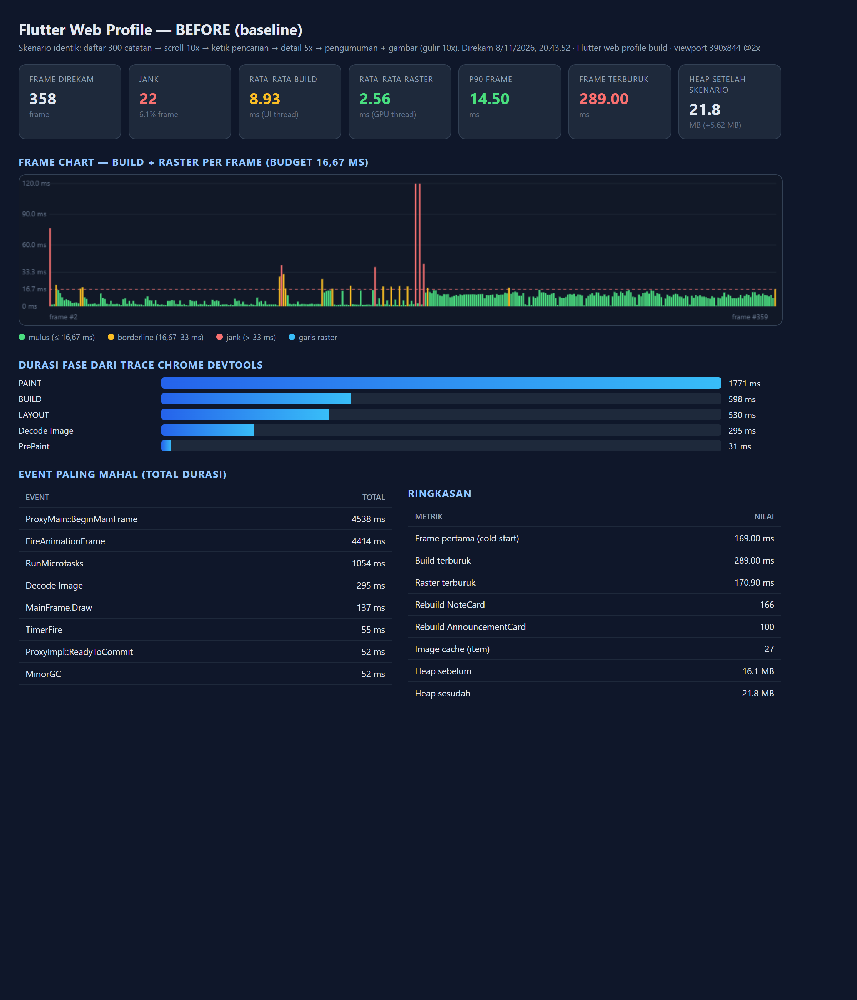
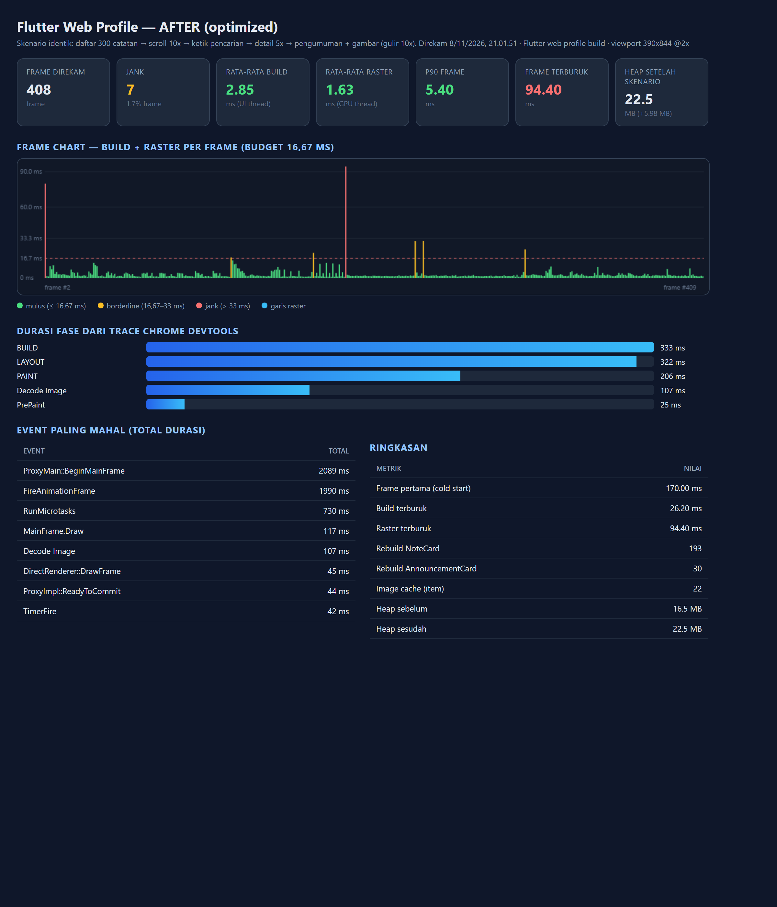
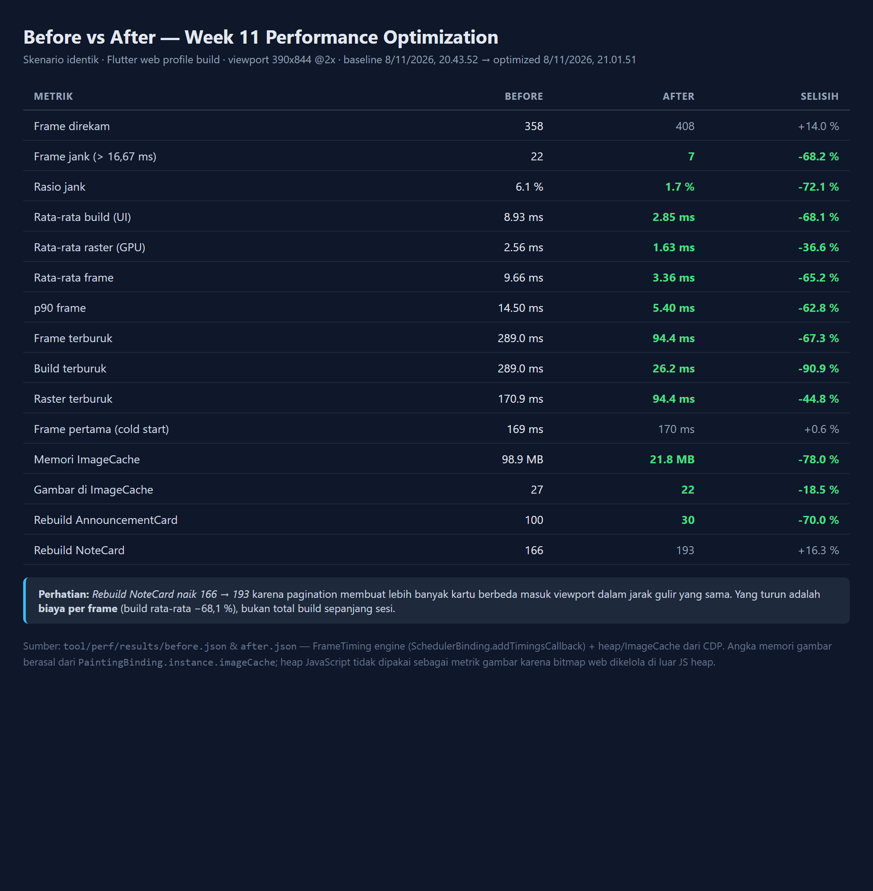

# Week 11 — Performance Optimization

**Mata Kuliah:** Pemrograman Mobile
**Nama:** Mokhamad Rizki Hadiono Singgih
**NIM:** 244107020198
**Kelas:** TI-3G
**Prodi:** D-IV Teknik Informatika — Politeknik Negeri Malang

---

## Ringkasan

Modul ini mengoptimasi performa aplikasi catatan (hasil Week 10) berdasarkan
**profiling yang terukur**, bukan tebakan. Pekerjaan yang dilakukan:

1. Menambahkan beban kerja realistis berupa halaman **Pengumuman Kampus**
   (100 item + gambar) agar masalah performa benar-benar muncul.
2. Membangun *harness* profiling deterministik di atas **Chrome DevTools Protocol**
   yang merekam `FrameTiming` engine, trace build/layout/paint, heap, dan screenshot.
3. Mencatat **6 temuan** performa dengan angka nyata → [`docs/performance-findings.md`](docs/performance-findings.md)
4. Menerapkan **6 optimasi**.
5. Mengukur ulang dan menulis laporan before/after + memory profiling
   → [`docs/performance-report.md`](docs/performance-report.md)

### Hasil utama

| Metrik | Before | After | Selisih |
| :--- | ---: | ---: | ---: |
| Frame jank | 22 (6,1 %) | **7 (1,7 %)** | **−68,2 %** |
| Rata-rata build | 8,93 ms | **2,85 ms** | **−68,1 %** |
| Rata-rata frame | 9,66 ms | **3,36 ms** | **−65,2 %** |
| p90 frame | 14,50 ms | **5,40 ms** | **−62,8 %** |
| Frame terburuk | 289 ms | **94,4 ms** | **−67,3 %** |
| Memori ImageCache | 98,9 MB | **21,8 MB** | **−78,0 %** |
| Total fase PAINT | 1.771 ms | **206 ms** | **−88,4 %** |

|  |  |
| :---: | :---: |
| **Baseline** — 22 jank, build 8,93 ms | **Teroptimasi** — 7 jank, build 2,85 ms |

Tabel perbandingan lengkap:



---

## Ketentuan codelab yang dipenuhi

| Ketentuan | Implementasi | Bukti |
| :--- | :--- | :--- |
| Profiling baseline | Skenario deterministik + `FrameTiming` + trace CDP | `screenshots/before-profile.png`, `tool/perf/results/before.json` |
| `docs/performance-findings.md` (min. 3 temuan) | **6 temuan** dengan angka | [`docs/performance-findings.md`](docs/performance-findings.md) |
| Min. 3 optimasi | **6 optimasi** (§ Optimasi) | [`docs/performance-report.md`](docs/performance-report.md) |
| Profiling ulang | Run identik dengan label `after` | `screenshots/after-profile.png`, `tool/perf/results/after.json` |
| Memory profiling | Heap CDP + akuntansi `ImageCache` | [`docs/performance-report.md` §3](docs/performance-report.md) |
| `flutter analyze` bersih | `No issues found!` | § Bukti Mesin Hijau |
| `flutter test` lulus | `41 tests passed` | § Bukti Mesin Hijau |
| `lib/`, `docs/`, `README.md`, `screenshots/` | Semua tersedia | — |
| Refleksi 4 pertanyaan | — | [`Laporan-Praktikum-Week-11.md`](Laporan-Praktikum-Week-11.md) §9 |

---

## 6 Optimasi yang diterapkan

| # | Optimasi | File | Dampak terukur |
| :--- | :--- | :--- | :--- |
| 1 | **Decode gambar pada ukuran tampil** (`memCacheWidth/Height` + `ImageRenderMethodForWeb.HttpGet`) | `lib/core/widgets/cached_thumbnail.dart` | Memori per gambar 3,66 MB → 0,99 MB |
| 2 | **Lazy list + pagination 20 item** (`ListView.builder`, `db.query(limit:, offset:)`) | `announcements_page.dart`, `notes_page.dart`, `note_repository_impl.dart` | PAINT 1.771 → 206 ms; `AnnouncementCard` 100 → 30 build |
| 3 | **`select` per potongan state** + pemecahan widget | `notes_providers.dart`, `notes_page.dart`, `chat_screen.dart` | Build 8,93 → 2,85 ms |
| 4 | **`RepaintBoundary` per item** | `notes_page.dart`, `announcements_page.dart`, `chat_screen.dart` | Scroll tidak me-repaint seluruh layar |
| 5 | **Cache data stale-while-revalidate** (`SharedPreferences`) | `announcement_repository_impl.dart` | Data lama tampil instan; offline fallback |
| 6 | **Timeout + retry AI & batas `ImageCache`** | `ai_service.dart`, `main.dart`, `perf_main.dart` | Loading tidak menggantung; cache 200 item / 60 MB |

### Catatan teknis penting

`memCacheWidth` **tidak berpengaruh di Flutter web** bila memakai renderer default
`HtmlImage` — browser yang men-decode sehingga `ResizeImage` diabaikan. Pengukuran
pertama setelah memasang `memCacheWidth` masih menunjukkan 3,66 MB/gambar. Baru setelah
`ImageRenderMethodForWeb.HttpGet` dipakai (decode lewat engine Flutter), angka turun ke
1.036.800 byte = `720 x 360 x 4`. Detail di
[`docs/performance-report.md` §2.1](docs/performance-report.md).

---

## Struktur proyek

```
lib/
├── core/
│   ├── config/image_url_builder.dart      # URL gambar lokal (harness) vs picsum (produksi)
│   ├── perf/
│   │   ├── perf_recorder.dart             # FrameTiming recorder + countBuild
│   │   ├── perf_bridge.dart / _web.dart / _stub.dart   # jembatan JS
│   │   └── perf_scroll_registry.dart      # akses ScrollController untuk skenario
│   └── widgets/cached_thumbnail.dart      # gambar decode terbatas
├── features/
│   ├── announcements/                     # FITUR BARU: pengumuman kampus
│   │   ├── data/ (datasource HTTP, repository + cache SWR)
│   │   ├── domain/ (entity, repository, usecase)
│   │   └── presentation/ (page teroptimasi, providers pagination)
│   ├── notes/                             # dioptimasi: pagination + select
│   └── ai_chat/                           # dioptimasi: select + timeout/retry
├── perf/
│   ├── in_memory_note_repository.dart     # 300 catatan untuk profiling
│   └── perf_scenario.dart                 # skenario deterministik
├── perf_main.dart                         # entry point harness (--dart-define=PERF_MODE)
└── main.dart

tool/perf/
├── server.mjs      # server statis + generator PNG deterministik
├── run.mjs         # harness CDP: trace, heap, screenshot
├── chart.mjs       # render <label>-profile.png dari data nyata
├── compare.mjs     # render tabel before vs after
└── results/        # before.json, after.json, *-trace.json
```

---

## Cara menjalankan

### Aplikasi normal

```bash
flutter pub get
flutter analyze            # harus: No issues found!
flutter test               # harus: All tests passed!
flutter run                # pilih device
```

### Harness profiling

```bash
# 1. build profile
flutter build web --profile -t lib/perf_main.dart \
  --dart-define=PERF_MODE=true \
  --dart-define=PERF_IMAGE_BASE=http://127.0.0.1:8777/img \
  --output=build/perf_web

# 2. server statis + gambar (biarkan berjalan)
node tool/perf/server.mjs build/perf_web

# 3. jalankan skenario + ambil screenshot (terminal lain)
node tool/perf/run.mjs --label after --shots screenshots

# 4. render grafik perbandingan
node tool/perf/chart.mjs --labels after

# 5. render tabel before vs after (opsional, butuh before.json)
node tool/perf/compare.mjs
```

`PERF_MODE=false` (default) membuat seluruh instrumentasi menjadi *no-op*, sehingga
tidak ada overhead pada build produksi.

---

## 🧪 Bukti Mesin Hijau

```text
$ flutter analyze
Analyzing _11_week_11_performance_optimization...
No issues found!

$ flutter test
00:02 +41: All tests passed!
```

41 test lulus. Test baru khusus Week 11:

| File | Test | Yang dibuktikan |
| :--- | :--- | :--- |
| `pagination_test.dart` | Halaman pertama hanya 20 catatan | Repository tidak memuat seluruh tabel |
| `pagination_test.dart` | `loadMore` tanpa duplikasi | ID unik, `hasMore` menjadi `false` di akhir |
| `pagination_test.dart` | `loadMore` berhenti saat `hasMore = false` | Tidak ada request berulang |
| `pagination_test.dart` | Mengetik tidak memicu ulang `notesTotalProvider` | Isolasi rebuild lewat `select` |
| `pagination_test.dart` | Pencarian menjangkau seluruh database | Catatan #250 ditemukan walau halaman 1 hanya 20 item |
| `announcements_test.dart` | `_page`/`_limit` terkirim | Pagination benar-benar dilakukan server |
| `announcements_test.dart` | URL gambar dari `ImageUrlBuilder` | Konsisten dengan build harness |
| `announcements_test.dart` | HTTP error → exception | Ditangani sebagai `NetworkFailure` |
| `announcements_test.dart` | Hasil jaringan ditulis ke cache | SWR langkah 2 |
| `announcements_test.dart` | `readCache` dari `SharedPreferences` | SWR langkah 1 |
| `announcements_test.dart` | Fallback cache saat offline | Aplikasi tetap bisa dipakai |
| `announcements_test.dart` | Tanpa cache + tanpa jaringan → failure | Pesan error tampil, tidak crash |
| `announcements_test.dart` | `clearCache` | Cache bisa dihapus |

---

## 📸 Screenshots

| # | File | Keterangan |
| :--- | :--- | :--- |
| 1 | `screenshots/before-profile.png` | **Profiling baseline** — frame chart, 6,1 % jank, ImageCache 98,9 MB |
| 2 | `screenshots/after-profile.png` | **Profiling setelah optimasi** — 1,7 % jank, ImageCache 21,8 MB |
| 3 | `screenshots/before-after-comparison.png` | Tabel perbandingan seluruh metrik before vs after |
| 4 | `screenshots/01-notes-list.png` | Daftar catatan (pagination 20 item, `ListView.builder`) |
| 5 | `screenshots/02-notes-search.png` | Pencarian menjangkau seluruh database, bukan hanya halaman aktif |
| 6 | `screenshots/03-note-detail.png` | Halaman detail catatan |
| 7 | `screenshots/04-announcements.png` | Pengumuman kampus — `CachedNetworkImage` decode terbatas |
| 8 | `screenshots/05-chat-screen.png` | Asisten AI — daftar pesan dengan `select` terpisah |

> Semua screenshot diambil dari build **profile** yang benar-benar berjalan
> (Chrome headless, viewport 390x844 @2x) melalui CDP, bukan mockup.

---

## Dokumentasi pendukung

- [`docs/performance-findings.md`](docs/performance-findings.md) — 6 temuan performa + bukti angka
- [`docs/performance-report.md`](docs/performance-report.md) — before/after, memory profiling, trade-off, batasan
- [`Laporan-Praktikum-Week-11.md`](Laporan-Praktikum-Week-11.md) — laporan praktikum lengkap
- [`tool/perf/`](tool/perf/) — harness profiling (server, runner CDP, chart)
- [`tool/perf/results/`](tool/perf/results/) — data mentah `before.json`, `after.json`, trace CDP
