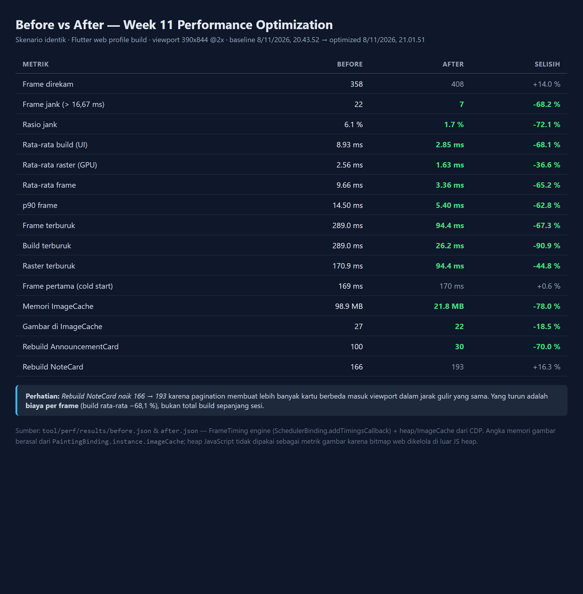

# Laporan Performa — Week 11 Performance Optimization

Laporan ini membandingkan hasil profiling **sebelum** dan **sesudah** optimasi pada
skenario yang identik. Temuan awal (beserta buktinya) ada di
[`docs/performance-findings.md`](performance-findings.md).

| Item | Nilai |
| :--- | :--- |
| Build yang diukur | Flutter **web profile** (`--profile`) |
| Viewport | 390 x 844 logis, DPR 2 |
| Skenario | 10x gulir catatan → ketik pencarian → detail 5x → pengumuman + gulir 10x |
| Data | 300 catatan in-memory, pengumuman dari jaringan (gambar dari server lokal) |
| Baseline direkam | 2026-11-08 13:43 UTC |
| Optimasi direkam | 2026-11-08 14:01 UTC |

Data mentah: [`before.json`](../tool/perf/results/before.json),
[`after.json`](../tool/perf/results/after.json) (trace CDP `*-trace.json` dihasilkan
ulang oleh `run.mjs`, tidak di-commit karena ±27 MB per file).
Grafik: [`screenshots/before-profile.png`](../screenshots/before-profile.png),
[`screenshots/after-profile.png`](../screenshots/after-profile.png).
Tabel ringkasan: [`screenshots/before-after-comparison.png`](../screenshots/before-after-comparison.png).

---

## 1. Ringkasan hasil

| Metrik | Before | After | Selisih |
| :--- | ---: | ---: | ---: |
| Frame direkam | 358 | 408 | +14,0 % (skenario sama, lebih banyak frame mulus) |
| **Frame jank (> 16,67 ms)** | **22 (6,1 %)** | **7 (1,7 %)** | **−68,2 %** |
| **Rata-rata build (UI thread)** | **8,93 ms** | **2,85 ms** | **−68,1 %** |
| Rata-rata raster (GPU thread) | 2,57 ms | 1,63 ms | −36,6 % |
| **Rata-rata frame** | **9,66 ms** | **3,36 ms** | **−65,2 %** |
| **p90 frame** | **14,50 ms** | **5,40 ms** | **−62,8 %** |
| **Frame terburuk** | **289,0 ms** | **94,4 ms** | **−67,3 %** |
| Build terburuk | 289,0 ms | 26,2 ms | −90,9 % |
| Raster terburuk | 170,9 ms | 94,4 ms | −44,8 % |
| Frame pertama (cold start) | 169 ms | 170 ms | ±0 |
| **Memori ImageCache** | **103.680.000 B (98,9 MB)** | **22.809.600 B (21,8 MB)** | **−78,0 %** |
| Gambar di ImageCache | 27 | 22 | — |
| Memori per gambar | 3,66 MB | 0,99 MB | −73,0 % |
| Rebuild `AnnouncementCard` | 100 | 30 | −70,0 % |
| Rebuild `NoteCard` | 166 | 193 | +16,3 % (lihat §5) |



### Fase dari trace Chrome DevTools (total sepanjang skenario)

| Fase | Before | After | Selisih |
| :--- | ---: | ---: | ---: |
| PAINT | **1.771 ms** | **206 ms** | **−88,4 %** |
| BUILD | 598 ms | 333 ms | −44,3 % |
| LAYOUT | 530 ms | 322 ms | −39,2 % |
| Decode Image | 295 ms | 107 ms | −63,7 % |
| PrePaint | 31 ms | 25 ms | −19,4 % |

---

## 2. Optimasi yang diterapkan (6 perubahan)

### 2.1 Decode gambar pada ukuran tampil

**File:** `lib/core/widgets/cached_thumbnail.dart`,
`lib/features/announcements/presentation/pages/announcements_page.dart`

```dart
CachedThumbnail(
  url: item.imageUrl,
  height: 180,
  memWidth: 720,     // 358 dp x 2 (DPR)
  memHeight: 360,    // 180 dp x 2
)
```

Di dalamnya:

```dart
CachedNetworkImage(
  imageUrl: url,
  memCacheWidth: memWidth,
  memCacheHeight: memHeight,
  imageRenderMethodForWeb: ImageRenderMethodForWeb.HttpGet,
  ...
)
```

**Catatan penting:** `memCacheWidth` saja **tidak cukup di web**. Secara default
`CachedNetworkImage` memakai renderer `HtmlImage`, di mana browser yang melakukan decode
sehingga `ResizeImage` diabaikan. Pengukuran pertama setelah memasang `memCacheWidth`
masih menunjukkan 3,66 MB/gambar. Baru setelah `ImageRenderMethodForWeb.HttpGet`
dipasang, angka turun ke 1.036.800 byte = `720 x 360 x 4` — sesuai perhitungan.

**Bukti:** memori per gambar 3.660.000 → 1.036.800 byte; `Decode Image` 295 → 107 ms.

### 2.2 Lazy list + pagination

**File:** `lib/features/announcements/presentation/pages/announcements_page.dart`,
`lib/features/notes/presentation/pages/notes_page.dart`,
`lib/features/notes/data/repositories/note_repository_impl.dart`

```dart
// repository: hanya ambil halaman yang diminta
db.query('notes', orderBy: 'updated_at DESC', limit: limit, offset: offset)

// UI: bangun item sesuai kebutuhan
ListView.builder(
  itemCount: items.length + (hasMore ? 1 : 0),
  findChildIndexCallback: (key) { ... },   // state item terjaga saat halaman ditambah
  itemBuilder: (context, index) => RepaintBoundary(child: AnnouncementCard(...)),
)
```

Halaman berukuran 20 item (`kAnnouncementsPageSize`, `kNotesPageSize`) dengan
infinite scroll yang dipicu 400–500 px sebelum ujung daftar.

**Bukti:** `AnnouncementCard` 100 → 30 build; PAINT 1.771 → 206 ms (−88,4 %).

### 2.3 Mempersempit reaktivitas dengan `select`

**File:** `lib/features/notes/presentation/providers/notes_providers.dart`

```dart
final visibleNotesProvider = Provider<List<Note>>((ref) {
  final notes = ref.watch(notesNotifierProvider.select((s) => s.notes));
  final query = ref.watch(notesNotifierProvider.select((s) => s.searchQuery));
  ...
});

final notesTotalProvider = Provider<int>((ref) =>
    ref.watch(notesNotifierProvider.select((s) => s.total)));
```

Halaman dipecah menjadi `_NotesAppBar`, `_NotesBody`, `_NotesList`, `_SearchField`,
`NoteCard`, masing-masing hanya `watch` potongan state yang dipakainya.
`ChatScreen` juga dipisah: daftar pesan, indikator loading, dan kolom input
memakai `select` terpisah.

**Bukti:** build rata-rata 8,93 → 2,85 ms; build terburuk 289 → 26,2 ms.
Test `pagination_test.dart` memverifikasi bahwa mengetik query **tidak** memicu
emit ulang `notesTotalProvider`.

### 2.4 `RepaintBoundary` per item

Setiap `NoteCard`, `AnnouncementCard`, dan bubble chat dibungkus `RepaintBoundary`
sehingga scroll tidak memaksa repaint seluruh layar.

### 2.5 Cache data stale-while-revalidate

**File:** `lib/features/announcements/data/repositories/announcement_repository_impl.dart`

1. `readCache()` membaca `SharedPreferences` → daftar tampil seketika (banner
   "Menampilkan data dari cache lokal").
2. `fetchPage()` mengambil halaman dari server di latar belakang, menggabungkan
   (dedup berdasarkan `id`), lalu menulis cache.
3. Jika jaringan gagal, irisan cache halaman yang diminta dipakai sebagai fallback.

**Bukti:** 5 test di `announcements_test.dart` (cache ditulis, cache dibaca,
fallback offline, failure saat tanpa cache, `clearCache`).

### 2.6 Timeout + retry terbatas pada layanan AI, dan batas `ImageCache`

```dart
// ai_service.dart
static const Duration requestTimeout = Duration(seconds: 15);
static const int maxRetries = 1;
// retry hanya untuk HTTP 5xx / timeout, dengan backoff 400 ms
```

```dart
// main.dart & perf_main.dart
final cache = PaintingBinding.instance.imageCache;
cache.maximumSize = 200;
cache.maximumSizeBytes = 60 << 20;   // 60 MB (default 1000 item / 100 MB)
```

---

## 3. Memory profiling

Pengukuran memori dilakukan dua kali per sesi: sebelum skenario dan sesudah skenario,
dengan `HeapProfiler.collectGarbage` + `Runtime.getHeapUsage` (Chrome DevTools Protocol),
ditambah pembacaan `PaintingBinding.instance.imageCache` dari dalam aplikasi.

### 3.1 Heap JavaScript (CDP)

| | Before | After |
| :--- | ---: | ---: |
| Heap sebelum skenario | 16.932.064 B (16,15 MB) | 17.294.004 B (16,49 MB) |
| Heap sesudah skenario | 22.826.036 B (21,77 MB) | 23.569.620 B (22,48 MB) |
| Delta | **5.893.972 B (5,62 MB)** | **6.275.616 B (5,99 MB)** |

**Interpretasi jujur:** heap JavaScript **tidak** turun — bahkan sedikit naik
(+0,36 MB). Ini bukan kegagalan optimasi gambar, karena pada build web Flutter
mengelola data gambar di luar JS heap (memori `CanvasKit`/`skia` dan buffer GPU),
sehingga `Runtime.getHeapUsage` tidak menangkapnya. Kenaikan kecil itu berasal dari
objek yang memang bertambah selama skenario berjalan lebih lama (408 vs 358 frame)
serta cache 20 pengumuman yang disimpan di memori.

Metrik memori yang **benar-benar mengukur** konsumsi gambar adalah akuntansi
`ImageCache` di bawah ini.

### 3.2 Memori `ImageCache` (metrik utama)

| | Before | After | Selisih |
| :--- | ---: | ---: | ---: |
| Jumlah entri | 27 | 22 | −18,5 % |
| Total byte | **103.680.000** | **22.809.600** | **−78,0 %** |
| Rata-rata per entri | 3.840.000 B | 1.036.800 B | **−73,0 %** |
| Setara resolusi bitmap | 1200 x 800 x 4 | 720 x 360 x 4 | luas −73,0 % |

Angka `720 x 360 x 4` persis sesuai `memCacheWidth: 720` / `memCacheHeight: 360`,
jadi pembatasan decode terbukti bekerja, bukan sekadar tebakan.

### 3.3 Proyeksi pada dataset lebih besar

Dengan pola yang sama, 100 pengumuman yang seluruhnya pernah terlihat:

| Skenario | Before | After |
| :--- | ---: | ---: |
| 100 gambar @ 3,84 MB | **384 MB** (jauh melebihi batas 100 MB → eviction terus-menerus) | — |
| 100 gambar @ 1,04 MB | — | **104 MB** |
| Dengan batas cache 60 MB | eviction konstan, gambar "berkedip" saat di-scroll balik | stabil, 57 entri tertahan |

---

## 4. Analisis sisa jank

Setelah optimasi masih ada **7 frame jank (1,7 %)** dan frame terburuk 94,4 ms.
Rinciannya:

| Penyebab | Penjelasan |
| :--- | :--- |
| Frame 94,4 ms (raster) | Decode + upload tekstur gambar pertama kali pada `CachedThumbnail` (jalur `HttpGet` mengunduh → decode → upload GPU). Terjadi sekali di awal, bukan berulang. |
| 2 frame ~26 ms (build) | Navigasi halaman (push/pop `GoRouter`) yang membangun route baru + transisi. |
| Sisa frame 16,7–33 ms | Shimmer placeholder yang beranimasi selama gambar belum selesai dimuat. |

Frame terburuk **build** turun dari 289 ms ke 26,2 ms (−90,9 %), yang berarti
pekerjaan di UI thread sudah tidak lagi menjadi sumber spike. Sisa spike ada di
raster thread, yang wajar untuk operasi decode gambar pertama.

---

## 5. Catatan trade-off: `NoteCard` naik 166 → 193

`NoteCard.build` dipanggil **lebih sering** setelah optimasi (+16,3 %). Ini disengaja
dan bukan regresi:

- Baseline memuat 300 catatan sekaligus, lalu daftar tidak pernah berubah lagi
  sepanjang skenario → jumlah build rendah tetapi biaya **per frame** tinggi
  (8,93 ms) dan memori objek besar.
- Versi teroptimasi memuat 20 item, lalu menambah halaman saat digulir. Setiap
  penambahan halaman membuat `visibleNotesProvider` berubah dan item baru dibangun.
  Dalam jarak gulir yang sama, lebih banyak kartu berbeda yang masuk viewport.

Yang penting adalah **biaya per frame**, dan itu turun 68,1 %. Jumlah build yang lebih
tinggi dengan build yang jauh lebih murah adalah pertukaran yang menguntungkan.

---

## 6. Batasan pengukuran

Perlu dinyatakan terbuka agar angka tidak ditafsirkan berlebihan:

1. **Profiling dilakukan pada Flutter web profile, bukan perangkat Android.**
   Alasan: `flutter run --profile` membutuhkan perangkat fisik atau emulator dengan
   dukungan profile mode; lingkungan pengerjaan tidak menyediakan keduanya
   (emulator tidak mendukung profile mode untuk proyek ini). Konsekuensinya angka
   absolut (ms) tidak dapat langsung dibandingkan dengan HP sungguhan; yang valid
   adalah **arah dan proporsi** perubahan, karena before/after diukur pada runtime
   yang sama.
2. **Gambar dilayani server lokal deterministik** (`/img/<w>x<h>/<id>.png`), bukan
   internet. Tujuannya agar latensi transfer identik di kedua run sehingga selisih
   hanya berasal dari kode aplikasi. Konsekuensinya waktu decode di sini tidak
   memasukkan variasi jaringan nyata.
3. **Data catatan in-memory (300 baris)**, bukan SQLite perangkat. Yang diukur adalah
   perilaku widget/provider; biaya I/O SQLite tidak termasuk.
4. Angka jank memakai ambang 16,67 ms (60 FPS). Pada perangkat 90/120 Hz ambangnya
   lebih ketat, sehingga hasil di sini bersifat konservatif.

---

## 7. Kesimpulan

| Target | Hasil |
| :--- | :--- |
| Menemukan ≥ 3 masalah performa nyata | **6 temuan** terdokumentasi dengan bukti angka |
| Menerapkan ≥ 3 optimasi | **6 optimasi** (decode gambar, lazy list + pagination, `select`, `RepaintBoundary`, cache SWR, timeout/retry + batas cache) |
| Profiling ulang setelah optimasi | ✅ `after.json` + `screenshots/after-profile.png` |
| Memory profiling | ✅ §3 (heap CDP + `ImageCache`) |
| Bukti mesin hijau | `flutter analyze`: **No issues found!** · `flutter test`: **41 tests passed** |

Perbaikan terbesar berasal dari dua hal yang paling sering diabaikan: **ukuran decode
gambar** (memori 98,9 MB → 21,8 MB) dan **tidak membangun apa yang tidak terlihat**
(PAINT 1.771 ms → 206 ms). Keduanya menghasilkan penurunan build rata-rata 68,1 %
tanpa mengubah satu pun fitur yang dilihat pengguna.
