# Laporan Praktikum Week 12: Testing & Quality Assurance

**Nama:** MOKHAMAD RIZKI HADIONO SINGGIH
**NIM:** 244107020198
**Kelas:** TI-3G, Pemrograman Mobile
**Program Studi:** D-IV Teknik Informatika
**Jurusan:** Teknologi Informasi, Politeknik Negeri Malang
**Tanggal:** 13 November 2026

---

## 1. Tujuan Praktikum

Setelah menyelesaikan praktikum ini, mahasiswa mampu:

1. Menentukan bagian aplikasi yang perlu diuji dengan pengujian unit, widget,
   atau integrasi.
2. Menulis pengujian unit untuk logika dan kasus tepi.
3. Menguji tampilan serta interaksi widget Flutter.
4. Memisahkan dependensi agar kode mudah diuji, termasuk dengan fake
   repository.
5. Menjalankan pengujian integrasi dan menggunakan cakupan kode sebagai bahan
   evaluasi.

---

## 2. Objek Praktikum

Proyek yang diuji adalah aplikasi catatan hasil Week 11
(`_12_week_12_testing_quality_assurance`, salinan dari
`_11_week_11_performance_optimization` dengan nama package
`week12_testing_quality_assurance`). Aplikasi memiliki fitur:

| Fitur | Teknologi | Relevansi untuk pengujian |
| :--- | :--- | :--- |
| Catatan offline-first | SQLite (`sqflite`) | Sumber data perlu dipisah agar dapat diganti fake |
| Autentikasi | `shared_preferences` | Perlu diuji tanpa plugin platform |
| Asisten AI | Gemini via HTTP | Tidak diuji ke jaringan nyata |
| Pengumuman kampus | HTTP + cache | Diuji di Week 11, tetap dijaga regresinya |
| Navigasi | `go_router` | Perlu diuji pada integration test |

Fitur utama yang menjadi fokus pengujian Week 12 adalah **catatan**, karena di
situlah aturan bisnis paling padat: validasi judul, pagination, pencarian,
sinkronisasi, dan penghapusan.

---

## 3. Landasan Teori Singkat

### 3.1 Tiga lapis pengujian Flutter

| Jenis | Yang diperiksa | Kelebihan | Kekurangan |
| :--- | :--- | :--- | :--- |
| Unit | Satu fungsi atau objek tanpa merender UI | Tercepat, paling stabil, mudah dilokalisasi saat gagal | Tidak menangkap masalah integrasi |
| Widget | Tampilan dan interaksi widget | Menguji UI tanpa perangkat | Perlu `pumpWidget`, tidak menyentuh plugin asli |
| Integrasi | Alur aplikasi pada perangkat | Paling mendekati pengalaman pengguna | Lambat, butuh emulator, paling rapuh |

### 3.2 Pola Arrange, Act, Assert

Setiap test disusun dalam tiga bagian: menyiapkan keadaan, melakukan satu
tindakan, lalu memeriksa hasilnya. Pola ini membuat test mudah dibaca dan
menunjukkan dengan jelas apa yang sebenarnya diuji.

### 3.3 Fake, stub, dan mock

| Istilah | Ciri |
| :--- | :--- |
| Stub | Memberi jawaban tetap, tidak menyimpan keadaan |
| Mock | Merekam pemanggilan dan memverifikasinya |
| Fake | Implementasi sederhana yang benar benar berjalan |

Praktikum ini memakai **fake**, karena fake memungkinkan pemeriksaan keadaan
akhir ("apakah catatan benar benar masuk daftar?"), bukan hanya "apakah method
dipanggil".

### 3.4 Cakupan kode

Cakupan mengukur baris yang **dijalankan** saat test berjalan. Angka tinggi
tidak menjamin semua perilaku diperiksa, dan angka rendah belum tentu berarti
kode berbahaya. Karena itu cakupan dipakai sebagai petunjuk untuk mencari
bagian yang belum tersentuh.

---

## 4. Persiapan dan Perubahan Kode

### 4.1 Scaffold proyek

Proyek Week 11 disalin ke folder Week 12, lalu:

- nama package diubah menjadi `week12_testing_quality_assurance` pada
  `pubspec.yaml`, seluruh `import`, `namespace` dan `applicationId` Android,
  serta paket `MainActivity.kt`,
- folder `build/`, `.dart_tool/`, dan `coverage/` tidak disalin,
- `integration_test` dan `sqflite_common_ffi` ditambahkan ke
  `dev_dependencies`.

### 4.2 Validasi dijadikan fungsi murni

Sebelumnya aturan judul catatan hanya ada di dalam `AddNote`:

```dart
final trimmedTitle = title.trim();
if (trimmedTitle.isEmpty) {
  return (
    note: null,
    failure: const ValidationFailure('Judul catatan tidak boleh kosong'),
  );
}
```

Aturan itu tidak dapat dipakai oleh UI, sehingga pengguna baru melihat pesan
setelah repository dipanggil. Week 12 memindahkannya ke
`lib/core/validation/note_validator.dart`:

```dart
const int kMaxNoteTitleLength = 120;

String? noteTitleError(String? value) {
  final trimmed = (value ?? '').trim();
  if (trimmed.isEmpty) {
    return 'Judul catatan tidak boleh kosong';
  }
  if (trimmed.length > kMaxNoteTitleLength) {
    return 'Judul catatan maksimal $kMaxNoteTitleLength karakter';
  }
  return null;
}
```

Fungsi ini sekarang dipakai oleh tiga tempat: `AddNote`, `AddNoteDialog`, dan
`NoteDetailPage`. Satu sumber kebenaran berarti pesan di UI dan domain tidak
mungkin berbeda.

### 4.3 Dialog tambah catatan dipisah menjadi widget

`_showAddNoteDialog` yang semula berisi 80 baris widget inline di dalam
`NotesPage` dipecah menjadi `AddNoteDialog` (widget tersendiri). Keuntungannya:

- validasi dapat menampilkan `errorText` di dalam form,
- dialog dapat diuji langsung maupun lewat halaman,
- `NotesPage` menjadi lebih pendek dan lebih mudah dibaca.

Perilaku yang juga diperbaiki: dialog kini **tidak** tertutup saat penyimpanan
gagal. Sebelumnya pengguna kehilangan teks yang sudah diketik.

### 4.4 `Key` pada kontrol yang diuji

Seluruh kontrol yang diuji diberi `Key` eksplisit, misalnya
`noteTitleField`, `noteSaveButton`, `notesErrorRetry`, `loginSubmitButton`.
Tanpa `Key`, pencarian bergantung pada teks yang mudah berubah saat desain
diperbarui.

---

## 5. Rancangan Pengujian

### 5.1 Skenario yang dicatat

Sesuai codelab, minimal tiga skenario dengan satu kasus tepi dan satu
kegagalan. Praktikum ini mencatat **24 skenario**, terdiri atas 12 unit, 11
widget, dan 1 integrasi. Daftar lengkap ada di
[`docs/qa-strategy.md`](docs/qa-strategy.md).

Contoh tiga skenario inti:

| Skenario | Jenis | Kasus | Hasil yang diharapkan |
| :--- | :--- | :--- | :--- |
| Judul catatan hanya berisi spasi | Unit | Kasus tepi | Ditolak dengan `ValidationFailure`, repository tidak dipanggil |
| Daftar gagal dimuat lalu pengguna menekan Coba Lagi | Widget | Kegagalan dan pemulihan | Pesan error hilang, daftar muncul |
| Pengguna menambah catatan lalu melihatnya di daftar | Integrasi | Sukses end to end | Catatan tersimpan di SQLite dan tampil |

### 5.2 Pembagian per lapis

| Lapis | Berkas | Jumlah test |
| :--- | :--- | ---: |
| Unit | `test/unit/note_validator_test.dart` | 9 |
| Unit | `test/unit/note_usecases_test.dart` | 10 |
| Unit | `test/unit/note_repository_sqlite_test.dart` | 13 |
| Unit | `test/unit/auth_repository_test.dart` | 8 |
| Widget | `test/widget/notes_page_widget_test.dart` | 7 |
| Widget | `test/widget/login_page_widget_test.dart` | 5 |
| Widget | `test/widget/note_detail_page_widget_test.dart` | 4 |
| Integrasi | `integration_test/app_test.dart` | 1 |
| **Total baru** | | **56** |

Ditambah 41 test lama dari Week 7 sampai Week 11, total menjadi **97 test**.

### 5.3 Fake repository

`test/support/fakes.dart` menyediakan `FakeNoteRepository` dengan kemampuan:

| Fitur | Kegunaan |
| :--- | :--- |
| `notes` awal yang dapat diisi | Menyiapkan data tanpa database |
| `fetchFailure`, `addFailure`, dan seterusnya | Memaksa jalur gagal per operasi |
| `latency` | Menguji indikator loading |
| Penghitung `fetchCalls`, `addCalls`, dan seterusnya | Membuktikan sebuah operasi **tidak** dipanggil |

Contoh pemakaian untuk skenario pemulihan:

```dart
final repo = FakeNoteRepository(
  notes: [note(id: 1, title: 'Catatan Setelah Pulih')],
  fetchFailure: const LocalFailure('Gagal membaca database lokal'),
);

await tester.pumpWidget(buildSubject(repo: repo));
await tester.pumpAndSettle();
expect(find.text('Gagal membaca database lokal'), findsOneWidget);

repo.fetchFailure = null;                       // repository kini sehat
await tester.tap(find.byKey(const Key('notesErrorRetry')));
await tester.pumpAndSettle();

expect(find.text('Catatan Setelah Pulih'), findsOneWidget);
```

---

## 6. Implementasi Pengujian

### 6.1 Unit test validasi

```dart
test('menolak teks yang hanya berisi spasi (kasus tepi)', () {
  expect(noteTitleError('     '), 'Judul catatan tidak boleh kosong');
  expect(isValidNoteTitle('\t \n '), isFalse);
});

test('menerima judul tepat pada batas maksimal', () {
  final input = List.filled(kMaxNoteTitleLength, 'a').join();
  expect(noteTitleError(input), isNull);
});
```

Kasus tepi yang dicakup: string kosong, hanya spasi, `null`, tepat di batas,
satu karakter melewati batas, spasi pembungkus yang tidak boleh dihitung, dan
karakter unicode.

### 6.2 Unit test dengan fake repository

```dart
test('menolak judul kosong tanpa memanggil repository', () async {
  final repo = FakeNoteRepository();

  final result = await AddNote(repo).call(title: '   ');

  expect(result.failure, isA<ValidationFailure>());
  expect(repo.addCalls, 0);      // bukti: repository tidak tersentuh
});
```

Baris `expect(repo.addCalls, 0)` adalah inti test ini. Tanpa baris itu, test
hanya membuktikan ada pesan error, bukan bahwa validasi benar benar mencegah
akses database.

### 6.3 Unit test repository SQL asli

`sqflite` tidak berjalan di Dart VM, sehingga test memakai
`sqflite_common_ffi` dengan database di memori:

```dart
setUp(() async {
  db = await databaseFactory.openDatabase(
    inMemoryDatabasePath,
    options: OpenDatabaseOptions(version: 1, onCreate: _createSchema),
  );
  repository = NoteRepositoryImpl(openDb: () async => db);
});
```

Yang diuji di sini bukan tiruan: klausa `WHERE`, `ORDER BY`,
`LIMIT`/`OFFSET`, `ESCAPE`, dan penanganan error benar benar dieksekusi oleh
mesin SQLite.

### 6.4 Widget test halaman daftar

```dart
testWidgets('judul kosong ditolak tanpa memanggil repository', (tester) async {
  final repo = FakeNoteRepository(notes: [note(id: 1, title: 'Catatan Lama')]);

  await tester.pumpWidget(buildSubject(repo: repo));
  await tester.pumpAndSettle();

  await tester.tap(find.byKey(const Key('addNoteFab')));
  await tester.pumpAndSettle();

  await tester.enterText(find.byKey(const Key('noteTitleField')), '     ');
  await tester.tap(find.byKey(const Key('noteSaveButton')));
  await tester.pumpAndSettle();

  expect(find.text('Judul catatan tidak boleh kosong'), findsOneWidget);
  expect(find.text('Buat Catatan Baru'), findsOneWidget);   // dialog tetap terbuka
  expect(repo.addCalls, 0);
});
```

### 6.5 Integration test

`integration_test/app_test.dart` menjalankan `app.main()` sungguhan, sehingga
seluruh lapisan asli dipakai: go_router, Riverpod tanpa override, SQLite, dan
`shared_preferences`.

```dart
Future<void> pumpUntilFound(
  WidgetTester tester,
  Finder finder, {
  Duration timeout = const Duration(seconds: 30),
  String? reason,
}) async {
  final deadline = DateTime.now().add(timeout);
  while (DateTime.now().isBefore(deadline)) {
    await tester.pump(const Duration(milliseconds: 100));
    if (finder.evaluate().isNotEmpty) return;
  }
  fail(reason ?? 'Elemen tidak muncul dalam ${timeout.inSeconds} detik');
}
```

`pumpUntilFound` dipakai sebagai pengganti `pumpAndSettle`, karena indikator
loading beranimasi terus dan proses I/O pada perangkat butuh waktu nyata.

Alur yang diuji: **login, tambah catatan, buka detail, edit judul, simpan,
cari, logout**.

---

## 7. Hasil Eksekusi

### 7.1 Analisis statis

```text
$ flutter analyze
Analyzing _12_week_12_testing_quality_assurance...
No issues found! (ran in 49.9s)
```

### 7.2 Test unit dan widget

```text
$ flutter test --coverage
00:13 +97: All tests passed!
```

### 7.3 Cakupan kode

```text
TOTAL                                            848/1145     74.1%
Cakupan baris keseluruhan : 74.1%
Berkas dianalisis         : 32
```

| Kelompok berkas | Cakupan |
| :--- | ---: |
| Use case domain | 100 % (semua berkas) |
| Repository autentikasi | 100 % |
| Repository catatan (SQL) | 93,0 % |
| Halaman login | 93,8 % |
| Halaman daftar catatan | 86,5 % |
| Halaman detail catatan | 75,9 % |
| Instrumentasi performa | 0 sampai 3,8 % |

### 7.4 Test integrasi

```text
$ flutter test integration_test/app_test.dart -d emulator-5554
Perangkat  : emulator-5554 (Pixel 7, Android 15)

00:00 +0: alur utama: login, tambah, edit, cari, dan logout
00:09 +1: (tearDownAll)
00:09 +1: All tests passed!
```

### 7.5 Bukti visual

Seluruh gambar di bagian ini berasal dari eksekusi nyata pada 13 November 2026.
Gambar tampilan aplikasi diambil dari aplikasi yang benar benar berjalan di
emulator Pixel 7 melalui `flutter drive`, bukan mockup.

#### 7.5.1 Keluaran perintah Flutter

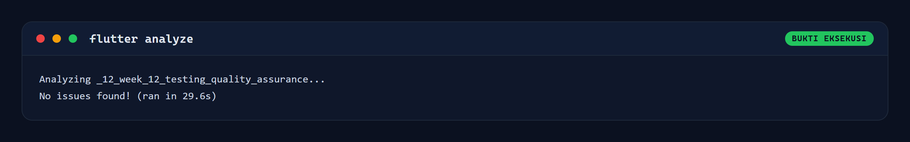

*Gambar 7.1 `flutter analyze` selesai tanpa satu pun temuan.*

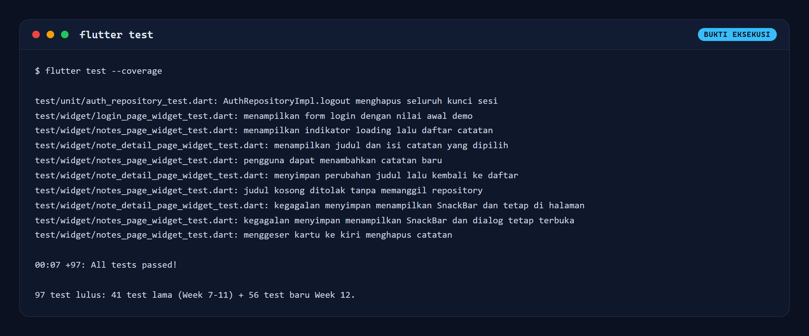

*Gambar 7.2 `flutter test` menjalankan 97 test dan seluruhnya lulus.*

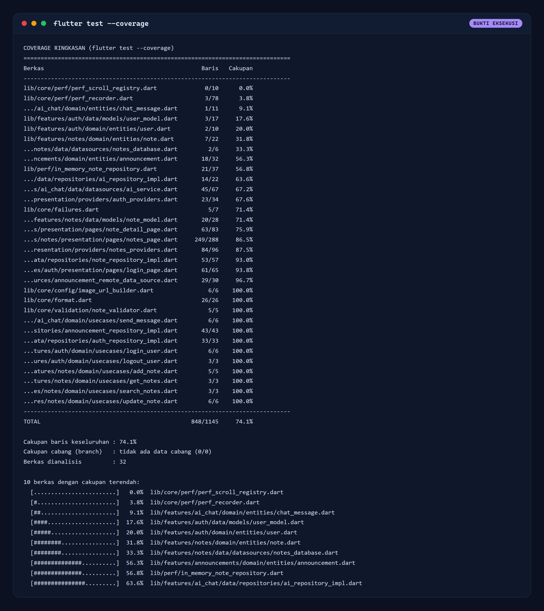

*Gambar 7.3 Cakupan per berkas, total 848 dari 1145 baris atau 74,1 persen.*

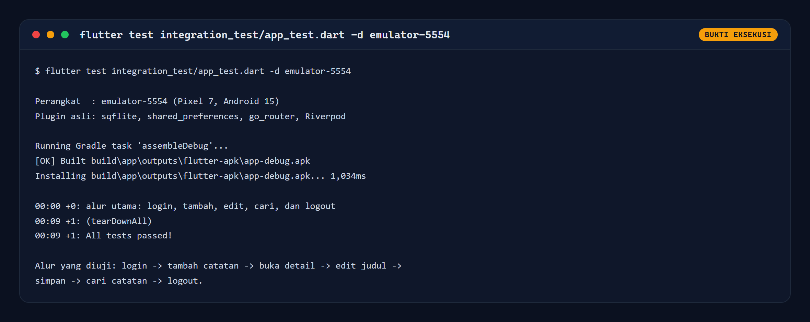

*Gambar 7.4 Integration test alur utama lulus pada emulator-5554 (Pixel 7).*

#### 7.5.2 Tampilan aplikasi pada emulator

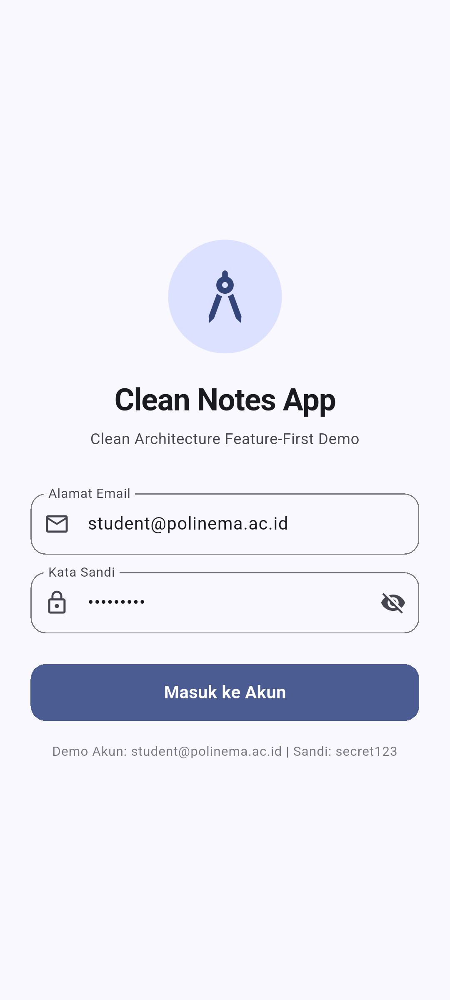

*Gambar 7.5 Halaman login dengan akun demo yang sudah terisi.*

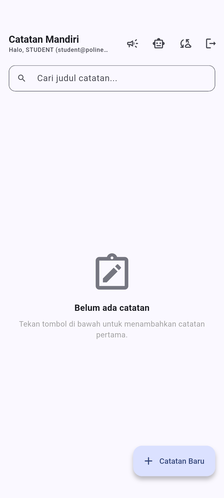

*Gambar 7.6 Daftar catatan masih kosong setelah login pertama.*

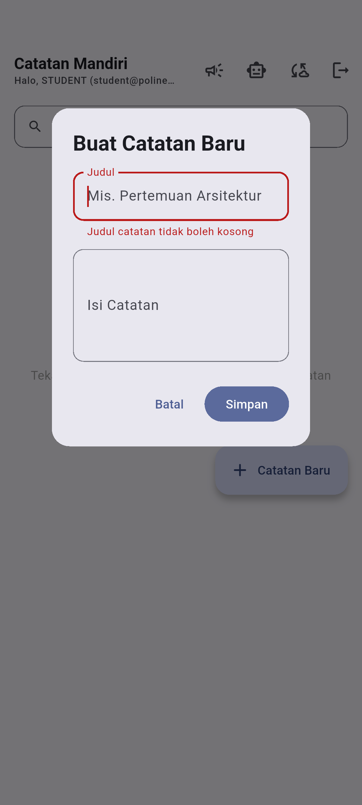

*Gambar 7.7 Validasi judul kosong tampil langsung di dalam form, dialog tetap terbuka.*


*Gambar 7.8 Form tambah catatan terisi judul dan isi.*

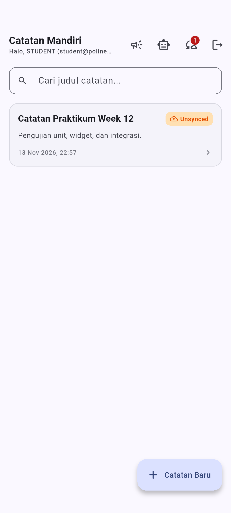

*Gambar 7.9 Catatan baru tersimpan dan tampil dengan penanda Unsynced.*

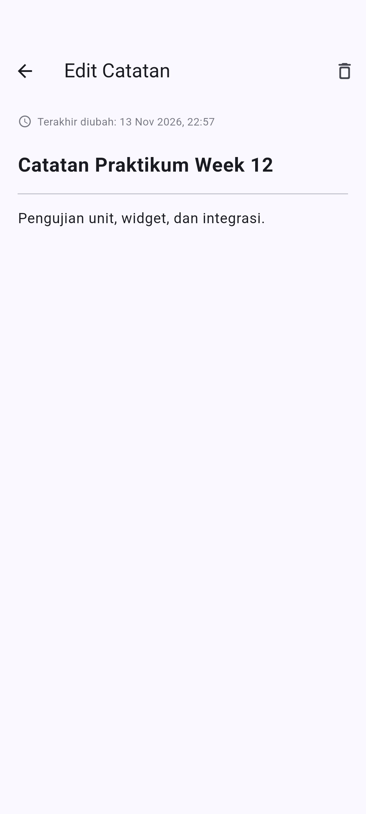

*Gambar 7.10 Halaman detail catatan dalam mode edit.*

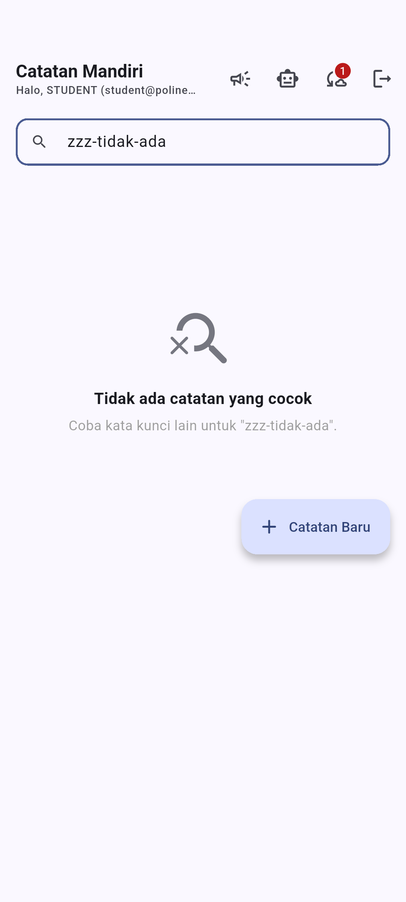

*Gambar 7.11 Empty state saat pencarian tidak menemukan catatan.*

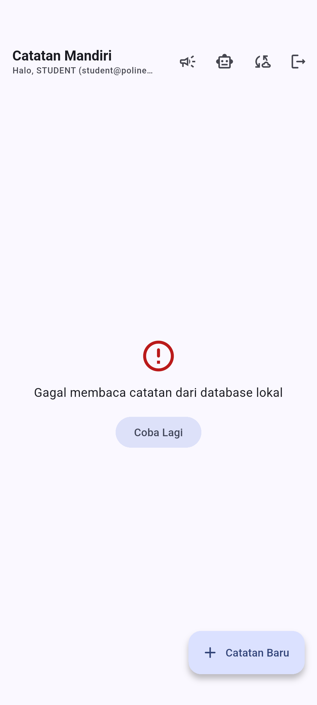

*Gambar 7.12 Keadaan error saat database gagal dibaca, lengkap dengan tombol Coba Lagi.*

---

## 8. Bug yang Ditemukan

### 8.1 Wildcard `LIKE` membuat pencarian mengembalikan semua catatan

Test `searchNotes memperlakukan wildcard LIKE sebagai teks biasa` gagal pada
percobaan pertama. Mencari karakter `%` mengembalikan seluruh catatan, padahal
seharusnya hanya judul yang memuat `%`.

Penyebabnya, parameter binding memang mencegah injeksi SQL, tetapi tidak
mengubah makna wildcard di dalam klausa `LIKE`. Perbaikannya adalah escape
karakter khusus:

```dart
final escaped = trimmed
    .replaceAll(r'\', r'\\')
    .replaceAll('%', r'\%')
    .replaceAll('_', r'\_');
final rows = await db.query(
  'notes',
  where: "title LIKE ? ESCAPE '\\'",
  whereArgs: ['%$escaped%'],
  orderBy: 'updated_at DESC',
  limit: 100,
);
```

Bug ini tidak akan pernah muncul saat pengujian manual dengan kata kunci
biasa. Nilai test di sini jelas: **kasus tepi menemukan cacat yang tidak
terlihat pada jalur normal**.

### 8.2 Dialog tertutup saat penyimpanan gagal

Widget test `kegagalan menyimpan menampilkan SnackBar dan dialog tetap terbuka`
mengungkap bahwa dialog langsung tertutup meski penyimpanan gagal. Pengguna
kehilangan teks yang sudah diketik. Perbaikan: `Navigator.pop()` hanya
dipanggil saat berhasil.

---

## 9. Kendala dan Cara Mengatasinya

| # | Kendala | Solusi |
| :--- | :--- | :--- |
| 1 | `sqflite` tidak berjalan di Dart VM, sehingga repository SQL tidak dapat diuji dengan `flutter test` | Menambahkan `sqflite_common_ffi` dan memakai database di memori |
| 2 | `SharedPreferences` butuh plugin platform | Memakai `SharedPreferences.setMockInitialValues({})` bawaan paket |
| 3 | Integration test gagal karena dialog masih beranimasi saat `enterText` | Menambahkan helper `settle()` yang memompa 700 ms sebelum interaksi |
| 4 | `pumpAndSettle` menggantung pada perangkat karena indikator loading beranimasi | Mengganti dengan `pumpUntilFound` yang memompa frame sampai kondisi terpenuhi |
| 5 | `flutter drive` keluar dengan kode 1 karena `convertFlutterSurfaceToImage` tidak didukung penuh di emulator | Screenshot tetap tersimpan. Bukti kelulusan diambil dari `flutter test ... -d emulator-5554` yang keluar dengan kode 0 |
| 6 | Build Gradle pertama memakan waktu 224 detik | Hanya terjadi sekali. Build berikutnya sekitar 31 detik |
| 7 | Cakupan awal hanya 65,4 % | Menambahkan test SQL asli dan repository autentikasi, naik menjadi 74,1 % |

---

## 10. Refleksi

### 10.1 Bug apa yang paling mungkin terlewat tanpa pengujian yang ditulis?

Bug wildcard `LIKE` pada pencarian. Saat menguji manual, pengguna mengetik kata
seperti "rapat" atau "belajar", dan semuanya bekerja. Karakter `%` hampir tidak
pernah diketik. Tanpa test yang sengaja memasukkan `%`, cacat ini akan terus
ada sampai suatu hari ada pengguna yang mencari simbol persen dan mendapat
seluruh isi database.

Bug kedua, dialog yang tertutup saat penyimpanan gagal, juga sulit ditemukan
manual karena memerlukan kondisi penyimpanan yang gagal. Dengan fake
repository, kondisi itu cukup satu baris: `addFailure: const LocalFailure(...)`.

### 10.2 Bagian mana yang perlu fake, dan bagaimana fake membuat pengujian lebih konsisten?

Yang perlu fake adalah seluruh batas sistem: repository catatan (SQLite),
repository autentikasi (`shared_preferences`), dan layanan AI (HTTP).

Fake membuat pengujian konsisten karena tiga hal:

1. **Deterministik.** Tidak ada database sisa run sebelumnya, tidak ada
   jaringan yang tiba-tiba lambat.
2. **Jalur gagal dapat dipaksa.** Kondisi seperti "database terkunci" atau
   "disk penuh" tidak perlu dibuat sungguhan.
3. **Cepat.** 56 test Week 12 selesai dalam sekitar 13 detik, karena tidak ada
   I/O disk maupun plugin.

Fake juga memungkinkan pemeriksaan negatif: `expect(repo.addCalls, 0)`
membuktikan validasi benar benar menahan akses ke database.

### 10.3 Apa perbedaan nilai pengujian widget dan pengujian integrasi pada fitur ini?

**Widget test** memberi nilai pada kecepatan dan ketepatan diagnosis. Saat
dialog gagal tertutup, widget test menunjuk langsung ke `AddNoteDialog` dan
baris yang salah. Widget test juga dapat mensimulasikan keadaan yang sulit
dibuat di perangkat, seperti error database dan loading yang diperpanjang.

**Integration test** memberi nilai pada kejujuran. Widget test memakai fake,
sehingga tidak pernah membuktikan bahwa SQLite benar benar menulis, bahwa sesi
login benar benar tersimpan di perangkat, dan bahwa go_router benar benar
berpindah halaman. Integration test membuktikan rantai itu utuh: catatan yang
dibuat benar benar masuk ke `clean_notes.db`, muncul setelah halaman dimuat
ulang, dan hilang setelah logout.

Keduanya tidak saling menggantikan. Widget test memberi umpan balik cepat saat
mengembangkan fitur, sedangkan integration test memberi keyakinan sebelum
mengirim perubahan.

### 10.4 Apakah cakupan 74,1 % sudah cukup?

Belum tentu. Angka itu hanya berarti 74,1 % baris dijalankan. Yang lebih
penting adalah bahwa semua use case domain mencapai 100 % dan seluruh cabang
penting punya test. Sebaliknya, ada berkas 0 % yang tidak menjadi masalah
karena memang bukan bagian alur pengguna (`lib/core/perf/`).

Kalau harus memilih, menambah test untuk cabang `deleteNote` di halaman detail
(sekarang 75,9 %) lebih bernilai daripada mengejar berkas instrumentasi
performa hanya demi menaikkan persentase.

---

## 11. Kesimpulan

1. Pengujian berhasil dijalankan pada tiga lapis: **97 test unit dan widget
   lulus**, serta **1 integration test lulus** pada emulator Pixel 7 dengan
   SQLite dan `shared_preferences` asli.
2. `flutter analyze` bersih tanpa satu pun warning.
3. Cakupan kode mencapai **74,1 %** baris, dengan seluruh use case domain
   tercakup penuh.
4. Pengujian menemukan **dua bug nyata**: wildcard `LIKE` pada pencarian dan
   dialog yang tertutup saat penyimpanan gagal. Keduanya sudah diperbaiki dan
   diverifikasi ulang oleh test yang sama.
5. Memisahkan validasi menjadi fungsi murni dan memindahkan dialog menjadi
   widget tersendiri terbukti bukan sekadar persiapan test, tetapi perbaikan
   desain yang juga meningkatkan pengalaman pengguna.

---

## 12. Lampiran

### 12.1 Perintah yang digunakan

```bash
flutter pub get
flutter analyze
flutter test --coverage
node tool/qa/coverage_summary.mjs
flutter test integration_test/app_test.dart -d emulator-5554
flutter drive --driver=test_driver/integration_test.dart \
  --target=integration_test/qa_screens_test.dart -d emulator-5554
flutter drive --driver=test_driver/integration_test.dart \
  --target=integration_test/qa_error_screen_test.dart -d emulator-5554
node tool/qa/render.mjs
```

### 12.2 Berkas keluaran mentah

| Berkas | Isi |
| :--- | :--- |
| `tool/qa/results/analyze.txt` | Keluaran `flutter analyze` |
| `tool/qa/results/test.txt` | Ringkasan `flutter test` |
| `tool/qa/results/test-full.txt` | Keluaran lengkap seluruh test |
| `tool/qa/results/coverage.txt` | Tabel cakupan per berkas |
| `tool/qa/results/coverage.json` | Data cakupan terstruktur |
| `tool/qa/results/integration_test.txt` | Keluaran integration test |

### 12.3 Daftar berkas pengujian

```
test/
├── support/fakes.dart
├── unit/
│   ├── note_validator_test.dart
│   ├── note_usecases_test.dart
│   ├── note_repository_sqlite_test.dart
│   └── auth_repository_test.dart
├── widget/
│   ├── notes_page_widget_test.dart
│   ├── login_page_widget_test.dart
│   └── note_detail_page_widget_test.dart
└── (9 berkas test Week 7-11)

integration_test/
├── app_test.dart
├── qa_screens_test.dart
└── qa_error_screen_test.dart

test_driver/
└── integration_test.dart
```
