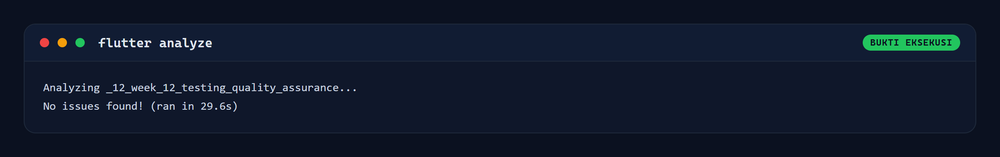
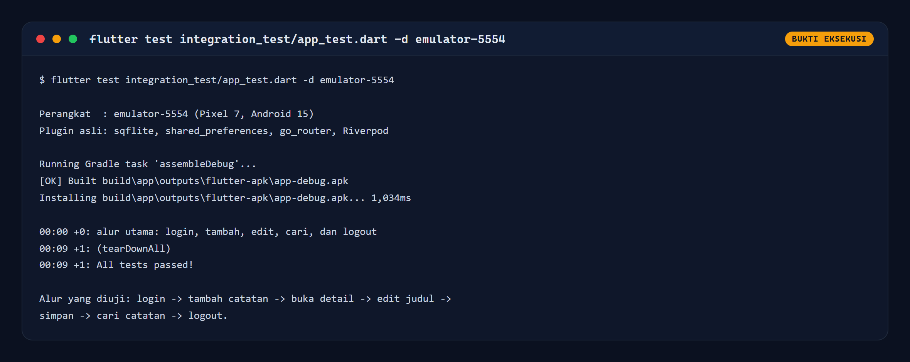
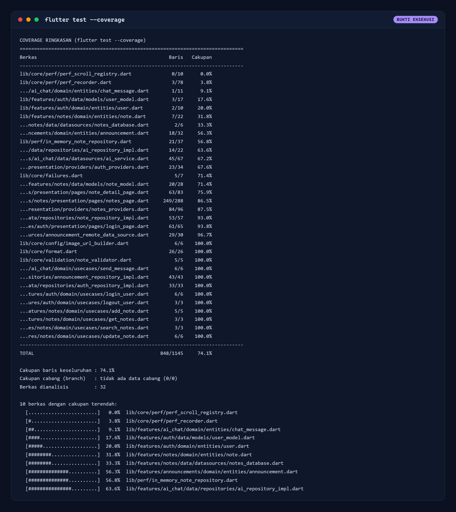

# Week 12: Testing & Quality Assurance

**Mata Kuliah:** Pemrograman Mobile
**Nama:** Mokhamad Rizki Hadiono Singgih
**NIM:** 244107020198
**Kelas:** TI-3G
**Prodi:** D-IV Teknik Informatika, Politeknik Negeri Malang

---

## Ringkasan

Folder ini adalah kelanjutan proyek catatan dari Week 11, dengan fokus baru:
**pengujian dan jaminan kualitas**. Pekerjaan yang dilakukan:

1. Memisahkan aturan validasi judul catatan menjadi fungsi murni
   (`lib/core/validation/note_validator.dart`) yang dipakai bersama oleh
   lapisan domain dan presentasi.
2. Menambah **fake repository** yang dapat dikendalikan penuh oleh test
   (sukses, gagal, dan jeda buatan).
3. Menulis **56 test baru** di tiga lapis: unit, widget, dan integrasi.
4. Menjalankan seluruh pemeriksaan pada mesin dan perangkat nyata, lalu
   menyimpan keluaran aslinya di `tool/qa/results/`.
5. Mengukur cakupan kode dan mencatat temuan, termasuk **satu bug nyata**
   yang ditemukan oleh test.

### Hasil utama

| Pemeriksaan | Perintah | Hasil |
| :--- | :--- | :--- |
| Analisis statis | `flutter analyze` | `No issues found!` |
| Test unit + widget | `flutter test` | **97 test lulus** (0 gagal) |
| Cakupan kode | `flutter test --coverage` | **74,1 %** baris (848/1145) |
| Test integrasi | `flutter test integration_test/app_test.dart -d emulator-5554` | **1 test lulus** di Pixel 7 |

|  |  |
| :---: | :---: |
| **flutter analyze** bersih | **Integration test** lulus di emulator |

Tabel cakupan lengkap: 

---

## Ketentuan codelab yang dipenuhi

| Ketentuan codelab | Implementasi | Bukti |
| :--- | :--- | :--- |
| Catat minimal 3 skenario, termasuk kasus tepi dan kegagalan | **24 skenario** terdokumentasi di [`docs/qa-strategy.md`](docs/qa-strategy.md) | § Ringkasan skenario di bawah |
| Unit test untuk validasi atau aturan bisnis, dikelompokkan `group` | `test/unit/note_validator_test.dart`, `note_usecases_test.dart`, `note_repository_sqlite_test.dart`, `auth_repository_test.dart` | `test/unit/` |
| Pisahkan akses data lewat repository + fake untuk sukses dan error | `NoteRepository` (abstrak) + `FakeNoteRepository` dengan `fetchFailure`, `addFailure`, dan `latency` | `test/support/fakes.dart` |
| Widget test: tampilan awal, input tidak valid, aksi sukses | 16 widget test di `test/widget/` | `test/widget/` |
| Satu integration test alur utama | `integration_test/app_test.dart` (login, tambah, edit, cari, logout) | `screenshots/qa-integration-test.png` |
| `flutter test`, `flutter test --coverage`, `flutter analyze` | Semua dijalankan dan lulus | `tool/qa/results/` |
| Catat skenario, hasil, dan temuan di `README.md` | Dokumen ini + [`docs/test-report.md`](docs/test-report.md) | § Temuan |
| Screenshot hasil | 8 screenshot UI perangkat + 4 render keluaran alat | `screenshots/` |

---

## Ringkasan skenario

**24 skenario** ditulis lengkap di [`docs/qa-strategy.md`](docs/qa-strategy.md).
Tabel berikut merangkumnya per kelompok.

| # | Skenario | Jenis | Kasus |
| :--- | :--- | :--- | :--- |
| 1 | Judul catatan berisi teks valid | Unit | Sukses |
| 2 | Judul kosong atau hanya spasi | Unit | Kegagalan |
| 3 | Judul tepat 120 karakter dan 121 karakter | Unit | Kasus tepi (batas) |
| 4 | Repository mengembalikan daftar catatan | Unit | Sukses |
| 5 | Repository gagal membaca database | Unit | Kegagalan |
| 6 | Pagination `limit`/`offset` di SQLite asli | Unit | Sukses |
| 7 | Query pencarian berisi `%` dan `_` | Unit | Kasus tepi (wildcard) |
| 8 | Update atau hapus id yang tidak ada | Unit | Kegagalan |
| 9 | Login dengan kata sandi salah | Unit + Widget | Kegagalan |
| 10 | Daftar kosong saat belum ada catatan | Widget | Kasus tepi (empty state) |
| 11 | Error lalu pulih setelah tombol Coba Lagi | Widget | Kegagalan dan pemulihan |
| 12 | Tambah catatan dengan judul kosong | Widget | Kegagalan validasi |
| 13 | Geser kartu untuk menghapus catatan | Widget | Sukses |
| 14 | Alur utama login sampai logout di perangkat | Integrasi | Sukses end to end |

---

## Inventaris test

| Berkas | Jumlah | Yang dibuktikan |
| :--- | ---: | :--- |
| `test/unit/note_validator_test.dart` | 9 | Aturan judul: trim, kosong, batas 120, unicode |
| `test/unit/note_usecases_test.dart` | 10 | Use case dengan fake repository, termasuk jalur gagal |
| `test/unit/note_repository_sqlite_test.dart` | 13 | SQL asli: query, urutan, pagination, escape wildcard, error |
| `test/unit/auth_repository_test.dart` | 8 | Sesi login, logout, dan kegagalan penyimpanan |
| `test/widget/notes_page_widget_test.dart` | 7 | Loading, kosong, error + retry, tambah, validasi, hapus |
| `test/widget/login_page_widget_test.dart` | 5 | Validasi email/sandi, kegagalan server, keadaan loading |
| `test/widget/note_detail_page_widget_test.dart` | 4 | Tampilan awal, simpan sukses, judul kosong, gagal simpan |
| `integration_test/app_test.dart` | 1 | Alur utama end to end pada emulator |
| **Test lama Week 7-11 (9 berkas)** | **41** | Regresi fitur sebelumnya tetap terjaga |
| **Total** | **97** | Semua lulus |

---

## Temuan: bug yang ditemukan oleh test

Test `searchNotes memperlakukan wildcard LIKE sebagai teks biasa` **gagal**
pada percobaan pertama. Penelusurannya:

| Tahap | Kondisi |
| :--- | :--- |
| Perilaku yang diharapkan | Mencari `%` hanya menemukan judul yang memuat karakter `%` |
| Perilaku nyata | Mencari `%` mengembalikan **seluruh** catatan |
| Penyebab | `where: 'title LIKE ?'` dengan `whereArgs: ['%$query%']`. Parameter binding memang mencegah injeksi SQL, tetapi `%` dan `_` tetap bermakna wildcard di dalam `LIKE` |
| Perbaikan | Karakter `\`, `%`, dan `_` di-escape sebelum masuk ke pola, lalu klausa memakai `ESCAPE '\'` |
| Berkas | `lib/features/notes/data/repositories/note_repository_impl.dart` |

Perbaikan ini diverifikasi ulang oleh test yang sama: judul `Diskon 50% Spesial`
ditemukan, sementara `_` tidak lagi mencocokkan semua baris.

---

## Temuan yang belum terselesaikan

| # | Temuan | Dampak | Rencana |
| :--- | :--- | :--- | :--- |
| 1 | `lib/core/perf/perf_recorder.dart` hanya 3,8 % tercakup | Instrumentasi performa Week 11 tidak diuji | Sengaja dilewati: kode ini hanya aktif saat `PERF_MODE=true` dan bergantung pada `dart:js_interop` |
| 2 | `lib/core/perf/perf_scroll_registry.dart` 0 % | Sama seperti di atas | Sama seperti di atas |
| 3 | `lib/features/ai_chat/**` sebagian belum tercakup | Panggilan Gemini butuh API key dan jaringan | Diuji terpisah lewat `test/ai_chat_test.dart` dengan klien tiruan, tidak di jaringan nyata |
| 4 | `notes_database.dart` 33,3 % | Fungsi `openNotesDb()` memakai `getDatabasesPath()` milik plugin | Terbukti jalan lewat integration test di emulator, tidak lewat unit test |
| 5 | Belum ada golden test untuk tampilan | Perubahan visual tidak terdeteksi otomatis | Di luar cakupan codelab Week 12 |

Angka cakupan dipakai sebagai **petunjuk**, bukan target. Berkas yang rendah
bukan otomatis berarti berisiko: sebagian memang tidak dapat diuji tanpa
perangkat atau jaringan.

---

## Struktur folder

```
lib/
├── core/
│   ├── validation/note_validator.dart   # BARU: aturan judul, satu sumber kebenaran
│   └── (format, failures, perf, widgets dari Week 11)
├── features/
│   ├── auth/                            # login, sesi, logout
│   ├── notes/
│   │   ├── data/repositories/           # SQL + escape wildcard LIKE (diperbaiki)
│   │   ├── domain/usecases/             # AddNote memakai note_validator
│   │   └── presentation/pages/          # AddNoteDialog dipisah + Key stabil
│   ├── announcements/                   # dari Week 11
│   └── ai_chat/                         # dari Week 11
└── main.dart

test/
├── support/fakes.dart                   # BARU: fake repository + fake auth
├── unit/                                # BARU: 40 test unit
├── widget/                              # BARU: 16 widget test
└── (9 berkas test lama Week 7-11)

integration_test/
├── app_test.dart                        # alur utama di perangkat
├── qa_screens_test.dart                 # screenshot UI perangkat
└── qa_error_screen_test.dart            # screenshot keadaan error

test_driver/integration_test.dart        # penyimpan screenshot flutter drive

tool/qa/
├── coverage_summary.mjs                 # ringkasan lcov.info per berkas
├── render.mjs                           # render keluaran alat jadi PNG
└── results/                             # keluaran mentah perintah Flutter
```

---

## Cara menjalankan

```bash
flutter pub get

# 1. Analisis statis
flutter analyze

# 2. Seluruh test unit + widget, sekaligus mengukur cakupan
flutter test --coverage

# 3. Ringkasan cakupan per berkas
node tool/qa/coverage_summary.mjs

# 4. Test integrasi pada emulator/perangkat
flutter test integration_test/app_test.dart -d emulator-5554

# 5. Screenshot UI dari perangkat
flutter drive --driver=test_driver/integration_test.dart \
  --target=integration_test/qa_screens_test.dart -d emulator-5554

# 6. Render keluaran alat menjadi gambar
node tool/qa/render.mjs

# 7. Aplikasi normal
flutter run
```

Catatan: `flutter drive` melaporkan exit code 1 setelah semua test lulus pada
konfigurasi ini, karena `convertFlutterSurfaceToImage()` tidak didukung penuh
di emulator. Screenshot tetap tersimpan dengan benar di `screenshots/`.

---

## Screenshot

### UI aplikasi pada emulator

| # | File | Keterangan |
| :--- | :--- | :--- |
| 1 | `screenshots/01-login-page.png` | Halaman login dengan akun demo |
| 2 | `screenshots/02-notes-list.png` | Daftar catatan kosong (empty state) |
| 3 | `screenshots/03-validation-error.png` | Validasi judul kosong tampil di dalam form |
| 4 | `screenshots/04-add-note-form.png` | Form tambah catatan terisi |
| 5 | `screenshots/05-note-added.png` | Catatan baru tampil dengan badge Unsynced |
| 6 | `screenshots/06-note-detail.png` | Halaman detail catatan |
| 7 | `screenshots/07-search-empty-state.png` | Hasil pencarian kosong |
| 8 | `screenshots/08-error-state.png` | Keadaan error dengan tombol Coba Lagi |

### Bukti eksekusi alat

| # | File | Keterangan |
| :--- | :--- | :--- |
| 9 | `screenshots/qa-analyze.png` | `flutter analyze`: No issues found |
| 10 | `screenshots/qa-flutter-test.png` | `flutter test`: 97 test lulus |
| 11 | `screenshots/qa-coverage.png` | Cakupan per berkas, total 74,1 % |
| 12 | `screenshots/qa-integration-test.png` | Integration test lulus di emulator-5554 |

Semua screenshot UI diambil dari aplikasi yang benar benar berjalan di
emulator Pixel 7 melalui `flutter drive`, bukan mockup.

---

## Dokumentasi pendukung

- [`docs/qa-strategy.md`](docs/qa-strategy.md): pemilihan jenis test, daftar
  skenario, dan alasan bagian yang sengaja tidak diuji.
- [`docs/test-report.md`](docs/test-report.md): hasil eksekusi, analisis
  cakupan, bukti visual, bug yang ditemukan, dan batasan.
- [`Laporan-Praktikum-Week-12.md`](Laporan-Praktikum-Week-12.md): laporan
  praktikum lengkap dengan refleksi dan seluruh screenshot.
- [`tool/qa/results/`](tool/qa/results/): keluaran mentah `flutter analyze`,
  `flutter test`, dan integration test.
