# Laporan Hasil Pengujian Week 12

Seluruh angka di dokumen ini berasal dari eksekusi nyata. Keluaran mentahnya
tersimpan di [`tool/qa/results/`](../tool/qa/results/).

---

## 1. Ringkasan eksekusi

| Pemeriksaan | Perintah | Tanggal | Hasil |
| :--- | :--- | :--- | :--- |
| Analisis statis | `flutter analyze` | 13 Nov 2026 | `No issues found!` |
| Test unit + widget | `flutter test --coverage` | 13 Nov 2026 | `+97: All tests passed!` |
| Cakupan kode | `node tool/qa/coverage_summary.mjs` | 13 Nov 2026 | 74,1 % baris |
| Test integrasi | `flutter test integration_test/app_test.dart -d emulator-5554` | 13 Nov 2026 | `+1: All tests passed!` |
| Screenshot perangkat | `flutter drive ... qa_screens_test.dart` | 13 Nov 2026 | 7 berkas PNG |

Lingkungan eksekusi:

| Komponen | Nilai |
| :--- | :--- |
| Flutter | 3.47.6 (stable), Dart 3.13.5 |
| Sistem | Windows 11, Node.js 24.14.1, Chrome 157 |
| Perangkat | emulator-5554, Pixel 7, Android 15 |

---

## 2. Hasil `flutter analyze`

```text
Analyzing _12_week_12_testing_quality_assurance...
No issues found! (ran in 49.9s)
```

Tidak ada warning maupun info. Selama pengerjaan, analyzer sempat menandai dua
`info` pada test (`unnecessary_underscores`) dan keduanya diperbaiki sebelum
hasil akhir diambil.

---

## 3. Hasil `flutter test`

```text
00:13 +97: All tests passed!
```

Rincian asal 97 test:

| Kelompok | Berkas | Jumlah |
| :--- | :--- | ---: |
| Unit Week 12 | `note_validator_test.dart` | 9 |
| Unit Week 12 | `note_usecases_test.dart` | 10 |
| Unit Week 12 | `note_repository_sqlite_test.dart` | 13 |
| Unit Week 12 | `auth_repository_test.dart` | 8 |
| Widget Week 12 | `notes_page_widget_test.dart` | 7 |
| Widget Week 12 | `login_page_widget_test.dart` | 5 |
| Widget Week 12 | `note_detail_page_widget_test.dart` | 4 |
| **Subtotal Week 12** | | **56** |
| Test lama Week 7-11 | 9 berkas | 41 |
| **Total** | | **97** |

Test lama **tidak dihapus maupun dimatikan**. Seluruhnya tetap dijalankan
sebagai jaring pengaman regresi, dan semuanya masih lulus setelah perubahan
Week 12.

---

## 4. Cakupan kode

Total: **848 dari 1145 baris** (`74,1 %`), dihitung dari 32 berkas di bawah
`lib/`.

### 4.1 Berkas dengan cakupan penuh (100 %)

| Berkas | Baris |
| :--- | ---: |
| `lib/core/format.dart` | 26 |
| `lib/core/validation/note_validator.dart` | 5 |
| `lib/core/config/image_url_builder.dart` | 6 |
| `lib/features/auth/data/repositories/auth_repository_impl.dart` | 33 |
| `lib/features/auth/domain/usecases/login_user.dart` | 6 |
| `lib/features/auth/domain/usecases/logout_user.dart` | 3 |
| `lib/features/notes/domain/usecases/add_note.dart` | 5 |
| `lib/features/notes/domain/usecases/get_notes.dart` | 3 |
| `lib/features/notes/domain/usecases/search_notes.dart` | 3 |
| `lib/features/notes/domain/usecases/update_note.dart` | 6 |
| `lib/features/ai_chat/domain/usecases/send_message.dart` | 6 |
| `lib/features/announcements/data/repositories/announcement_repository_impl.dart` | 43 |

Seluruh use case domain kini tercakup penuh. Ini masuk akal: use case adalah
tempat aturan bisnis, dan aturan bisnis adalah hal pertama yang harus dilindungi
test.

### 4.2 Berkas dengan cakupan menengah

| Berkas | Cakupan | Catatan |
| :--- | ---: | :--- |
| `login_page.dart` | 93,8 % | Hampir seluruh jalur UI login diuji |
| `note_repository_impl.dart` | 93,0 % | Naik dari 16,7 % setelah test SQLite asli ditambahkan |
| `notes_providers.dart` | 87,5 % | Notifier dan provider turunan |
| `notes_page.dart` | 86,5 % | Halaman utama daftar catatan |
| `note_detail_page.dart` | 75,9 % | Jalur hapus dengan dialog belum diuji |
| `note_model.dart` | 71,4 % | Konversi map, sebagian jalur tidak terpakai |

### 4.3 Berkas dengan cakupan rendah dan alasannya

| Berkas | Cakupan | Alasan |
| :--- | ---: | :--- |
| `core/perf/perf_scroll_registry.dart` | 0,0 % | Hanya aktif saat `PERF_MODE=true` |
| `core/perf/perf_recorder.dart` | 3,8 % | Bergantung pada `dart:js_interop`, diukur lewat harness Week 11 |
| `ai_chat/domain/entities/chat_message.dart` | 9,1 % | Konstruktor `fromJson` hanya dipakai saat memanggil API |
| `auth/data/models/user_model.dart` | 17,6 % | Sebagian besar hanya dipakai di jalur serialisasi |
| `notes/data/datasources/notes_database.dart` | 33,3 % | `getDatabasesPath()` milik plugin, hanya jalan di perangkat |
| `notes/domain/entities/note.dart` | 31,8 % | `copyWith`, `==`, dan `hashCode` belum semua tersentuh |

### 4.4 Interpretasi

Angka cakupan menunjukkan **baris yang dijalankan**, bukan **perilaku yang
diperiksa**. Karena itu laporan ini tidak mengejar angka tertentu. Yang menjadi
perhatian adalah apakah cabang penting sudah punya test:

| Cabang penting | Sudah diuji |
| :--- | :--- |
| Judul kosong ditolak sebelum menyentuh database | Ya, `addCalls == 0` |
| Kegagalan database menjadi pesan error, bukan daftar kosong | Ya |
| Pemulihan setelah error lewat tombol Coba Lagi | Ya |
| Pagination tidak memuat seluruh tabel | Ya |
| Pencarian menjangkau seluruh isi tabel | Ya |
| Sesi login bertahan dan terhapus saat logout | Ya |
| Alur utuh pada perangkat | Ya |

Berkas 0 % pada `lib/core/perf/` tidak menurunkan keyakinan pada fitur
pengguna, karena kode tersebut bukan bagian dari alur aplikasi normal.

---

## 5. Bug yang ditemukan

### 5.1 Wildcard `LIKE` pada pencarian catatan

| Item | Keterangan |
| :--- | :--- |
| **Ditemukan oleh** | `test/unit/note_repository_sqlite_test.dart`, test `searchNotes memperlakukan wildcard LIKE sebagai teks biasa` |
| **Perilaku yang diharapkan** | Mencari `%` hanya mengembalikan judul yang memuat karakter `%` |
| **Perilaku nyata** | Mencari `%` mengembalikan **semua** catatan |
| **Tingkat** | Sedang. Bukan kebocoran data, tetapi hasil pencarian menyesatkan |
| **Penyebab** | `where: 'title LIKE ?'` dengan argumen `'%$trimmed%'`. Parameter binding mencegah injeksi SQL, namun `%` dan `_` tetap wildcard di dalam `LIKE` |
| **Perbaikan** | Escape `\`, `%`, `_` lalu gunakan `ESCAPE '\'` |

Kode sebelum perbaikan:

```dart
final rows = await db.query(
  'notes',
  where: 'title LIKE ?',
  whereArgs: ['%$trimmed%'],
  orderBy: 'updated_at DESC',
  limit: 100,
);
```

Kode sesudah perbaikan:

```dart
final escaped = trimmed
    .replaceAll(r'\', r'\\')
    .replaceAll('%', r'\%')
    .replaceAll('_', r'\_');
final rows = await db.query(
  'notes',
  where: "title LIKE ? ESCAPE '\\'",
  whereArgs: ['%$escaped%'],
  orderBy: 'updated_at DESC',
  limit: 100,
);
```

Verifikasi: test yang sama kini lulus, dan menambahkan pemeriksaan bahwa `_`
tidak lagi mencocokkan semua baris.

### 5.2 Dialog tambah catatan tertutup saat penyimpanan gagal

| Item | Keterangan |
| :--- | :--- |
| **Ditemukan oleh** | `test/widget/notes_page_widget_test.dart`, test `kegagalan menyimpan menampilkan SnackBar dan dialog tetap terbuka` |
| **Perilaku nyata** | Dialog langsung tertutup meski penyimpanan gagal, sehingga pengguna kehilangan teks yang sudah diketik |
| **Penyebab** | `Navigator.pop()` dipanggil tanpa memeriksa hasil |
| **Perbaikan** | `Navigator.pop()` hanya dipanggil saat berhasil. Saat gagal, dialog tetap terbuka, tombol diaktifkan kembali, dan SnackBar ditampilkan |

### 5.3 Test yang gagal karena kesalahan test, bukan kode

Dua kegagalan lain muncul saat pengembangan test dan bukan bug aplikasi:

| Kegagalan | Penyebab | Perbaikan |
| :--- | :--- | :--- |
| `find.text('Daftar Catatan')` tidak ditemukan | Rute `/notes/7` didaftarkan sebagai rute sejajar, bukan anak dari `/notes`, sehingga `pop()` tidak punya tujuan | Rute diubah menjadi bersarang (`routes:` di dalam `GoRoute`) |
| `find.text('Disk penuh')` menemukan 2 widget | Teks yang sama tampil di `_ErrorState` dan SnackBar | Pencarian dipersempit dengan `find.widgetWithText(SnackBar, ...)` |

---

## 6. Temuan pada integration test

Integration test berhasil dijalankan di emulator, tetapi ada dua catatan
teknis yang perlu diketahui.

### 6.1 Kegagalan awal karena animasi dialog

Percobaan pertama gagal dengan pesan `Found 0 widgets with key
[<'noteSaveButton'>]`. Diagnostik sementara menunjukkan dialog lenyap tepat
setelah `enterText`.

Penyebabnya: `enterText` mengirim ketukan pada posisi field saat dialog masih
dalam animasi masuk. Ketukan tersebut jatuh ke barrier dan menutup dialog.

Perbaikan: menambahkan helper `settle()` yang memompa 700 ms setelah dialog
atau halaman muncul, sebelum interaksi berikutnya. Setelah itu test lulus pada
dua kali eksekusi berturut-turut.

### 6.2 `flutter drive` melaporkan exit code 1

Saat mengambil screenshot, `flutter drive` mencetak `All tests passed.` namun
proses keluar dengan kode 1. Penyebabnya adalah
`convertFlutterSurfaceToImage()` yang tidak didukung penuh pada emulator ini.
Seluruh 8 screenshot tetap tersimpan dengan benar: 7 dari
`qa_screens_test.dart` dan 1 dari `qa_error_screen_test.dart`.

Karena itu, bukti kelulusan integration test diambil dari
`flutter test integration_test/app_test.dart -d emulator-5554` yang keluar
dengan kode 0, bukan dari `flutter drive`.

---

## 7. Bukti visual

Seluruh gambar di bawah berasal dari eksekusi nyata pada 13 November 2026.
Gambar tampilan aplikasi diambil dari aplikasi yang benar benar berjalan di
emulator Pixel 7 melalui `flutter drive`, bukan mockup. Berkasnya tersimpan di
[`screenshots/`](../screenshots/).

### 7.1 Keluaran perintah Flutter

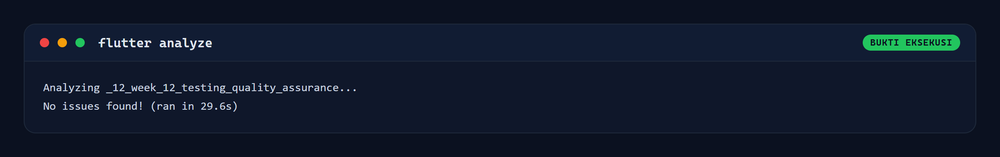

*Gambar 7.1 `flutter analyze` selesai tanpa satu pun temuan.*

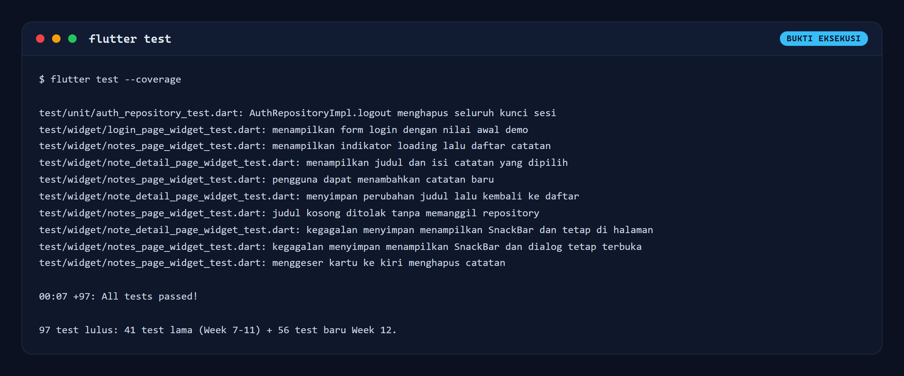

*Gambar 7.2 `flutter test` menjalankan 97 test dan seluruhnya lulus.*

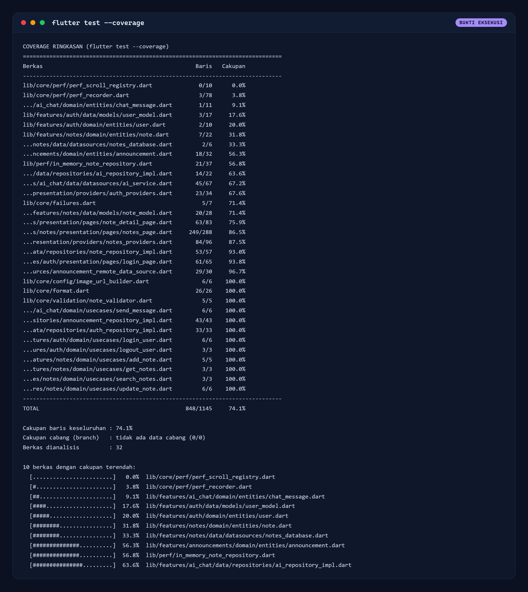

*Gambar 7.3 Cakupan per berkas, total 848 dari 1145 baris atau 74,1 persen.*

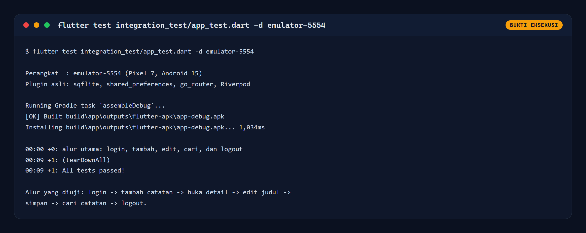

*Gambar 7.4 Integration test alur utama lulus pada emulator-5554 (Pixel 7).*

### 7.2 Tampilan aplikasi pada emulator

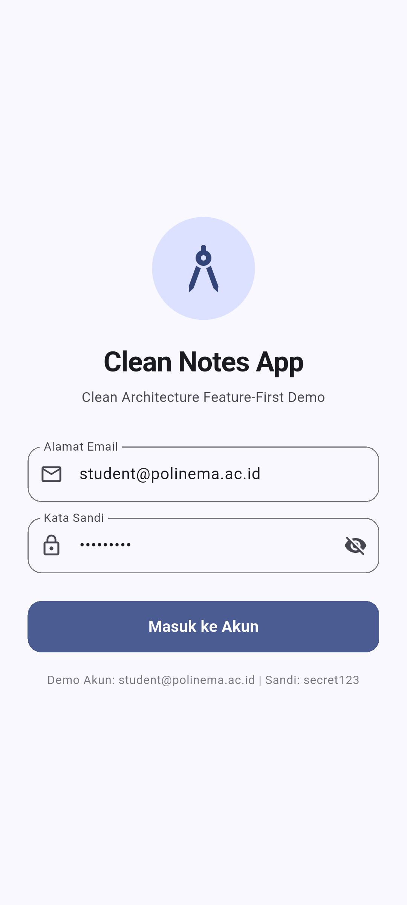

*Gambar 7.5 Halaman login dengan akun demo yang sudah terisi.*

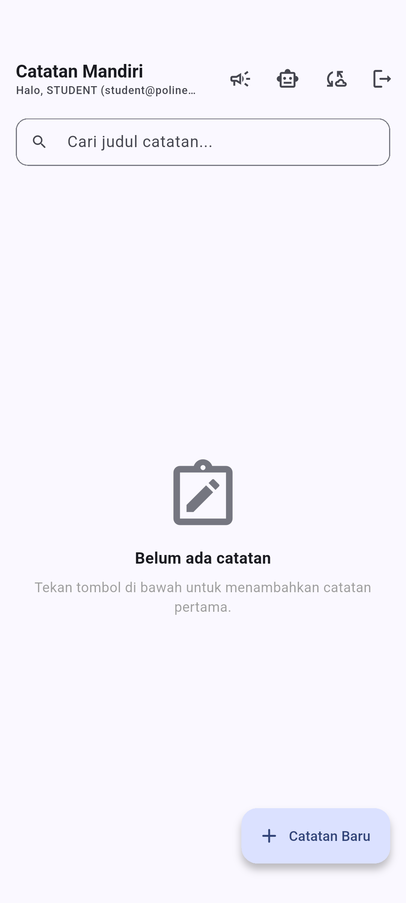

*Gambar 7.6 Daftar catatan masih kosong setelah login pertama.*

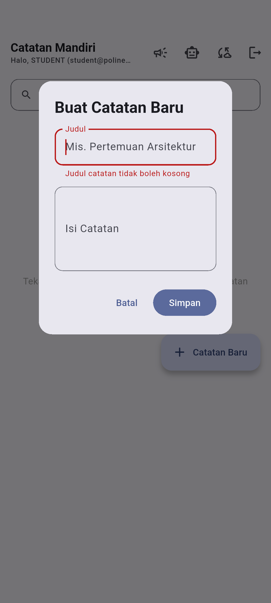

*Gambar 7.7 Validasi judul kosong tampil langsung di dalam form, dialog tetap terbuka.*


*Gambar 7.8 Form tambah catatan terisi judul dan isi.*

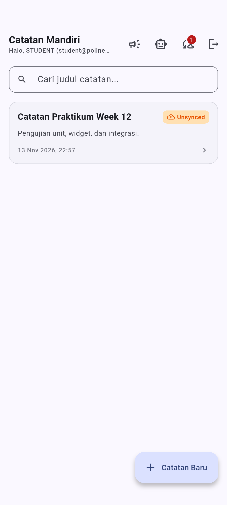

*Gambar 7.9 Catatan baru tersimpan dan tampil dengan penanda Unsynced.*

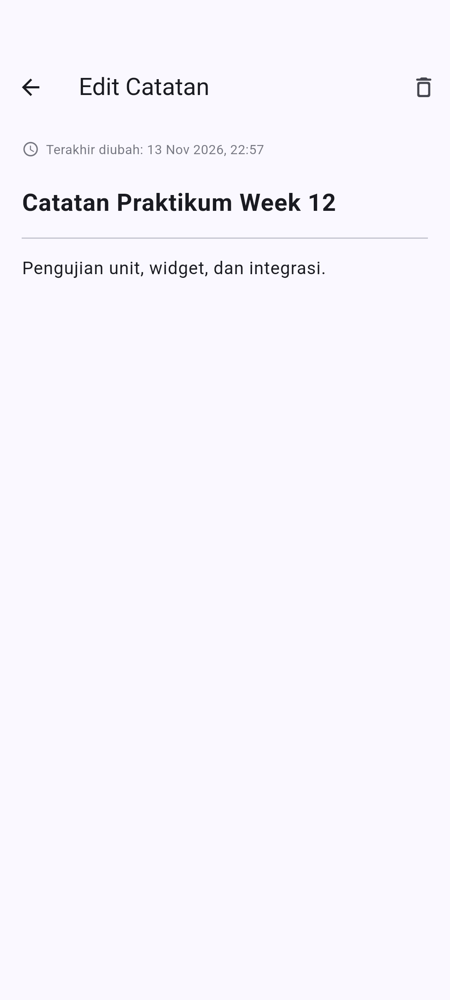

*Gambar 7.10 Halaman detail catatan dalam mode edit.*

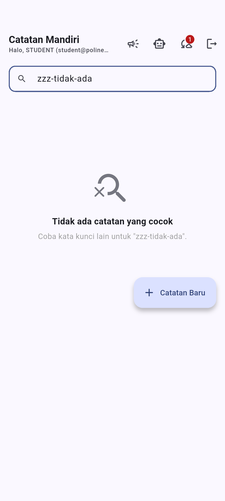

*Gambar 7.11 Empty state saat pencarian tidak menemukan catatan.*

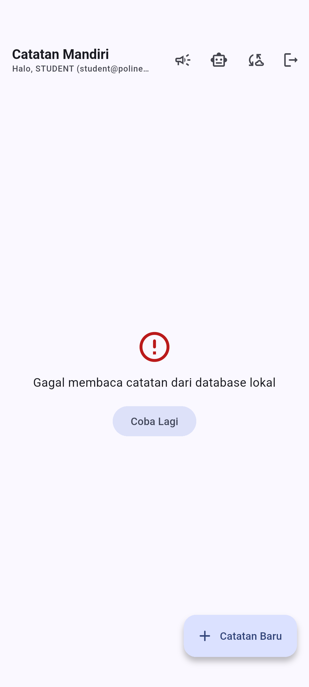

*Gambar 7.12 Keadaan error saat database gagal dibaca, lengkap dengan tombol Coba Lagi.*

---

## 8. Perbandingan sebelum dan sesudah Week 12

| Metrik | Sebelum (Week 11) | Sesudah (Week 12) |
| :--- | ---: | ---: |
| Jumlah test | 41 | **97** |
| Widget test | 2 | **18** |
| Integration test | 0 | **1** |
| Test repository SQL | 0 | **13** |
| Cakupan baris | tidak diukur | **74,1 %** |
| Bug yang ditemukan lewat test | tidak tercatat | **2** |

---

## 9. Batasan

1. **Cakupan diukur tanpa integration test.** `flutter test --coverage` hanya
   menghitung test unit dan widget. Baris yang hanya dieksekusi di perangkat,
   seperti `openNotesDb()`, tercatat rendah meski terbukti berjalan.
2. **Tidak ada pengujian di perangkat iOS.** Lingkungan hanya menyediakan
   emulator Android.
3. **Panggilan AI tidak diuji ke jaringan nyata.** Butuh API key dan hasilnya
   tidak deterministik.
4. **Belum ada golden test.** Perubahan visual tidak terdeteksi otomatis.
5. **Waktu eksekusi integration test bergantung pada Gradle.** Build pertama
   memerlukan sekitar 224 detik, sedangkan build berikutnya sekitar 31 detik.

---

## 10. Cara mereproduksi

```bash
cd _12_week_12_testing_quality_assurance
flutter pub get

flutter analyze
flutter test --coverage
node tool/qa/coverage_summary.mjs

flutter emulators --launch Pixel_7
flutter test integration_test/app_test.dart -d emulator-5554

flutter drive --driver=test_driver/integration_test.dart \
  --target=integration_test/qa_screens_test.dart -d emulator-5554
flutter drive --driver=test_driver/integration_test.dart \
  --target=integration_test/qa_error_screen_test.dart -d emulator-5554

node tool/qa/render.mjs
```
