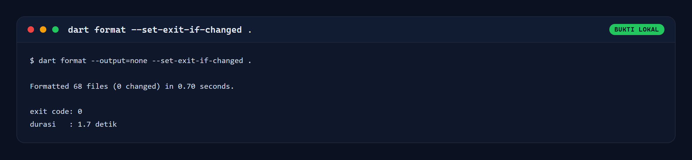
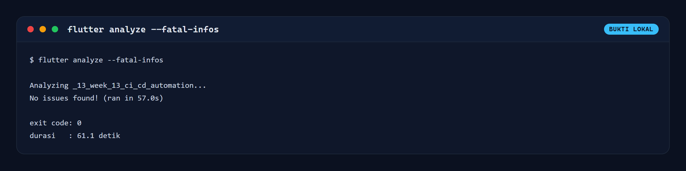
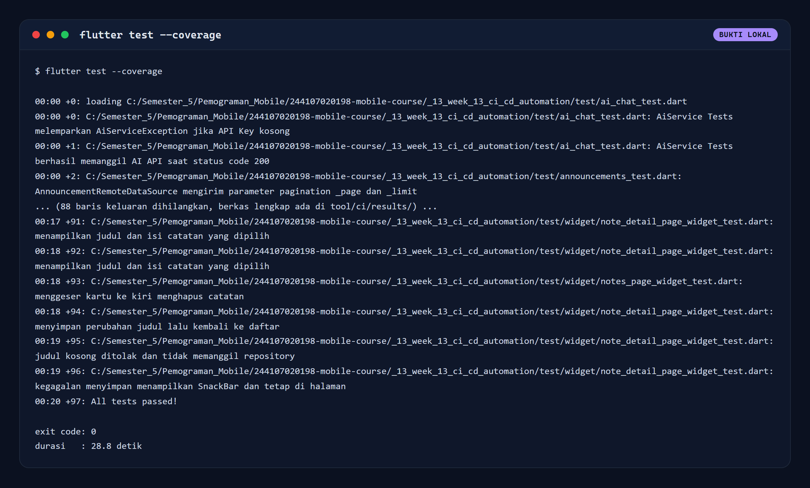
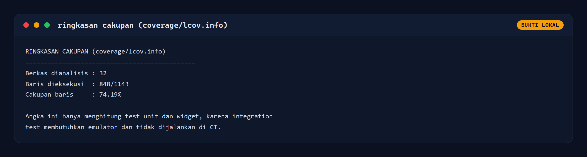

# Laporan Praktikum Week 13: CI/CD & Otomatisasi

**Nama:** MOKHAMAD RIZKI HADIONO SINGGIH
**NIM:** 244107020198
**Kelas:** TI-3G, Pemrograman Mobile
**Program Studi:** D-IV Teknik Informatika
**Jurusan:** Teknologi Informasi, Politeknik Negeri Malang
**Tanggal:** 23 November 2026

---

## 1. Tujuan Praktikum

1. Menjelaskan alur CI/CD dari commit hingga artefak aplikasi.
2. Membuat workflow untuk format, analisis, test, dan build Android.
3. Menyimpan APK dan AAB sebagai artefak yang dapat ditinjau.
4. Menerapkan versioning dan memahami batasan penyimpanan secret.

---

## 2. Objek Praktikum

Proyek yang dipakai adalah aplikasi catatan dari Week 12, disalin ke folder
`_13_week_13_ci_cd_automation` dengan nama package
`week13_ci_cd_automation`.

| Aspek | Sebelum (Week 12) | Sesudah (Week 13) |
| :--- | :--- | :--- |
| Nama package | `week12_testing_quality_assurance` | `week13_ci_cd_automation` |
| Versi | `1.0.0+1` | `1.1.0+2` |
| Jumlah test | 97 | 97 |
| Workflow CI | tidak ada | `.github/workflows/flutter-ci.yml` |
| Izin INTERNET | hanya di manifest debug | juga di manifest utama |
| Format kode | 23 berkas belum rapi | seluruhnya rapi |

Proyek ini dipilih karena sudah memiliki test yang berjalan, sehingga pipeline
langsung punya sesuatu yang layak diperiksa. Pipeline tanpa test hanya akan
memeriksa format dan kompilasi.

---

## 3. Landasan Teori

### 3.1 CI dan CD

**Continuous integration** menjalankan pemeriksaan otomatis setiap kali
perubahan diajukan atau di-push. **Continuous delivery** mengotomatiskan
penyiapan rilis sampai artefak siap diambil. **Continuous deployment** melangkah
lebih jauh dengan mengirim rilis ke pengguna tanpa campur tangan manusia.

Praktikum ini berhenti di continuous delivery: artefak dihasilkan dan disimpan,
tetapi tidak diunggah ke Play Store.

### 3.2 Mengapa otomatisasi diperlukan

| Masalah pemeriksaan manual | Cara CI mengatasinya |
| :--- | :--- |
| Mudah terlewat saat tergesa-gesa | Selalu dijalankan, tanpa kecuali |
| Sulit direproduksi di mesin lain | Lingkungan ditetapkan di berkas workflow |
| Hasilnya tidak tercatat | Setiap run punya log dan artefak permanen |
| Bergantung pada siapa yang memeriksa | Aturannya sama untuk semua orang |

### 3.3 Gate kualitas

Gate adalah pemeriksaan yang menghentikan proses bila gagal. Pipeline ini
memakai tiga gate berurutan: format, analisis, dan test. Build hanya berjalan
setelah ketiganya lulus.

Urutan dari yang paling murah ke paling mahal penting, karena kegagalan murah
sebaiknya diketahui lebih dulu.

---

## 4. Persiapan Proyek

### 4.1 Penyalinan dan penamaan ulang

Folder Week 12 disalin ke `_13_week_13_ci_cd_automation`, tanpa menyertakan
`build/`, `.dart_tool/`, `coverage/`, `.gradle/`, dan `ephemeral/`. Nama package
diubah di seluruh berkas:

| Berkas | Yang diubah |
| :--- | :--- |
| `pubspec.yaml` | `name`, `description`, `version` |
| Seluruh `lib/`, `test/`, `integration_test/` | `import` |
| `android/app/build.gradle.kts` | `namespace`, `applicationId` |
| `android/app/src/main/kotlin/...` | path paket dan `package` di `MainActivity.kt` |

### 4.2 Versi

```yaml
version: 1.1.0+2
```

Minor naik dari `1.0.0` karena Week 13 menambah kemampuan baru berupa pipeline
otomatis. Build number naik dari `1` ke `2` karena ini unggahan baru.

### 4.3 Format kode

Pemeriksaan pertama yang dijalankan adalah `dart format --set-exit-if-changed .`
dan hasilnya **gagal**: 23 dari 68 berkas belum mengikuti format Dart. Ini wajar
karena Week 1 sampai Week 12 belum pernah menjalankan formatter.

Perbaikannya satu kali jalan:

```bash
dart format .
```

Perubahan format dipisahkan ke commit tersendiri agar diff logika dan diff gaya
tidak bercampur saat ditinjau.

### 4.4 Izin INTERNET

Ditemukan bahwa `android.permission.INTERNET` hanya ada di
`android/app/src/debug/AndroidManifest.xml`. Manifest debug tidak ikut ke build
release, sehingga APK release dapat dibangun tetapi seluruh permintaan jaringan
akan gagal.

Izin ditambahkan ke manifest utama:

```xml
<uses-permission android:name="android.permission.INTERNET"/>
```

### 4.5 Label aplikasi

`android:label` diubah dari `Asisten Pintar POLINEMA` menjadi `Clean Notes`
agar sesuai dengan nama aplikasi yang dipakai di dalam kode.

### 4.6 Material signing

`.gitignore` ditambah agar material signing tidak pernah masuk repository:

```gitignore
/android/key.properties
*.jks
*.keystore
*.p12
```

Konfigurasi signing sendiri **tidak** diubah. Alasan dan rencananya ada di
[`docs/security-review.md`](docs/security-review.md).

---

## 5. Workflow CI

### 5.1 Isi workflow

Berkas `.github/workflows/flutter-ci.yml` berisi satu job dengan 13 step:

| # | Step | Jenis |
| ---: | :--- | :--- |
| 1 | Checkout repository | persiapan |
| 2 | Set up Java 17 (Temurin) | persiapan |
| 3 | Set up Flutter stable + cache | persiapan |
| 4 | Tampilkan versi Flutter dan Dart | informasi |
| 5 | `flutter pub get` | persiapan |
| 6 | Install `libsqlite3-dev` | persiapan |
| 7 | `dart format --set-exit-if-changed .` | **gate 1** |
| 8 | `flutter analyze --fatal-infos` | **gate 2** |
| 9 | `flutter test --coverage` | **gate 3** |
| 10 | Upload `coverage/lcov.info` | artefak |
| 11 | `flutter build apk --release` | build |
| 12 | `flutter build appbundle --release` | build |
| 13 | Upload APK dan AAB | artefak |

### 5.2 Pemicu

```yaml
on:
  push:
    branches: [main]
  pull_request:
    branches: [main]
  workflow_dispatch:
```

`pull_request` memeriksa perubahan sebelum digabung. `push` memastikan branch
utama selalu dalam keadaan sehat. `workflow_dispatch` memungkinkan run manual
tanpa commit baru, berguna saat meninjau ulang konfigurasi.

### 5.3 Izin dan concurrency

```yaml
permissions:
  contents: read

concurrency:
  group: ${{ github.workflow }}-${{ github.ref }}
  cancel-in-progress: true
```

Izin dibatasi pada membaca kode. Concurrency membatalkan run lama pada ref yang
sama sehingga hanya hasil terbaru yang ditinjau.

### 5.4 Working directory

```yaml
defaults:
  run:
    working-directory: _13_week_13_ci_cd_automation
```

Repository berisi 13 folder praktikum, sehingga perintah Flutter harus
dijalankan di dalam folder proyek.

Konsekuensi yang perlu diingat: `actions/upload-artifact` **tidak** terpengaruh
`working-directory`. Path artefaknya harus ditulis dari root repository:

```yaml
path: |
  _13_week_13_ci_cd_automation/build/app/outputs/flutter-apk/app-release.apk
  _13_week_13_ci_cd_automation/build/app/outputs/bundle/release/app-release.aab
```

### 5.5 Mengapa `libsqlite3-dev` dipasang

Test repository memakai `sqflite_common_ffi` untuk menjalankan SQLite sungguhan
di Dart VM. Di Linux, paket `sqlite3` memuat `libsqlite3` secara dinamis. Tanpa
pustaka itu, unit test SQL akan gagal di runner meski lulus di mesin pengembang
Windows.

Ini contoh perbedaan lingkungan yang harus ditangani eksplisit di pipeline.

---

## 6. Verifikasi Lokal

Sebelum push, ketiga gate dijalankan pada mesin lokal dengan perintah yang
identik dengan workflow.

| Gate | Perintah | Hasil |
| :--- | :--- | :--- |
| Format | `dart format --output=none --set-exit-if-changed .` | 68 berkas, 0 berubah |
| Analisis | `flutter analyze --fatal-infos` | `No issues found!` |
| Test | `flutter test --coverage` | 97 test lulus |

Untuk memudahkan pengulangan, gate yang sama dibungkus dalam satu skrip:

```bash
node tool/ci/local_ci.mjs
```

Skrip ini menyimpan keluaran setiap gate ke `tool/ci/results/`, sehingga bukti
lokal dan bukti dari GitHub Actions dapat dibandingkan berdampingan.

---

## 7. Hasil

### 7.1 Verifikasi lokal

Ketiga gate dijalankan lewat satu skrip agar perintahnya persis sama dengan
workflow:

```bash
node tool/ci/local_ci.mjs
```

| Gate | Perintah | Exit code | Durasi |
| :--- | :--- | ---: | ---: |
| Format | `dart format --output=none --set-exit-if-changed .` | 0 | 1,7 detik |
| Analisis | `flutter analyze --fatal-infos` | 0 | 61,1 detik |
| Test | `flutter test --coverage` | 0 | 28,8 detik |

Keluaran mentahnya tersimpan di `tool/ci/results/` dan ditampilkan di bawah ini.

|  |  |
| :---: | :---: |
| **Gate 1** lulus, 68 berkas, 0 berubah | **Gate 2** lulus, `No issues found!` |





Cakupan dihitung dari `coverage/lcov.info`:

| Ukuran | Nilai |
| :--- | ---: |
| Berkas di `lib/` yang terukur | 32 |
| Baris ditemukan | 1143 |
| Baris dieksekusi | 848 |
| Cakupan baris | 74,19 % |

Angka ini hanya mencakup test unit dan widget. Integration test tidak masuk
hitungan karena membutuhkan emulator dan tidak dijalankan di CI.

### 7.2 Build release

Build dijalankan setelah ketiga gate lulus, dengan perintah yang sama seperti
di workflow.

| Artefak | Perintah | Ukuran | Durasi |
| :--- | :--- | ---: | ---: |
| `app-release.apk` | `flutter build apk --release` | 54.917.245 byte (52,37 MB) | 244,8 detik |
| `app-release.aab` | `flutter build appbundle --release` | 53.649.881 byte (51,16 MB) | 20,3 detik |

APK jauh lebih besar daripada AAB karena APK yang dihasilkan bersifat
universal: seluruh ABI (`arm64-v8a`, `armeabi-v7a`, `x86_64`) dan seluruh
kepadatan layar dimasukkan ke satu berkas. AAB diserahkan ke Play Store dalam
bentuk terpecah per perangkat, sehingga ukuran unduhan sebenarnya lebih kecil
daripada angka AAB itu sendiri.

Build kedua jauh lebih cepat karena cache Gradle dari build pertama masih
hangat. Di runner GitHub Actions, build pertama selalu dingin sehingga waktu
keduanya hampir sama.

### 7.3 Verifikasi di GitHub Actions

Workflow sudah ditulis dan divalidasi, tetapi **belum dijalankan** di GitHub
pada saat laporan ini disusun. Commit untuk repository ini diserahkan kepada
pemilik repository, sehingga push yang memicu run pertama belum dilakukan.

Urutan yang harus dijalankan agar bagian ini terisi:

```bash
git add .github _13_week_13_ci_cd_automation README.md
gcommit -m "Week 13 | CI/CD & Otomatisasi"
gpush

cd _13_week_13_ci_cd_automation
node tool/ci/fetch_run.mjs
```

Perintah terakhir membaca REST API GitHub dan menyimpan
`tool/ci/results/run-<id>.json` serta `artifacts-<id>.json`, lalu mencetak
ringkasan step dan artefak ke terminal. Data itulah yang mengisi tabel di
bawah.

| Yang dicatat | Sumber |
| :--- | :--- |
| Nomor run, event, commit | `run-<id>.json` bagian `runNumber`, `event`, `commitShort` |
| Status akhir dan durasi | `run-<id>.json` bagian `status`, `conclusion`, `durationSeconds` |
| Status tiap step | `run-<id>.json` bagian `jobs[].steps[]` |
| Ukuran artefak | `artifacts-<id>.json` |

*Tabel hasil run GitHub Actions akan ditambahkan di sini setelah push pertama.*

<!-- HASIL_RUN -->

---

## 8. Versioning dan Tag

### 8.1 Versi

```yaml
version: 1.1.0+2
```

### 8.2 Tag

Tag `v1.1.0` dibuat sebagai tag anotasi pada commit yang sudah lolos pipeline,
bukan pada commit sebelumnya. Urutannya penting: tag menandai keadaan kode yang
terbukti hijau di CI, sehingga artefak yang diunduh dari run tersebut dapat
dicocokkan dengan tag.

```bash
# Setelah workflow pada commit Week 13 berstatus success
git tag -a v1.1.0 -m "Week 13: CI/CD dan otomatisasi rilis"
git push origin v1.1.0

# Verifikasi
git tag -n --list "v1.1.0"
git log -1 --format="%H %d"
```

Tag ini **belum dibuat**, karena commit yang akan ditandai belum ada. Membuat
tag sekarang hanya akan menunjuk ke commit Week 12 yang belum memiliki
workflow.

*Hash commit dan keluaran `git tag -n` akan ditambahkan di sini setelah tag
dibuat.*

<!-- HASIL_TAG -->

---

## 9. Risiko Keamanan

Rincian lengkap ada di [`docs/security-review.md`](docs/security-review.md).
Ringkasannya:

| # | Temuan | Tingkat | Status |
| :--- | :--- | :--- | :--- |
| 1 | API key Gemini tertulis di source, repository publik | Tinggi | Nilai diganti placeholder, **key lama perlu di-revoke** |
| 2 | Release ditandatangani debug keystore | Sedang | Didokumentasikan, belum diubah |
| 3 | `INTERNET` hanya di manifest debug | Sedang | Diperbaiki |
| 4 | `--dart-define` dapat diekstrak dari APK | Rendah | Tidak ada nilai sensitif di sana |
| 5 | `google-services.json` memuat API key Firebase | Rendah | Dibiarkan, memang publik by design |

Temuan nomor 1 adalah yang paling penting. Mengganti teks di source tidak
menghapus nilai dari riwayat Git, sehingga key tersebut harus dianggap bocor dan
di-revoke di Google Cloud Console.

---

## 10. Kendala

| # | Kendala | Solusi |
| :--- | :--- | :--- |
| 1 | Format gagal pada 23 berkas | `dart format .` sekali jalan, commit terpisah |
| 2 | `upload-artifact` tidak mengikuti `working-directory` | Path artefak ditulis dari root repository |
| 3 | Test SQL butuh `libsqlite3` di Linux | Step `apt-get install libsqlite3-dev` |
| 4 | Integration test butuh emulator | Tidak dijalankan di CI, dicatat sebagai batasan |
| 5 | APK release tanpa izin INTERNET | Izin ditambahkan ke manifest utama |
| 6 | API key ditemukan di source publik | Diganti placeholder, revoke dicatat sebagai langkah manual |

---

## 11. Refleksi

### Yang berubah dari cara kerja sebelumnya

Sebelum Week 13, semua pemeriksaan bergantung pada ingatan. Saya menjalankan
`flutter analyze` dan `flutter test` karena memang sedang mengerjakan kode, bukan
karena ada yang memaksa. Begitu pekerjaan selesai dan perhatian berpindah,
pemeriksaan itu berhenti.

Pipeline membalik hubungan itu. Pemeriksaan berjalan karena ada commit, bukan
karena ada orang yang ingat. Perbedaannya terlihat langsung pada gate pertama:
`dart format --set-exit-if-changed .` gagal pada 23 dari 68 berkas, dan itu
berkas dari Week 1 sampai Week 12 yang selama ini dianggap sudah rapi. Tidak
ada yang salah dengan kode itu. Yang tidak pernah ada adalah pemeriksa yang
konsisten.

### Temuan yang paling mengubah cara saya membaca hasil build

Izin `INTERNET` yang hanya ada di manifest debug adalah pelajaran paling
berguna di minggu ini. Build release tetap **berhasil**, APK tetap terbentuk,
dan tidak ada satu pun peringatan di log. Aplikasi hanya akan gagal saat
dijalankan, ketika setiap permintaan jaringan ditolak.

Artinya "build hijau" hanya membuktikan kode dapat dikompilasi. Ia tidak
membuktikan aplikasi berfungsi. Pipeline yang baik karena itu perlu memeriksa
konfigurasi, bukan hanya hasil kompilasi. Pada proyek ini pemeriksaan tersebut
belum otomatis, dan itu tercatat sebagai batasan, bukan sesuatu yang dianggap
selesai.

### Bagian yang membuat saya mengubah rancangan

Rancangan pertama saya menaruh build sebelum test, dengan alasan agar artefak
cepat tersedia. Setelah dihitung, build APK memakan sekitar empat menit
sementara tiga gate hanya sekitar satu setengah menit. Menaruh build di depan
berarti setiap kesalahan format membuang empat menit waktu runner. Urutan
akhirnya dibalik: gate termurah lebih dulu, build terakhir.

Hal serupa terjadi pada `upload-artifact`. Path-nya harus ditulis dari root
repository walaupun perintah Flutter berjalan di subfolder. Tanpa
`if-no-files-found: error`, kesalahan path itu akan menghasilkan job hijau
dengan artefak kosong, jenis kegagalan yang paling sulit disadari karena tidak
ada yang berwarna merah.

### Batas antara otomatis dan manual

Tidak semua temuan dapat diselesaikan pipeline. API key yang sudah ter-push
tidak dapat dihapus dari riwayat Git oleh workflow mana pun, dan keystore
produksi justru tidak boleh berada di workflow yang berjalan untuk pull
request. Keduanya berakhir sebagai langkah manual yang tercatat di
[`docs/security-review.md`](docs/security-review.md).

Ini pelajaran kedua: otomatisasi memindahkan pekerjaan, bukan menghilangkannya.
Yang berubah adalah pekerjaan yang tersisa menjadi lebih jelas dan lebih
sedikit, karena bagian yang dapat diperiksa mesin sudah diambil alih.

### Yang belum tercapai pada laporan ini

Run pertama di GitHub Actions belum dijalankan karena commit diserahkan kepada
pemilik repository. Seluruh isi workflow sudah divalidasi secara lokal dengan
perintah yang identik, tetapi bukti dari runner sungguhan, termasuk waktu
langkah dan ukuran artefak, masih menunggu push. Saya memilih mencatatnya
sebagai belum selesai daripada menuliskan angka yang belum terjadi.

---

## 12. Kesimpulan

1. Pipeline CI untuk proyek ini terdiri dari tiga gate berurutan (format,
   analisis, test) dan baru membangun APK serta AAB setelah ketiganya lulus.
   Seluruh gate lulus di mesin lokal: 68 berkas rapi, `No issues found!`, dan
   97 test lulus dengan cakupan 74,19 % baris.

2. Menyiapkan pipeline menemukan empat masalah yang tidak terlihat dari
   pekerjaan manual: 23 berkas belum diformat, izin `INTERNET` tidak ada di
   manifest utama, label aplikasi tidak sesuai, dan satu API key tertulis di
   source publik. Temuan ketiga adalah yang paling berbahaya karena build tetap
   hijau sementara aplikasi release tidak dapat mengakses jaringan.

3. Workflow memakai izin minimum (`contents: read`), tidak memakai secret, dan
   membatalkan run lama pada ref yang sama lewat `concurrency`. Artefak APK dan
   AAB diunggah dengan `if-no-files-found: error` dan disimpan tujuh hari,
   sehingga job tidak dapat berstatus hijau dengan artefak kosong.

4. Versi naik dari `1.0.0+1` menjadi `1.1.0+2`, mengikuti aturan bahwa fitur
   baru menaikkan minor dan setiap unggahan menaikkan build number. Tag
   `v1.1.0` disiapkan untuk menandai commit yang lolos pipeline.

5. Batas yang masih terbuka: integration test tidak berjalan di CI karena
   membutuhkan emulator, signing rilis masih memakai debug keystore, API key
   lama perlu di-revoke manual, dan run pertama di GitHub Actions belum
   dijalankan. Keempatnya tercatat sebagai pekerjaan lanjutan, bukan sebagai
   hal yang sudah selesai.

---

## 13. Lampiran

### 13.1 Perintah yang digunakan

```bash
# Persiapan
flutter pub get
dart format .

# Gate yang sama dengan CI
dart format --output=none --set-exit-if-changed .
flutter analyze --fatal-infos
flutter test --coverage

# Bukti lokal
node tool/ci/local_ci.mjs

# Bukti dari GitHub Actions
node tool/ci/fetch_run.mjs

# Build manual
flutter build apk --release
flutter build appbundle --release
```

### 13.2 Berkas keluaran

| Berkas | Isi |
| :--- | :--- |
| `tool/ci/results/01-format.txt` | Keluaran gate format |
| `tool/ci/results/02-analyze.txt` | Keluaran gate analisis |
| `tool/ci/results/03-test.txt` | Keluaran gate test |
| `tool/ci/results/04-coverage.txt` | Ringkasan cakupan |
| `tool/ci/results/local-ci.json` | Ringkasan seluruh gate |
| `tool/ci/results/run-<id>.json` | Detail run GitHub Actions |
| `tool/ci/results/artifacts-<id>.json` | Daftar artefak run |
