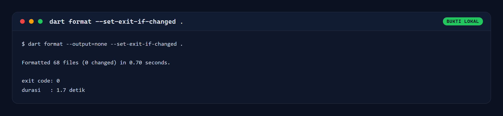
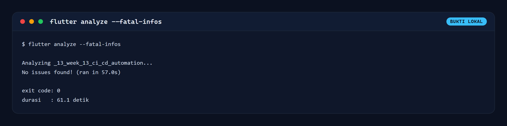
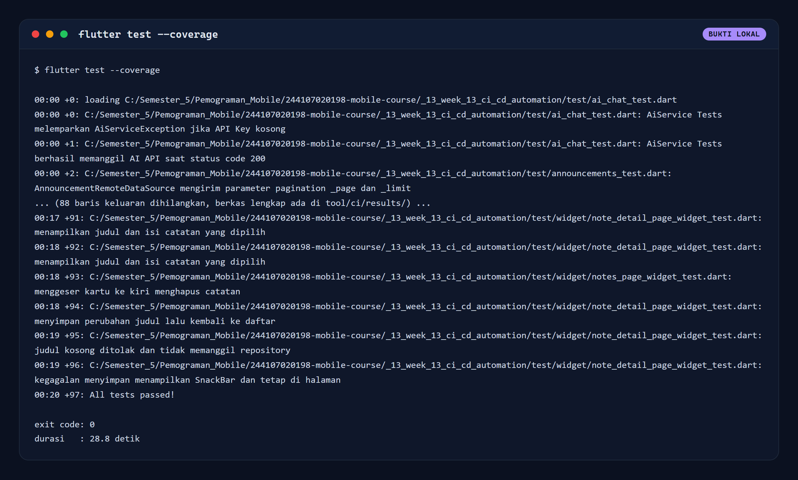
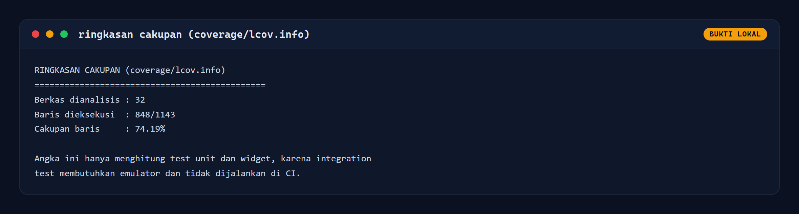
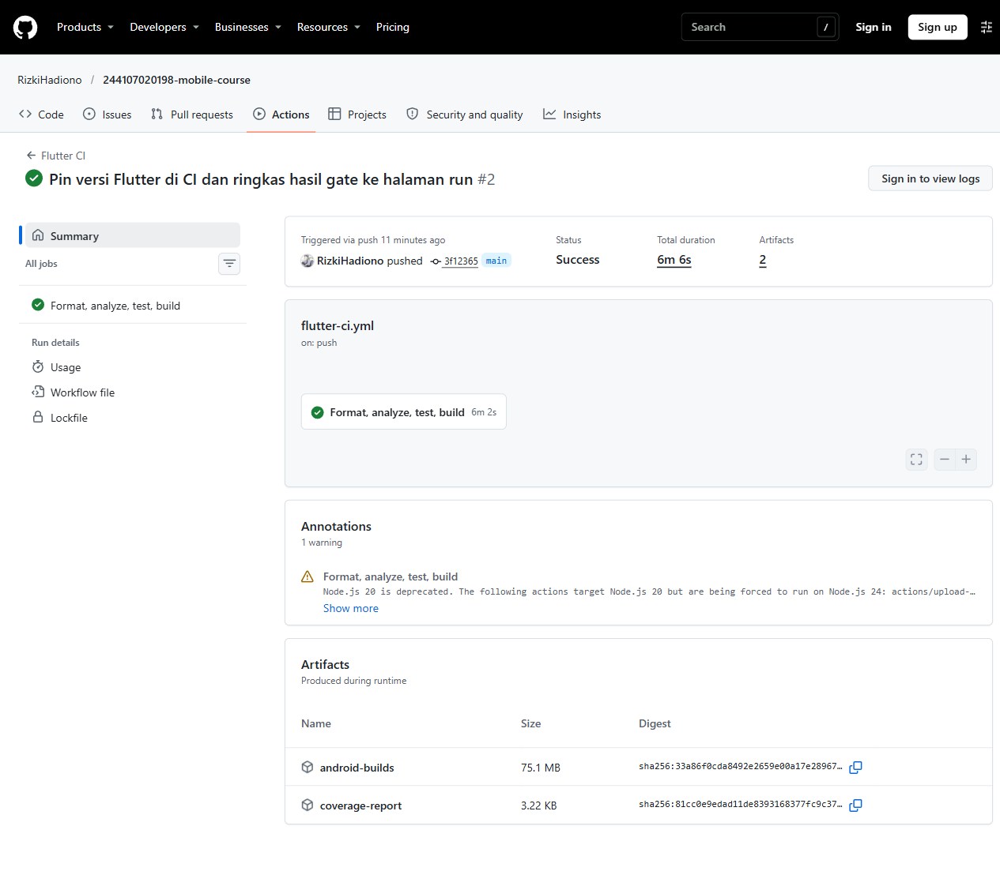
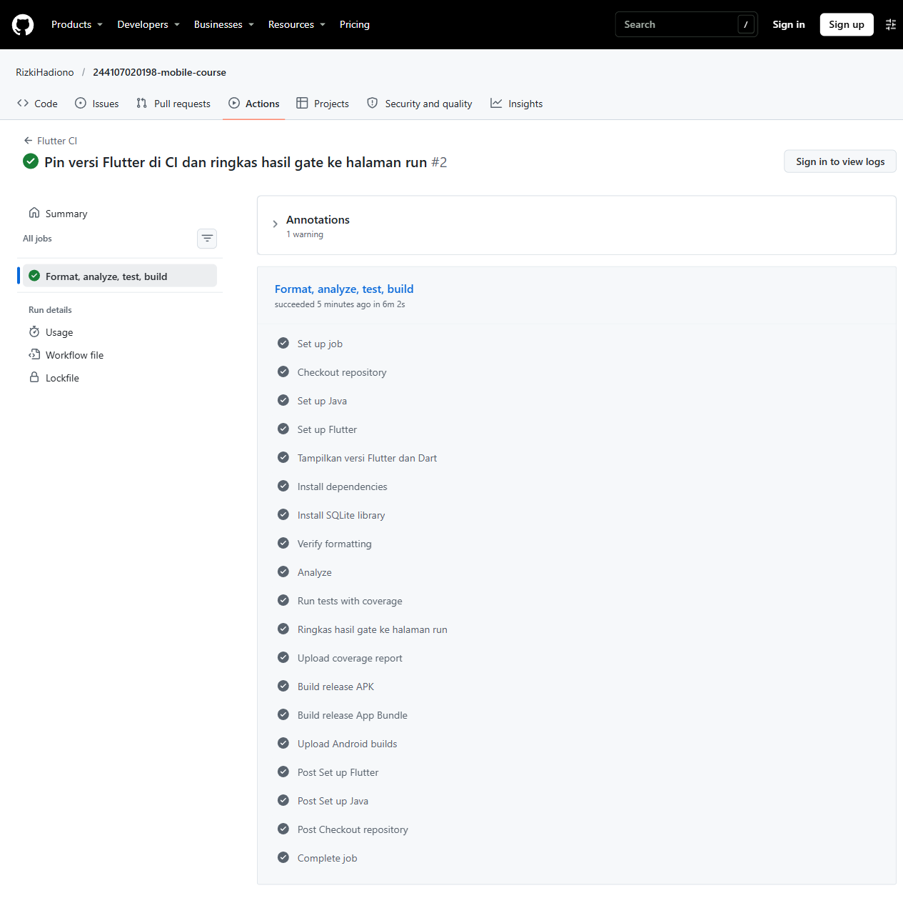

# Week 13: CI/CD & Otomatisasi

**Mata Kuliah:** Pemrograman Mobile
**Nama:** Mokhamad Rizki Hadiono Singgih
**NIM:** 244107020198
**Kelas:** TI-3G
**Prodi:** D-IV Teknik Informatika, Politeknik Negeri Malang

---

## Ringkasan

Folder ini adalah kelanjutan proyek catatan dari Week 12, dengan fokus baru:
**integrasi berkelanjutan dan otomatisasi rilis**. Pekerjaan yang dilakukan:

1. Membuat workflow GitHub Actions
   (`.github/workflows/flutter-ci.yml`) yang menjalankan tiga gate kualitas
   lalu membangun APK dan AAB.
2. Menjalankan gate yang sama di mesin lokal lewat `tool/ci/local_ci.mjs`,
   sehingga kegagalan diketahui sebelum push.
3. Memperbaiki temuan yang muncul saat menyiapkan pipeline: izin `INTERNET`
   yang hilang di manifest utama, label aplikasi, 23 berkas yang belum
   diformat, dan satu API key yang tertulis di source publik.
4. Menjalankan workflow sungguhan di GitHub, mengambil datanya lewat REST API
   (`tool/ci/fetch_run.mjs`), lalu menyimpan bukti mentahnya.
5. Menandai commit yang lolos pipeline dengan tag `v1.1.0`.

### Hasil utama

| Pemeriksaan | Perintah | Hasil |
| :--- | :--- | :--- |
| Format | `dart format --output=none --set-exit-if-changed .` | 68 berkas, **0 berubah** |
| Analisis statis | `flutter analyze --fatal-infos` | `No issues found!` |
| Test unit + widget | `flutter test --coverage` | **97 test lulus** (0 gagal) |
| Cakupan kode | `flutter test --coverage` | **74,19 %** baris (848/1143) |
| Build APK | `flutter build apk --release` | 52,37 MB |
| Build AAB | `flutter build appbundle --release` | 51,16 MB |
| Run GitHub Actions | workflow `Flutter CI` | **success**, run #2 sampai #4 hijau, dua artefak |

| Run | Commit | Status | Durasi |
| ---: | :--- | :--- | ---: |
| #1 | `7b54649` | failure di step `Analyze` | 70 detik |
| #2 | `3f12365` | **success**, seluruh 15 step | 366 detik |
| #3 | `e02c6bd` | **success**, seluruh 15 step | 416 detik |
| #4 | `0e893f6` | **success**, seluruh 15 step | 363 detik |

Run #1 gagal di step `Analyze` sementara perintah yang sama lulus di mesin
lokal. Penyebab pastinya tidak dapat dibaca karena log step hanya terbuka bagi
pengguna yang masuk, jadi dugaan yang paling masuk akal adalah pergeseran versi
SDK: workflow saat itu memakai `channel: stable`, sedangkan mesin lokal memakai
Flutter `3.47.6`. Versi SDK kemudian dipatok, dan run #2 hijau. Dugaan itu tidak
ditulis sebagai fakta di laporan.

Gate lokal dijalankan lewat `node tool/ci/local_ci.mjs`. Keluaran mentahnya
tersimpan di `tool/ci/results/` dan gambarnya ada di `screenshots/`.

Status run di GitHub Actions: **success** pada run #2 sampai #4
([halaman run #4](https://github.com/RizkiHadiono/244107020198-mobile-course/actions/runs/45058635734)).
Run #1 gagal di step `Analyze` sebelum versi Flutter dipatok. Tag `v1.1.0`
menunjuk ke commit `0e893f6` yang lulus pada run #4.

---

## Ketentuan codelab yang dipenuhi

| Ketentuan codelab | Implementasi | Bukti |
| :--- | :--- | :--- |
| Workflow berjalan pada `push` dan `pull_request` | Plus `workflow_dispatch` untuk run manual | `.github/workflows/flutter-ci.yml` |
| Menjalankan format, analyze, dan test | Tiga gate berurutan, build hanya setelah lulus | Step 8 sampai 10 |
| Build APK dan AAB sebagai artefak | Dua artefak: `android-builds` (75,07 MB) dan `coverage-report` (3,22 KB) | Tab Artifacts pada run #2 |
| `permissions: contents: read` | Izin minimum, tanpa secret | Bagian 7 `docs/security-review.md` |
| `concurrency` dengan `cancel-in-progress` | Grup per workflow dan ref | Step level workflow |
| `if-no-files-found: error` | Dipakai pada kedua langkah unggah | Step 10 dan 13 |
| `retention-days: 7` | Dipakai pada kedua langkah unggah | Step 10 dan 13 |
| Versioning sebelum rilis | `1.0.0+1` menjadi `1.1.0+2` | `pubspec.yaml` |
| Tag pada commit yang lolos | Tag anotasi `v1.1.0` | Bagian 8 laporan |
| Screenshot hasil | Halaman run GitHub Actions dan keluaran alat | `screenshots/` |

---

## Isi workflow

Satu job, 15 step pada workflow. Urutannya disengaja: yang paling murah
dijalankan lebih dulu, dan build hanya berjalan bila ketiga gate lulus. Angka
durasi di bawah ini diambil dari run #2 yang sebenarnya, bukan perkiraan.

| # | Step | Jenis | Durasi |
| ---: | :--- | :--- | ---: |
| 1 | Checkout repository | persiapan | 3 detik |
| 2 | Set up Java 17 (Temurin) | persiapan | 0 detik |
| 3 | Set up Flutter 3.47.6 + cache | persiapan | 26 detik |
| 4 | Tampilkan versi Flutter dan Dart | informasi | 1 detik |
| 5 | `flutter pub get` | persiapan | 8 detik |
| 6 | Install `libsqlite3-dev` | persiapan | 3 detik |
| 7 | `dart format --set-exit-if-changed .` | **gate 1** | 0 detik |
| 8 | `flutter analyze --fatal-infos` | **gate 2** | 11 detik |
| 9 | `flutter test --coverage` | **gate 3** | 30 detik |
| 10 | Ringkas hasil gate ke halaman run | informasi | 0 detik |
| 11 | Upload `coverage/lcov.info` | artefak | 1 detik |
| 12 | `flutter build apk --release` | build | **235 detik** |
| 13 | `flutter build appbundle --release` | build | 12 detik |
| 14 | Upload APK dan AAB | artefak | 3 detik |
| 15 | Post action dan penutupan job | persiapan | 25 detik |

Build APK memakan sekitar 64 persen total waktu run, sementara ketiga gate yang
menjadi inti pemeriksaan hanya 41 detik. Alasan setiap keputusan desain ada di
[`docs/ci-cd.md`](docs/ci-cd.md).

---

## Temuan yang diperbaiki

Menyiapkan pipeline memaksa pemeriksaan yang sebelumnya dilewati. Empat
temuan muncul, dan semuanya berasal dari pemeriksaan otomatis, bukan dari
pembacaan manual.

| # | Temuan | Cara ditemukan | Perbaikan |
| :--- | :--- | :--- | :--- |
| 1 | 23 dari 68 berkas belum mengikuti format Dart | Gate format langsung gagal | `dart format .`, commit terpisah |
| 2 | `INTERNET` hanya ada di manifest debug | Tinjauan manifest saat menyiapkan build release | Izin ditambahkan ke manifest utama |
| 3 | Label aplikasi masih `Asisten Pintar POLINEMA` | Build release menampilkan nama lama | Diubah menjadi `Clean Notes` |
| 4 | API key Gemini tertulis di `tool/capture_screenshots.dart` Week 10 dan 11 | Pemeriksaan `AIza[0-9A-Za-z_-]{20,}` di seluruh repo | Nilai diganti `CONTOH_KEY_GANTI_SENDIRI`, key lama perlu di-revoke |

Temuan nomor 2 adalah contoh paling jelas dari peringatan codelab: **build
hijau bukan jaminan aplikasi berfungsi**. APK release tetap dapat dibangun
tanpa izin `INTERNET`, tetapi seluruh permintaan jaringan akan gagal saat
aplikasi dijalankan.

Temuan nomor 4 tidak dapat diselesaikan sepenuhnya dari sini. Mengganti teks di
source tidak menghapus nilai dari riwayat Git, sehingga key tersebut harus
dianggap bocor dan di-revoke manual di Google Cloud Console. Rinciannya ada di
[`docs/security-review.md`](docs/security-review.md).

---

## Yang sengaja tidak dijalankan di CI

| Pemeriksaan | Alasan |
| :--- | :--- |
| Integration test | Butuh emulator. Runner GitHub hanya menyediakan VM Linux tanpa akselerasi GPU, sehingga emulator Android tidak praktis |
| Panggilan Gemini API | Butuh API key dan jaringan, hasilnya tidak deterministik |
| Signing rilis | Material signing tidak boleh ada di workflow yang berjalan untuk pull request |
| Uji instalasi APK | Butuh perangkat nyata |

Integration test tetap tersimpan di `integration_test/app_test.dart` dan dapat
dijalankan manual pada emulator. Ini batasan yang dicatat, bukan yang
diabaikan.

---

## Struktur folder

```
.github/workflows/flutter-ci.yml        # workflow CI (di root repository)

_13_week_13_ci_cd_automation/
├── android/
│   └── app/src/main/AndroidManifest.xml    # izin INTERNET + label Clean Notes
├── docs/
│   ├── ci-cd.md                            # alasan desain pipeline
│   ├── langkah-berikutnya.md               # pekerjaan manual yang tersisa
│   └── security-review.md                  # temuan keamanan + daftar periksa rilis
├── integration_test/app_test.dart          # alur utama, dijalankan manual
├── lib/                                    # kode aplikasi dari Week 12
├── screenshots/                            # bukti run GitHub Actions dan keluaran alat
├── test/                                   # 97 test unit dan widget
├── tool/ci/
│   ├── local_ci.mjs                        # menjalankan tiga gate secara lokal
│   ├── fetch_run.mjs                       # mengambil data run lewat REST API
│   └── results/                            # keluaran mentah gate + data run
├── Laporan-Praktikum-Week-13.md
└── pubspec.yaml                            # version: 1.1.0+2
```

---

## Cara menjalankan

```bash
cd _13_week_13_ci_cd_automation
flutter pub get

# Gate yang sama persis dengan workflow, sekaligus menyimpan bukti
node tool/ci/local_ci.mjs

# Data run terakhir di GitHub (tanpa perlu gh CLI)
node tool/ci/fetch_run.mjs

# Perintah terpisah bila ingin dijalankan sendiri
dart format --output=none --set-exit-if-changed .
flutter analyze --fatal-infos
flutter test --coverage
flutter build apk --release
flutter build appbundle --release
```

Workflow berjalan otomatis pada setiap push ke `main` dan pada setiap pull
request. Untuk menjalankannya tanpa commit baru, buka tab **Actions**, pilih
**Flutter CI**, lalu **Run workflow**.

---

## Screenshot

### Bukti gate lokal

| # | File | Keterangan |
| :--- | :--- | :--- |
| 1 | `screenshots/ci-local-format.png` | `dart format --set-exit-if-changed .`: 68 berkas, 0 berubah |
| 2 | `screenshots/ci-local-analyze.png` | `flutter analyze --fatal-infos`: `No issues found!` |
| 3 | `screenshots/ci-local-test.png` | `flutter test --coverage`: 97 test lulus |
| 4 | `screenshots/ci-local-coverage.png` | Cakupan baris 74,19 % (848/1143) |

|  |  |
| :---: | :---: |
| **Gate 1** format lulus | **Gate 2** analisis lulus |





### Bukti run GitHub Actions

| # | File | Keterangan |
| :--- | :--- | :--- |
| 5 | `screenshots/ci-run-list.png` | Dua run: #1 gagal, #2 berhasil |
| 6 | `screenshots/ci-run-summary.png` | Ringkasan run #2: success, 6m 6s, dua artefak |
| 7 | `screenshots/ci-run-steps.png` | Seluruh step run #2 berstatus success |





---

## Dokumentasi pendukung

- [`docs/ci-cd.md`](docs/ci-cd.md): alur pipeline, alasan setiap keputusan
  desain, aturan versioning, dan cara membaca kegagalan.
- [`docs/security-review.md`](docs/security-review.md): enam temuan keamanan,
  apa yang sudah ditangani, dan daftar periksa sepuluh langkah sebelum rilis.
- [`docs/langkah-berikutnya.md`](docs/langkah-berikutnya.md): pekerjaan yang
  masih manual dan celah yang perlu ditutup berikutnya.
- [`Laporan-Praktikum-Week-13.md`](Laporan-Praktikum-Week-13.md): laporan
  praktikum lengkap dengan refleksi dan seluruh screenshot.
- [`tool/ci/results/`](tool/ci/results/): keluaran mentah gate lokal dan data
  run GitHub Actions.
